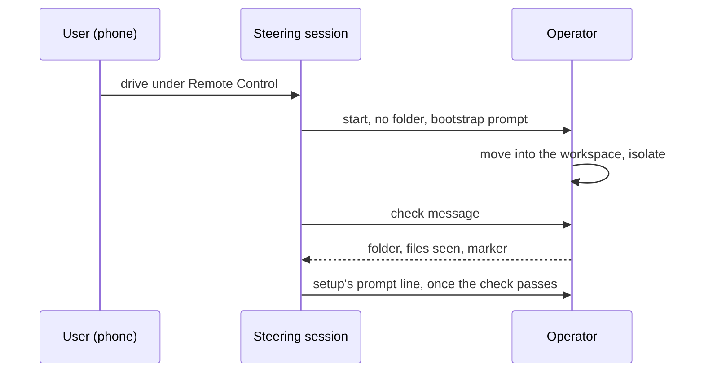

## Summary

An eval's operator, and the Foreman campaigns it starts, cannot today be started from a phone: the evals docs say a session driven by Remote Control cannot start another one, and that a Foreman campaign needs the desk. Since the hosts card now records that such a session can start one (with no working folder), this PR documents a route for the operator to land in the eval workspace with only the workspace's instructions in its context, and the host-neutral check that proves it. The route is written down but **not yet proved**: a trial on a real Remote Control session decides what the docs may claim, so this PR stays a draft until that trial reports.

## Deliverables

The route, as the hosts card's new section documents it (unproved until the trial):

- The evals README states the requirement host-neutrally: an operator started in the workspace, on its main checkout, whose context holds only the workspace's instructions; a check in a turn that reads no file; a Pass rule.
- Three isolation routes are tried in order by the trial: self-clear, the phone's New session, a neutral steering folder.

## Blast radius

Grade: 1. Prose and a trial record only; a `git revert` restores the previous docs.

## Autonomous decisions

- The runbooks' and README's trust clauses are rewritten now (they point at a trial this change replaces); the lines that claim what a moved operator or its sessions do wait for the trial's result.

## Known gaps

- **UNVERIFIED:** the route has not been run from a real session: the trial of the trial file is pending, so this PR is a draft.
- The README's "Prerequisites" last sentence, "The operator" opening, "Starting the Foreman" bullet and the Foreman runbooks' desk and `ping` lines still say a Foreman campaign needs the desk, until the trial reports.

Details

## Changes

- `skills/chantier/references/hosts/claude-code.md`: new section "The eval operator from a remote client"; rows "Trust of a workspace inside a trusted folder" and "Move a started session to another folder" follow it.
- `evals/README.md`: trust sentences, steps pointer, "The operator" requirement, check, Pass rule and per-host pointer.
- `evals/full/RUNBOOK.md`, `evals/real-foreman/RUNBOOK.md`, `evals/real-direct/RUNBOOK.md`, `evals/ticket-summary/RUNBOOK.md`: trust clause.

## Impacts

No visual change; docs read differently for the away-from-desk operator.

## Test plan

- [ ] New or changed tests: No behaviour change
- [ ] Local gates at `<sha7>`: `just check`
- [ ] Evidence: the trial file, pending
- [ ] Review: approved at `<sha7>`
- [ ] Verified at `<sha7>`
- [ ] CI green at `<sha7>`

## Internal references

- CR-415 eval-operator-from-phone; trial file `work/trial-phone.md`.

