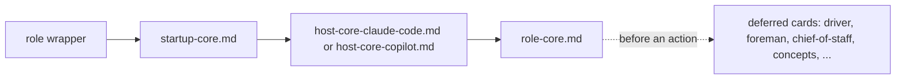

> **WORK IN PROGRESS, DRAFT, NOT READY TO MERGE.** Snapshot pushed on the user's request to pause and hand over. No review passed and no gate is complete at this head: round-5 and round-6 changes were **never reviewed by an Inspector** (last verdict, round 4: FIX-REQUIRED), no Verifier ran, no long gate or CI ran on this head. Nothing here waives a gate or claims completion.
>
> - Rounds used: 6 of 6; no seventh authorised.
> - Round 5 Coder: requested `gpt-6.1-sol`; host reported "Required model enforcement replaced requested model `gpt-6.1-sol` with `gpt-5.6-luna`", so it ran on Luna (edits preserved, unreviewed).
> - Round 6 Coder: generic agent with explicit `model: gpt-6.1-sol` (user-authorised one-off, tools unrestricted). Host telemetry events (`subagent.started`/`completed`, read after the run, not a pre-execution validation) record `gpt-6.1-sol`, `firstDispatchedModel gpt-6.1-sol`, `explicit_override`.
> - Reported by the Coder, not re-run by the Driver: `just check` 258 passed; startup/board tests 30 passed; watcher pair 100/100.
> - Restart: `work/handoff.md` in the CR folder (next: fresh Inspector, then long gate, CI, Verifier).

## Summary

Starting a chantier role used to make it read very large reference cards in full (about 213 KB for the Chief of Staff on Copilot, about 273 KB on Claude Code), long before any action needed them. This change gives every role and host a short mandatory startup core of at most 12,288 bytes, and turns the large cards into references that are read before the action that needs them. The startup behaviour is also made effect-specific: official CLI preparation is automatic, a free seat is taken without a redundant question, and the board and persistent autosync are each started only on their own explicit permission.

## Deliverables

Mandatory startup reading, per role and host, is declared once in `skills/chantier/references/startup-manifest.json` and measured by a test:

| Role | Before (whole files named at boot) | Startup bytes (Claude / Copilot) | Reload bytes (Claude / Copilot) |
| --- | ---: | ---: | ---: |
| chief-of-staff | 272,715 / 212,945 | 11,668 / 11,674 | 12,252 / 12,258 |
| router | 71,229 | 11,446 / 11,452 | 12,030 / 12,036 |
| cr-driver | 85,140+ | 9,763 / 9,839 | 10,347 / 10,423 |
| verifier | 10,333+ | 9,951 / 10,014 | 10,535 / 10,598 |
| foreman (own session, no wrapper) | 178,819 / 119,049 | 9,784 / 9,930 | 10,368 / 10,514 |

A structure test derives every role and host from the installed wrappers and skills and enforces a hard 12,288-byte limit on both startup and reload. It counts unique raw bytes of actual files and sections: the loaded skill or wrapper, common/host/role cores, the entire manifest, mandatory card sections, and reload action readings including session-start's Reload section. Foreman also includes the selected full host reference's Startup core (751 / 891 bytes), not merely the short host-core file. There are no documentation exclusions; only project rules and command output are outside the contract's limit. `env UV_NO_CONFIG=1 uv run --locked --project skills/chantier/scripts/cli pytest -q skills/chantier/scripts/cli/tests/test_startup_manifest.py -s` prints the full 19-role by 2-host table. An independent raw-byte union measurement agreed for all 38 startup and 38 reload paths. The largest reload is 12,258 bytes (Chief of Staff / Copilot), 30 bytes below the limit.

Large cards are deferred: read by named section or file before the action that needs them, and an unavailable indispensable reference blocks only that action.

Behaviour choices made in the startup text and the board command:

- Official CLI preparation of the selected source and version is automatic; a failure stops role initialisation with the exact failure and no substitute.
- A free or own Chief of Staff seat is taken after an explicit invocation; a seat naming another session, liveness unknown included, asks first.
- The board asks before starting and declining starts nothing; accepting it no longer joins autosync, which is a separate explicit opt-in.
- Persistent autosync is an explicit opt-in independent of the board; starting the board joins nothing, and the board's own Start autosync click is the explicit opt-in.
- Startup report is short and factual, and separates tools available, documented behaviour, exercised paths, announced bindings, untested paths and skipped validation.

## Blast radius

Grade: **2**. Card text, the four skill entry points, both host wrapper sets (identical bodies) and the board start command change. A wrong deferred-reading table would make an agent miss a rule at its action; revert the commit to restore the previous cards.

## Autonomous decisions

- One JSON manifest (stdlib-readable) is the single declaration of mandatory reads and action readings, instead of per-card conventions.
- Existing project and doc text that directly contradicted the accepted startup behaviour (board joining autosync, automatic board launch) was updated; no other policy was touched.

## Known gaps

- **UNVERIFIED:** behaviour on a real Claude Code and a real Copilot session; the byte limit and the card text are measured, host-session behaviour is not.
- The round-4 macOS scenario run failed `parallel` (211/212: rules output) and `surface-board` (153/154: the `cli:` fact). Round 4 reproduced the identical two failures and counts on `origin/main` at `5eb0c1e`. Those scenario units **are changed** by this CR; baseline comparison, not an untouched-unit claim, establishes these failures as pre-existing. Round 6 did not rerun the long scenario. The pipeline job `just scenario (ubuntu-latest)` remains the long gate at the pushed head.
- There is no `just validate` recipe in the chantier repository. The planning surface's `env UV_NO_CONFIG=1 just validate chantier` skips Chantier because `projects/chantier/index.md` does not exist. Its successful exit is **not content validation**; none is claimed.

Details

## Changes

- New short cores: `startup-core.md`, `host-core-claude-code.md`, `host-core-copilot.md`, `role-core.md`, and `startup-manifest.json` (mandatory files per role and host, action to required readings).
- Role wrappers (both hosts), `SKILL.md` of the four skills and the openings of the large cards state the deferred-reading contract.
- `board/command.py`: starting the board no longer joins autosync.
- `test_startup_manifest.py` (new), `test_plugin_files.py`, `test_board.py`, `scenario/run_scenario.py`: startup/reload byte and action-reading structure tests, board and autosync checks; `board/command.py` and `board/autosync_api.py`: no automatic autosync join on board start, no duplicate participant on repeated start, join failures reported.
- `board/autosync_tool.py`: participant identity uses the existing psutil-backed `chantier.procs.alive_since`, never `os.kill(pid, 0)` (unsafe on Windows). Tests forbid process signals and autosync launch while probing the current PID, and simulate live, reused, gone, denied, zombie and invalid PIDs on both platform policies.
- Join failure tests cover exact early and delayed diagnostics plus draining 2 MB without deadlock. Delayed failure and live-success tests use a stdin handshake rather than a timed spin; watcher threads are joined before assertions. Both passed 100/100 repetitions (200/200 tests, zero failures).
- `AGENTS.md`, `docs/use-cases.md`, `concepts.md`, `session-start.md`: text aligned with the new startup behaviour.

## Human decisions

- Every role and host gets a mandatory startup reading of at most 12 KiB including common and host material; later procedures load only before the action that needs them, and an unavailable indispensable reference blocks only that action (an explicit reading contract, not CLI tracking).
- Official CLI preparation of the selected source and version is automatic; any failure stops role initialisation with the exact diagnostic and no alternative route. Other checks block only the actions whose prerequisites failed.
- Seat: a free or own seat is taken after an explicit invocation; another session's seat, unknown liveness included, is asked about before takeover.
- The board is asked about before starting and is independent of autosync; autosync participation is an explicit opt-in, other participants are never stopped by a local opt-out, and without participation the project's manual synchronisation rules apply.
- Permissions are per session, project and effect; a reload neither repeats a grant nor duplicates a service; the startup report is short, factual and separates measured, documented, announced and untested facts.

## Impacts

Smaller boot reading for every role; no visual change.

## Test plan

- [x] New or changed tests: all roles x both hosts startup and reload, hard 12,288-byte limit, raw-byte/nested-section deduplication and an oversized real-file reload mutation that must fail; board-without-autosync and safe process-identity checks.
- [x] Working-tree fast gate: `env UV_NO_CONFIG=1 just check` passed (258 tests; ruff, mypy, lock, Biome and release-notes checks). Earlier round-6 formatting, lint, type and function-size failures were fixed before this pass.
- [x] Targeted startup/board tests: 30 passed; the delayed-failure and live-success watcher pair also passed 100 consecutive runs (200 tests).
- [ ] Local gates at `<sha7>`: working-tree results must be restated with the committed SHA.
- [ ] Evidence: none beyond the measured table above
- [ ] Review: pending
- [ ] Verified at `<sha7>`: pending
- [ ] CI green at `<sha7>`: pending

## Internal references

- CR-296 improve-skill-boot, batch-20.

