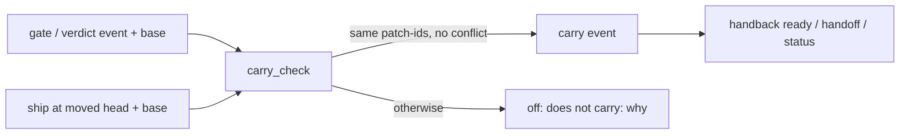

## Summary

When a pull request's commits are rebased onto a new base, the CLI used to replay the judged head onto the base and compare trees and commit counts. That check refused a pass whose patch was identical (a PR moved from one branch of a stack onto another), which cost a second long gate and a second verification for nothing. Restacks that happened after a hand-back also left no record that the pass and the verdict still held at the new head.

This change compares the exact patch-ids of the PR's own commits and records the carry when the moved head is shipped, restacks included.

## Deliverables

The carry is decided by git's exact patch-ids (`git patch-id --verbatim`) of the commits above the base each head was judged on, and `ship` records it:

- Every `gate` and `verdict` event records the `base` the head sits on (the nearest ancestor among the start base, the PR's base and the planned place).
- `ship` logs a `carry` event and prints `carried: long gate and verdict from <sha7> (clean rebase onto <base>)`, or an `off: ... does not carry: <why>` line.
- `ship --conflict` says a conflict was resolved in the rebase: it voids every earlier judged head, so nothing carries over it.
- Old git (before 2.39, no `patch-id --verbatim`) is refused with its reason; a whitespace-only change does not carry.

## Blast radius

Grade: 2

The carry check, the `ship` record and the readers of a hand-back and of the status change; the check is stricter in some cases (no base recorded, merge commits, whitespace) and looser in others (a change below the PR). Revert restores the replay check.

## Autonomous decisions

- A head that sits on none of the three candidate branches records no base and gets the reason `sits on none of its base branches` in the carry check (not in the specification's list), because nothing may be guessed.
- "Nearest" tip is the candidate with the fewest commits between it and the head.

## Known gaps

- Heads judged before this change record no base, so they get a new long gate and verification at their next move (one-time cost).
- No screenshot of the pane from a real session.

Details

## Changes

- `commands/carry.py` and `commands/crs.py`: the base rule, `carry_check` by exact patch-ids, `carry_at`, `last_gate_pass` and `last_verdict_head` including carries.
- `commands/delivery.py`, `declare/delivery.py`: `ship` records the `carry` event and takes `--conflict`.
- `commands/gate.py`, `commands/gate_run.py`: `base` on every gate event; verdict events too.
- `commands/driver_checks.py`, `commands/facts.py`, `status/gate.py`, `status/steps.py`, `board/state.py`, `evals/kit/audit.py`: readers of the recorded carry.
- Cards and docs: `driver.md`, `concepts.md`, `verifier.md`, `status-layout.md`, `docs/gates.md`, `scenario/README.md`, scenario unit 12f and a new unit.

## Human decisions

- The carry compares the exact patch-id (`git patch-id --verbatim`, git 2.39 or later), not the diff text; an older git is refused with its reason, and a whitespace-only change does not carry.
- The PR's own commits are the commits above the base it was judged on, and that base is recorded with the gate pass and the verdict; a change in a PR below it does not break the carry.
- A rebase that resolved a conflict never carries, even with equal patch-ids.
- The carry is recorded when the moved head is shipped, restacks included.
- The one-time cost is accepted: heads judged before this change have no recorded base and are judged again at their next move.

## Impacts

The status pane and `STATUS.md` can show `carried from <sha7>` before a hand-back, and a "Carried" step.

## Test plan

- [x] New or changed tests (unit tests of the carry, the base rule, `ship --conflict`, an unreadable ref)
- [x] Local gates at `3758c52`: `just check`, `just eval-dry-run`
- [x] Evidence: none beyond the tests and the scenario
- [x] Review: approved at `46a1797`, carried from `46a1797` over a clean rebase to `3758c52`
- [x] Verified at `3758c52`
- [x] CI green at `3758c52`

## Internal references

CR-332 carry-by-patch-id. git 2.39 release notes add `git patch-id --verbatim`.

