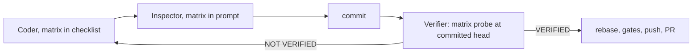

## Summary

A change whose behaviour differs by host (Claude Code, Copilot) or between a shipped default and a user-configured value was only proven on the configured case until late in its review: one escalation change took six rounds because the Copilot shipped-default case surfaced at round 4, after the push, and the fix was then proven on a hand-built shape. This change makes that case visible from the first round: the specification names a host and default matrix, the first round's Coder and Inspector carry it, and a Verifier probes every cell at the committed head before the first push.

## Deliverables

The flow of a CR that has a matrix, before its first push:

- New term "Host and default matrix" in `concepts.md`: one cell per applicable combination (each host, shipped default or configured value, a host's refusal), each with the result it must show and the real flow that proves it; a hand-built shape proves no cell.
- The specification writer names the matrix; the Inspector treats a cell with no test, or tested only on a hand-built shape, as blocking.
- The probe writes `verifier/matrix-r<n>.md`, runs no verdict and no gate, and costs no round unless it fails (then it is the next round, under the same limit). The Verifier at the pushed head is given it as a previous judgment.

## Blast radius

Grade: **1**. Cards only, no CLI or agent file change; a plain `git revert` restores the previous behaviour.

## Autonomous decisions

None.

## Known gaps

- Not exercised on a real CR with a matrix yet: the probe step is described in the cards and unproved until a batch runs it.

Details

## Changes

- `skills/chantier/references/concepts.md`: the "Host and default matrix" term; rule 5 notes the probe exception.
- `skills/chantier/references/spec-writer.md`: the matrix in a rich specification's evidence.
- `skills/chantier/references/driver.md`: matrix in the plan, the checklist and the Inspector's prompt; the probe after the round's commit note and before the rebase while the CR is unpushed; the pushed-head Verifier's previous judgment.
- `skills/chantier/references/inspector.md`: a cell with no real-flow test is blocking.
- `skills/chantier/references/verifier.md`: the probe paragraph, the pushed-head exception, the delta rule.

## Impacts

No visual change. Specifications and Drivers of future CRs that depend on host or shipped defaults gain a probe step.

## Test plan

- [x] New or changed tests: No behaviour change (cards only)
- [x] Local gates at `5b86c93`: `just check` pass; `just scenario (ubuntu-latest)` pass in CI
- [x] Evidence: Grep and diff checks at `5b86c93`
- [x] Review: approved at `5b86c93`
- [x] Verified at `5b86c93`
- [x] CI green at `5b86c93`

## Internal references

- CR-335 round-one-host-default-matrix, batch-24.

