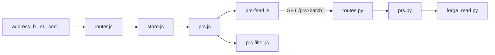

## Summary

The board's PRs page showed only the running batch's pull requests, in one fixed order. It now lets you pick the batch whose PRs are shown (a past batch is read once on the forge), filter by state (all, open, draft, merged), and sort by batch order, opening date, last activity or CR number; the choice lives in the page's address. On a project whose forge is GitLab, the board says "MR" (merge request) wherever it said "PR", in English and French, and writes an MR's number `!n`. With no batch running, the page shows the last closed batch instead of "No batch running".

## Deliverables

Before (base, `1690ec4`) and after (`ad5dd94`, carried by a clean rebase), a GitLab project's PRs page; the after side says "MRs", shows the batch navigator and the state and sort chips:

| Before at `1690ec4` | After at `ad5dd94` (carried) |
| --- | --- |
|  |  |

Sorted by "opened", each row shows its opening date (GitHub project, `ad5dd94`, carried):

- The batch navigator now serves the PRs page; a closed batch is read once, a batch change reads the forge at once, and each batch shown keeps its own 10 s read.
- State and sort are two rows of the board's toggle chips; filtering and sorting happen in the browser on the answer's rows, so they never change what the server reads.
- The forge is told from the PR links of the record (GitLab's `/-/merge_requests/` shape), else from the `origin` remote's host; the MR wording lives in `en-mr.js` / `fr-mr.js` under an `mr.` key space looked up first on a GitLab project.

## Blast radius

Grade: 2

The MR wording touches words on every page, and the PRs route's answer shape changes (`closed` added, `last_batch` removed). A plain revert restores the previous behaviour.

## Autonomous decisions

- None

## Known gaps

- The GitLab `createdAt updatedAt` fields and GitLab rows were exercised only against a stub `glab`, not a real GitLab project.

Details

## Changes

- `board/prs.py`, `routes.py`: `?batch=`, closed-batch rows, `closed`, per-batch forge key, `opened_at` / `updated_at` on rows.
- `board/forge_read.py`: `createdAt updatedAt` in the single GraphQL call.
- `board/forge_kind.py`, `state.py`: `forge` in the project state and the overview line.
- `web/js`: router, store, api, batch navigator, feed, PRs page, `prs-filter.js`, `prs-row.js`, `words.js` (`tf`), MR word files.
- `web/js/views/overview.js`, `ui/header.js`, `ui/picker.js`, `views/batch-graph.js`: the overview's cards and headings, the header stat and the Batch page's node cards use the MR words (`pr.tag` / `mr.tag` keys added); the shared-forge test moved to `picker.js`.
- `web/css/views/prs.css`, `postit.css`: the chip row and the date shown on a row, with tokens only.
- `tests/test_board_prs.py`: its fixture body moves to a shared `served()` function that the new batch tests reuse.
- `AGENTS.md`: the PRs-page rule now says "the batch shown"; `docs/web-board.md` documents the page.

## Human decisions

- Filter by batch and state, sort by opening date, last activity or CR number, kept in the address.
- A change of the batch shown reads the forge at once.
- "MR" and `!n` on a GitLab project, on every page.

## Impacts

The PRs page gains the navigator and two chip rows; a GitLab project reads "MR".

## Test plan

- [x] New or changed tests (`test_board_prs_batches.py`, `test_board_forge_kind.py`, `test_board_forge_read.py`)
- [x] Local gates at `ad5dd94` (carried by a clean rebase): `just check` pass; `just eval-dry-run` pass
- [x] Evidence: before at `1690ec4`, after at `ad5dd94` (carried by a clean rebase)
- [x] Review: approved at `ad5dd94` (carried by a clean rebase)
- [x] Verified at `ad5dd94` (carried by a clean rebase)
- [x] CI green at `ad5dd94`

## Internal references

- CR-343 board-prs-filter-sort

