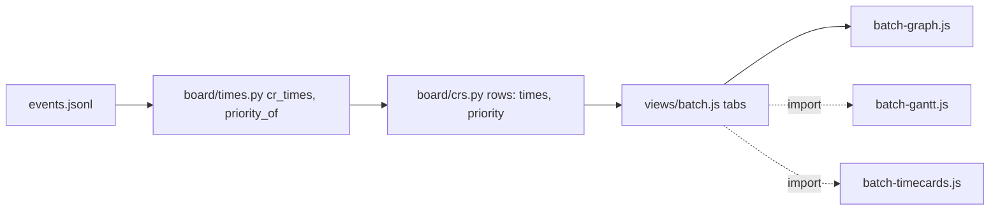

## Summary

The board's Batch page showed one picture of a batch, the dependency graph. This PR puts the central view under three tabs (Graph, Gantt, Time cards) so the same batch can be read as a dependency graph, as a timeline, or as one paper time card per change request. A change request (CR) that just changed state also carries a small burst for 10 minutes, and every CR of a live batch shows the priority chip of the stage it came from.

## Deliverables

- **Tabs under the legend line.** Graph is the default; Gantt and Time cards load their module on first opening (`import()`), and the open tab is kept in the address as `t=gantt` or `t=cards`, so Back and Forward walk the tabs.
- **Gantt.** One row per CR on a real time scale from the batch's start to now, with a "now" line. Each bar is split into segments, one per period in a state, in that state's token colour; the open segment of an unfinished CR runs to "now" and is hatched; a CR not started is a cross at the right edge; vertical arrows are the graph's declared dependencies, one for one.
- **Time cards.** One paper card per CR: one stamped line per round (coder, inspector), the verifier line, the PR and the cost, a red MERGED stamp, an orange REWORKED ×N stamp from round 3.
- **Priority chip** (Inbox, P1 to P4, 3-ready) on the node, Gantt label, time card and PR card, derived by the board from the CR's `add` event.
- Screenshots of the new tabs, at `15359cc` (carried from `7f07565`: the images and the views they show are unchanged by the rebase onto the base branch; also in the "Batch" section of `docs/web-board.md`):

Design choices: tokens only, the one card (a new `paper` variant with a `stamps` part) and the one chip (toggle form for the tabs), no side border, no new one-off style; the Costs receipt and its stamp are untouched.

## Blast radius

Grade: **1**. Board web files plus one read-only derivation in the board's server; no change to records or the CLI's lifecycle. A plain `git revert` restores the previous Batch page.

## Autonomous decisions

- The REWORKED stamp uses `--stamp-rework` (the "waits" state colour) because the prototype has no orange; the round lines' ink is a new violet `--stamp-hand`, since `--stamp-ink` already names an opacity.
- Stamps are a `stamps` part of the one `card()` builder, because the design test forbids `card-*` classes outside it.
- The Gantt SVG is drawn as markup without a namespace attribute, because the structure test bans `https://` in web files.
- The demo project's `events.jsonl` was enriched (add origins, phase and pr-draft events) so the documentation screenshots show chips, segments and the verifier line.

## Known gaps

- The burst animation replays when the Graph tab is reopened or the page is repainted from scratch (its 10-minute window itself does not restart).
- No before screenshots of the Batch page were captured; the new tabs have no earlier state, and the graph tab keeps today's look.
- No phone screenshots of the Gantt and time-card tabs.
- The Gantt screenshot shows the "now" line and its label but not the not-started crosses (below the fold); a viewport under about 1350 px scrolls the Gantt horizontally, with the label column kept.
- A live running batch and the Costs receipt's image copy were not exercised in a browser (no Costs file changed).

Details

## Changes

- `board/times.py` (new): `cr_times` (started, ended, state change, segments, rounds, verifier, verdict) and `priority_of`; `board/crs.py` adds `times` and `priority` to each row.
- `js/views/batch.js`, `core/router.js`, `core/store.js`: tab bar, `t=` address, lazy imports, teardown; the router keeps the PRs page's `st=` and `sort=` beside `t=`.
- `js/views/batch-gantt.js`, `batch-timecards.js` and their sheets; `batch-graph.js` (burst, chip, shared `edges()` from `model/semantics.js`); `ui/card.js` and `css/components/card.css` (paper variant, stamps); `i18n/en-batch.js`, `fr-batch.js`; `DESIGN.md`; docs and screenshots.

## Human decisions

- Gantt on real time from the batch's start to now, a not-started CR as a cross at the right edge.
- The burst lasts 10 minutes whatever the user does.
- Both tabs draw declared dependencies only.
- Bars are split into segments by state, the open one hatched.
- An orange REWORKED ×N stamp from round 3, distinct from the red MERGED stamp.
- Every new view follows the board's design rules (tokens, one card, one chip).

## Impacts

The Batch page gains three tabs, a burst on recently changed CRs and a priority chip on live batch cards; the new screenshots show the Gantt and the time cards.

## Test plan

- [x] New or changed tests (they fail on the previous code): `tests/test_board_times.py`
- [x] Local gates at `15359cc`: `just check` (565 passed); `just eval-dry-run` passed in CI at `15359cc`
- [ ] Evidence: after at `15359cc` (carried from `7f07565`); no before capture
- [x] Review: approved at `15359cc` (the rebase onto the base branch and its resolved conflict in `core/router.js`, reviewed alone; the change itself approved in two earlier rounds)
- [x] Verified at `15359cc` (tab and PRs filter addresses proved again in a browser; the other claims carried from `7f07565`)
- [x] CI green at `15359cc` (`just check` on Linux, macOS and Windows, `just eval-dry-run`, `just scenario`)

## Internal references

CR-345 board-batch-view-tabs; follows CR-344 board-design-system (base branch).

