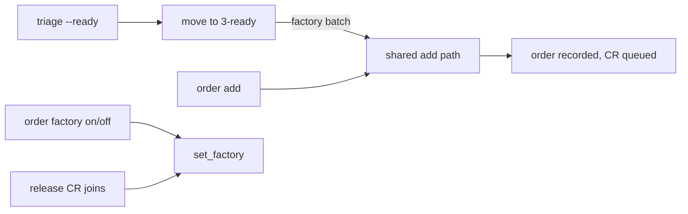

## Summary

A batch opened to take work as it gets specified still needed a separate `order add` and a go for every change request that became ready. This adds a **factory** mode: in a factory batch, `triage <folder> --ready` moves the change request to `3-ready` and adds it to the batch in the same call, on the go the user gave once. The batch never ends by itself: at its last change request's end it pauses, waits for the next ready one, and closes only on the user's word.

## Deliverables

- `open` with no change request is a factory batch; `open --factory` makes one with change requests; `order factory on|off --note "<words>"` switches any open batch.
- `triage --ready` joins through the same code as `order add` (same checks, refusals and order line); a refused add leaves the CR in `3-ready` and says why on stderr.
- A release CR never joins by itself; when one joins with `order add --release`, the factory turns off.
- At the last CR's end a factory batch pauses and prints a `next:` line saying it waits for the next ready CR, with no retro and no close offer.
- `status`, the STATUS files, the board and `brief.md` show `factory: on`; the README gains a "Factory mode" section.

## Blast radius

Grade: 2

The `order add` path is now shared with `triage`, and the record, status and board views gain one field. A batch recorded before this change reads as not a factory. Revert is a plain `git revert`.

## Autonomous decisions

- The factory tests live in a new `test_factory.py` beside the existing test files, to keep each file small.

## Known gaps

- `docs/batch-lifecycle.svg` was edited by hand and not rendered by an agent.

Details

## Changes

- Record: `BatchRecord.factory`; `set_factory` and `ready_not_joined` helpers in the new `commands/factory.py`.
- `open --factory`, brief token, output and event; `--factory` with `--release` refused.
- `triage --ready` joins through the shared add function of `commands/orders.py`; the order carries `origin: "triage --ready"`.
- `order factory on|off`, recorded done at once; a release joining turns the factory off.
- `end_of_batch` prints the factory `next:` line; `status`, STATUS files, `surface_batches` and the web board show the factory state.
- Cards, README and the lifecycle docs describe the mode.

## Human decisions

- The mode is named "factory" everywhere (record field, order, status word).
- Only `triage --ready` joins on its own; a release CR and a board move do not.
- The go given once covers every CR that joins; the user can stop it with `order factory off`.
- The README advises opening a factory batch in stack mode with 4 slots; the CLI's defaults do not change.

## Impacts

The board and `status` show `factory: on` and a factory empty state.

## Test plan

- [x] New or changed tests (they fail on the previous code): `test_factory.py` and updated open, batch-end and empty-batch tests
- [x] Local gates at `b2ae16d`: just check and just eval-dry-run pass (the scenario ran in the pipeline job, see CI)
- [ ] Evidence: none beyond the tests and the scenario
- [x] Review: approved at `1908533` (round 2 inspector, before the commit)
- [x] Verified at `b2ae16d`
- [x] CI green at `b2ae16d`

## Internal references

CR-370 ready-joins-waiting-batch; stacked on CR-369 open-empty-batch.

