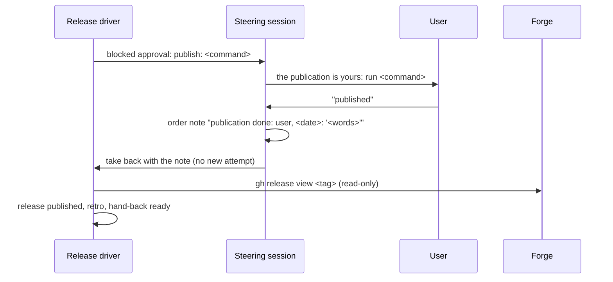

## Summary

When the host refuses the release publication command, the user publishes by hand, and until now nobody finished the release: no `release published`, no retro, no hand-back, and the batch never paused. After this change the user says once that the release is published, the steering session relays it as a note, and a Release driver checks the publication on the forge and runs the normal end checklist.

## Deliverables

- Cards only: the Chief of Staff, Foreman and Release driver cards describe the route; no CLI change.
- The release scenario unit now scripts the refusal, the relay and the take back.

## Blast radius

Grade: **1**. Card text and a scenario unit only; a plain `git revert` restores the previous behaviour.

## Autonomous decisions

- The new Release driver bullet is placed right after the publication bullet, so the two read together.
- The user's word is relayed as an `order note` starting `publication done:`, never as an `order approve`.
- No CLI change, and taking the release back is not a new attempt (no `release start`).
- The Release driver checks the publication on the forge, read-only, and never runs the command again; a published text that differs from the prepared notes is accepted.
- The command handed back must still run once the Driver has ended, so its files stay out of folders the Driver cleans up.

## Known gaps

- `glab release view` on GitLab is **unproved** (marked so in the card); Copilot is unproved for the whole release path.

Details

## Changes

- `skills/chantier/references/chief-of-staff.md`: Releases gains a paragraph on the refused publication, the user's word and the `publication done:` note.
- `skills/chantier/references/foreman.md`: an `order note` starting `publication done:` takes the release back; a working Driver gets it as a message.
- `skills/chantier/references/driver.md`: the publication bullet keeps its files out of cleaned folders and names steps run; a new bullet for a publication done by someone else.
- `scenario/run_scenario.py`, `scenario/README.md`: unit `release` covers the route.

## Impacts

No visual change. A refused publication now has a way to finish.

## Test plan

- [x] No behaviour change in the CLI; the scenario unit `release` covers the route
- [x] Local gates at `8a88c55`: `just check`, `just scenario --unit release` (143/143 checks); `just eval-dry-run` is not owed (no CLI or eval kit change)
- [x] Evidence: none; cards and scenario only
- [x] Review: approved at `8a88c55`
- [x] Verified at `8a88c55`
- [x] CI green at `8a88c55`

## Internal references

- CR-377 release-user-publishes

