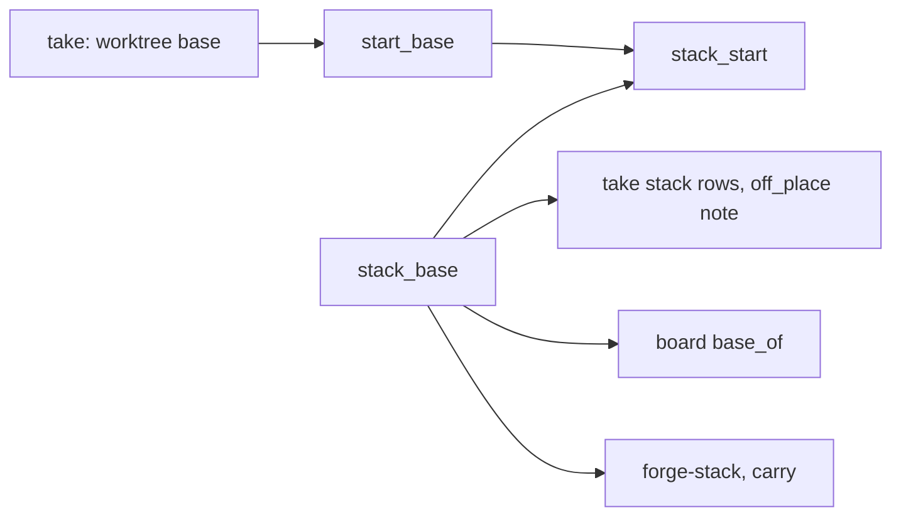

## Summary

In a stack batch, the base a PR starts on (printed by `take`) and the place the record gives it (shown by `take stack`, `stack`, the board and the `not on its place` note) were computed by different functions, and they disagreed. A CR could be told to rebase onto the wrong CR, or be recorded on a branch that did not exist yet. This PR makes both read one function, so they can no longer differ.

## Deliverables

One function, `stack_start`, now gives the base of a CR that the stack driver has not placed yet. Its rules, first match wins:

| Rule | Base |
| --- | --- |
| 1 | the branch its first `take` recorded (`start_on`), while the CR that owns it is open |
| 2 | the nearest CR below it in the stack's order that has a PR, or the nearest open dependency when that dependency sits higher in the stack |
| 3 | no CR below has a PR: the nearest open dependency in the stack's order, else the default branch |

Before, a CR with open dependencies started on the last one written in `after`, and an unplaced CR with no dependency took the CR just below it even when that CR had no branch yet. Now a dependency is chosen by its place in the stack, and a CR with no PR is never a base.

## Blast radius

Grade: **2**. The base function is shared by `take`, the stack rows, the board, `forge-stack` and the carry check, but only for an unplaced CR of a stack batch. Parallel, series, release, fix and placed CRs keep their rules. A `git revert` restores the previous behaviour.

## Autonomous decisions

- The board's `why` word is `dependency` when the returned base is one of the CR's open dependencies' branches, `stack` when `stack` placed the CR, `planned` otherwise (as the specification says); it is computed from the returned branch rather than from the presence of an `after`.

- `start_base` returns `stack_start` for a CR the stack driver placed only when that CR has a recorded `start_on`; a placed CR with none keeps the dependency rule. The specification says `not c.stacked` alone; the scenario's stack unit has a placed CR whose recorded start base must still print.

## Known gaps

None.

Details

## Changes

- `stacks.py`: new `stack_start` (with two small helpers); `start_base` and `stack_base` return it for an unplaced CR of a stack batch (both values of `planned`); `start_on_for` uses the same "nearest CR below with a PR" rule; docstrings rewritten.
- `scenario/run_scenario.py`: the stack unit's four stale expectations follow the one base function (the take prints the nearest dependency in the stack's order).
- `board/crs.py`: `base_of` reads `stack_base` and sets `why` as above.
- `tests/test_stack_base.py` (new): one parametrized check of the cases below, and one in-process `take` check.

## Human decisions

- In a stack batch the take's printed base and the record's place use one function, and a CR with open dependencies starts on the nearest of them in the stack's order, not the last one written.
- The CR below that serves as a base must have a PR, so its branch is on the remote; a CR below with no PR is skipped.

## Impacts

No visual change. `take stack` rows and the `(note rebase: stacked on <cr>)` tail name the right CR.

## Test plan

- [x] New or changed tests (they fail on the previous code): `test_stack_base.py`, cases for both reported anomalies, nearest dependency, a CR without a PR skipped, a placed CR unchanged, and `take` agreeing with the `take stack` row
- [x] Local gates at `d25289b`: `just check`, `just eval-dry-run`
- [x] Evidence: none beyond the tests
- [x] Review: approved, committed in `d25289b` (rebased onto CR-391)
- [x] Verified at `d25289b`
- [x] CI green at `d25289b`

## Internal references

CR-390 take-stack-and-the-record-name-wrong, batch-28 anomalies after order O-24 (CR-383, CR-387).

