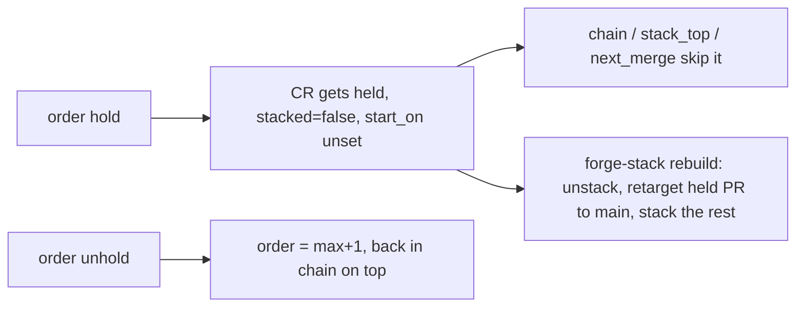

## Summary

In a stack, a CR that is ready to merge could not be kept aside: `stack` and `forge-stack rebuild` put every CR with a PR back into the stack, so a PR the user wanted to merge a week later kept returning on top. This adds `order hold <cr>` and `order unhold <cr>`: a held CR stays in the batch, stays ready, and is left out of the stack order, the record's stack and the forge's native stack, until the user puts it back.

## Deliverables

A held CR leaves the stack and its PR sits on the default branch as a draft; unholding puts it back on top, under the release.

| | Before | After |
| --- | --- | --- |
| `stack <cr>…` | places every other CR on top | refuses a held CR, never places it |
| `forge-stack rebuild` | stacks every CR with a PR | leaves held PRs out, retargets them to the default branch |
| `status` | no notion of hold | one `held:` line per held CR; the CR waits "held out of the stack" |
| release | starts after the stack | waits while a CR is held |

Choices: only a `ready` CR of a stack can be held; a CR that another open CR depends on cannot; leaving the stack (switch to series or parallel) releases every hold; `order merged` accepts a held CR.

## Blast radius

Grade: **2**. The CR record gains one optional field and the stack computation (`chain`, bases, `forge-stack`) now skips held CRs; a batch with no hold is unchanged. Revert is a plain `git revert`, a recorded `held` is ignored by older code.

## Autonomous decisions

- The two handlers live in a new module (`orders_hold.py`, with `orders_word.py` split out) to stay under the project's module size and import-cycle limits.

## Known gaps

- No screenshot of the pane from a real session: the label text of a held CR changed.

Details

## Changes

- `core/records.py`: `held` on a CR entry.
- `commands/orders_hold.py`, `orders_apply.py`, `declare/orders.py`: the `hold` and `unhold` orders with their refusals.
- `stacks.py`: `chain`, `top_cr`, `next_merge`, `start_on_for`, `start_base` skip held CRs; the waits text for a held CR.
- `commands/delivery.py`, `commands/driver.py`: `stack`, `stack --out-of-draft` and `take` refuse a held CR.
- `commands/orders_reorder.py`: leaving a stack frees every hold before places are computed.
- `commands/forge_stack*.py`: held PRs are left out, retargeted to the default branch, and reported by `show`.
- `commands/facts.py`, `commands/batch_status.py`: the `held:` line.
- Cards: `chief-of-staff.md`, `foreman.md`, `driver.md`, `concepts.md`.
- Tests `test_stack_hold.py`; one scenario case in the stack unit.

## Human decisions

- A held PR goes to draft and onto the default branch, so it cannot be merged by accident with the PRs under it.
- The release stays last: a held CR blocks it, and the user chooses to unhold the CR or move it out of the batch.
- Holding is the user's word, so it goes through `order`.

## Impacts

The pane's label for a held CR reads "held out of the stack"; nothing else visible.

## Test plan

- [x] New or changed tests (they fail on the previous code): `tests/test_stack_hold.py`, one scenario case in the stack unit
- [x] Local gates at `ce7a7ef`: `just scenario` passed; `just check` and `just eval-dry-run` (18 of 18 cases) passed at `a476dc3`, the rebased head before the last fix, and CI runs `just check` on the three systems at `ce7a7ef`
- [x] Evidence: none beyond the tests and scenario (CLI and cards change)
- [x] Review: approved at `ce7a7ef` (pass at `a476dc3`, committed as `ce7a7ef`)
- [x] Verified at `ce7a7ef`
- [x] CI green at `ce7a7ef`: `just check` (ubuntu, macos, windows), `just scenario (ubuntu-latest)`, `just eval-dry-run (ubuntu-latest)`

## Internal references

CR-394 hold-a-ready-cr-out-of-the-stack (batch-29).

