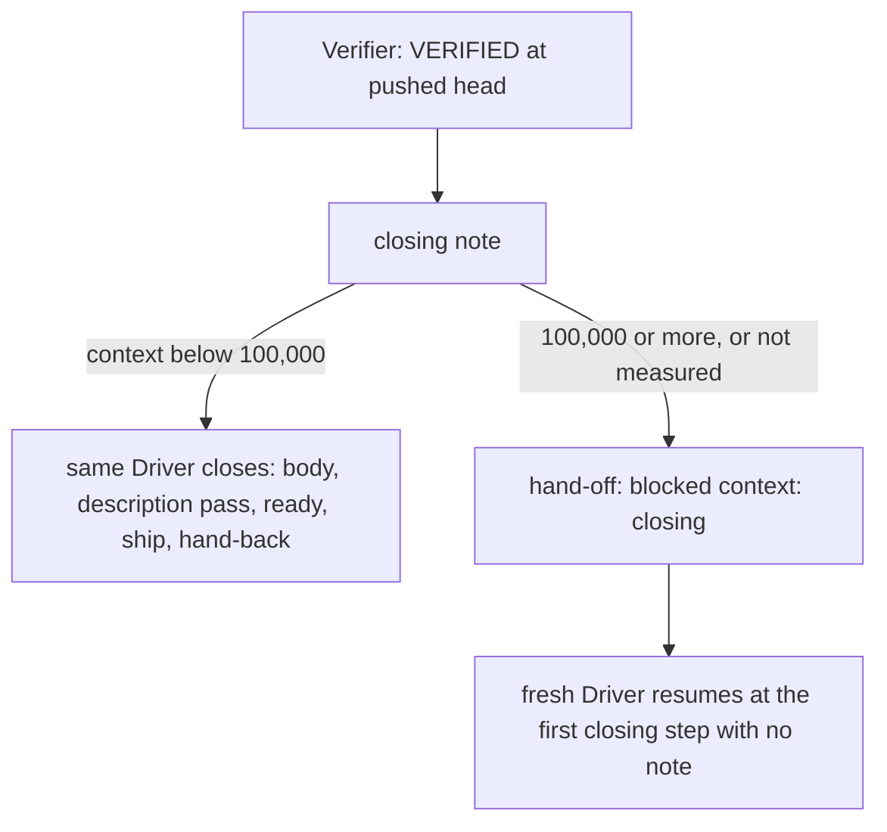

## Summary

A CR Driver (chantier's role that takes one change from its specification to a green PR) used to read most of a 112 KB card and hand off to a fresh Driver at every verified head. Measured on the last batch's cost report and Driver notes, 17 of 43 Driver restarts were that mandatory hand-off, and Drivers cost 26% of the batch ($29.76 of $116.26). This PR cuts what a Driver reads and lets the same Driver finish the closing step when it has room, so one Driver can carry a CR from its first take to its ready hand-back.

## Deliverables

Card read on the common path (bytes, `driver.md`; before at `a872a66`, after at `77089e3`):

| | Before | After |
| --- | ---: | ---: |
| Opening + shared sections + `## CR driver` | 74,666 | 44,758 (budget 45,000, now a test) |

The Driver's prompt line changes from `Read <card>;` to `Card: <card>: its Startup core now, each other section when its step comes, as the card's opening says;`.

Closing step:

Choices: a note per closing step (`closing: body posted`, `closing: description pass VERIFIED`, `closing: PR ready` or `PR kept draft`), so a fresh Driver resumes without rereading the rounds; a second closing hand-off with no new step note is escalated to the user.

## Blast radius

Grade: 2. Cards drive every Driver's behaviour; a revert restores the old card and prompt line, but a batch in flight reads whichever card is current.

## Autonomous decisions

- Trigger-only rules (forge server error, archive in the PR, refused force push, steering notes, matrix probe, conflicts, re-takes) moved to their own sections, not condensed away, to keep every rule.

## Known gaps

- **UNVERIFIED:** the aim itself (one Driver per CR) is measured only once a later batch closes, from its cost report and Driver transcripts.

Details

## Changes

- `driver.md`: "Your means" split into sections read when their step comes; trigger sections; `## CR driver: re-takes`; new reading rules; closing in place under 100,000 tokens.
- `startup-manifest.json`: Driver roles list the shared sections they read.
- `foreman.md`, `concepts.md`, host references: new section names; second `context: closing:` hand-back is an ask.
- `driver_prompt.py`: the `Card:` line; `evals/kit/dry_run.py` follows.
- Tests: card budget, manifest shape, prompt line; scenario `driver_liveness` checks the new strings.

## Human decisions

- Closing threshold is 100,000 tokens.
- The restart split is not added to the cost report; the retro sorts restarts from the notes.
- No new role or agent file.

## Impacts

No visual change. Drivers read less and usually finish their own closing.

## Test plan

- [x] New or changed tests (they fail on the previous code)
- [x] Local gates: `just check` pass at `77089e3`; `just eval-dry-run` pass (18 of 18 cases) at `995a6b0`, same patch before the rebase
- [x] Evidence: none (cards and prompt text; no visible change)
- [x] Review: approved at `8311949`
- [x] Verified at `995a6b0`, carried to `77089e3` (clean rebase, same patch)
- [x] CI green at `77089e3` (5 jobs, `just scenario (ubuntu-latest)` included)

## Internal references

- CR-398 one-driver-per-cr, batch-29.

