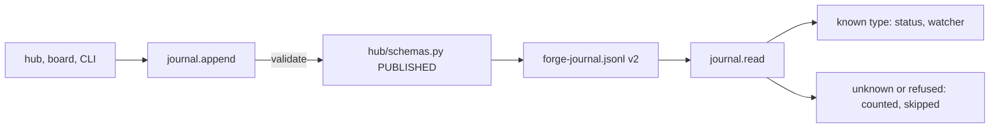

## Summary

Each line of a project's event journal (`forge-journal.jsonl`) now carries a type `name@N`, such as `merged@1`. A published type never changes: a change is a new `name@N+1`. An older session therefore reads what a newer one writes: it counts and skips the types it does not know, and wakes no one for them.

## Deliverables

The journal line, version 2 (`type` replaces `kind`):

```json
{"v":2,"seq":41,"t":"2026-11-18T10:02:03Z","type":"merged@1","source":"hub","audience":["project"],"batch":"batch-29","cr":"CR-12","pr":"#88","into":"main","into_cr":null,"merged_at":"2026-11-18T10:01:40Z"}
```

Published types, each with a JSON Schema shipped in `hub/schemas.json`:

| Type | Written by | Wakes a watcher |
| --- | --- | --- |
| `merged@1` | the hub, the board's PRs page | yes |
| `checks-red@1` | the hub | yes |
| `config@1` | the board's Configuration page | yes |
| `board@1` | the board's backlog writes | when `wakes` is true |



Choices: `append` is strict (a code fault on a refused event); the hub, the PRs page and the board writes set a refused event aside, write the others and report `skipped: ...`. Version 0 and 1 lines are read as `<kind>@1` and never rewritten. `just journal-schemas` adds missing schema entries and never changes an existing one.

## Blast radius

Grade: 2. The journal line format changes (version 2) and every writer and reader follows; an earlier chantier reads a version 2 line as a newer line and wakes no one. Revert is possible, with lines already written staying version 2.

## Autonomous decisions

- A `.gitattributes` line keeps `schemas.json` in LF, so its canonical form holds on Windows.
- `waking` is false for a line with an empty audience (an unknown or refused line is for no one).
- The four event texts moved into `hub/schemas.py` beside their types; their wording is unchanged.
- Models are strict (pydantic `strict`); `config@1`'s `old` and `new` accept a string, an integer or null; a line with an empty audience is its own event for the duplicate rule; a backlog write joins its failure and `skipped:` messages in `error`.
- The set-aside test of the PRs page sits in `test_board_prs_batches.py`, `test_board_prs.py` being at its line limit.

## Known gaps

- `scenario/run_scenario.py` still says "one `config` line" in a check label and a comment (about line 8907): wording only, no behaviour; left for a later pass.
- No screenshot is owed: nothing the CR board pane draws changes.

<details>
<summary>Details</summary>

## Changes

- `hub/schemas.py` (models, `PUBLISHED`, `validate`, normalized form, merge) and `hub/schemas.json`; `scripts/journal_schemas.py` and the `just journal-schemas` recipe.
- `hub/journal.py`: version 2, `append` validation, duplicate key from `PUBLISHED`, `read` with effective types and a fourth result, readers by type.
- `hub/cycle.py`, `board/prs.py`, `board/write_api.py`, `board/config_api.py`: refused events set aside; `commands/batch_status.py` names unknown-type lines.
- Tests (`test_event_types.py` new, others follow `type`), scenario checks, docs (`planning-folder.md`, `web-board.md`), `AGENTS.md`, `CONTRIBUTING.md`, `scenario/README.md` and the cards: the names `config@1`, `board@1`, `source:`.

## Human decisions

- Messages and plan storage stay two things; chantier's journal, surface server and watchers stay the channel, with no Board dependency.
- Models fix each field's JSON type and only formats that cannot change (CR ids, hex heads); open sets (`board@1.action`, `config@1.key`) stay plain strings.
- The old words (`config` line, `by: board`) are renamed everywhere in the docs and cards.
- A recipe writes missing schema entries and never alters a published one; the test compares a normalized form, not pydantic's raw output.

## Impacts

No visual change. Developers add a type by one `PUBLISHED` entry and `just journal-schemas`.

## Test plan

- [ ] New or changed tests (they fail on the previous code)
- [ ] Local gates at `<sha7>`:
- [ ] Evidence: before at `<sha7>`, after at `<sha7>`
- [ ] Review: approved at `<sha7>`
- [ ] Verified at `<sha7>`
- [ ] CI green at `<sha7>`

## Internal references

CR-401 typed-journal-events (Part A of seven).

</details>
