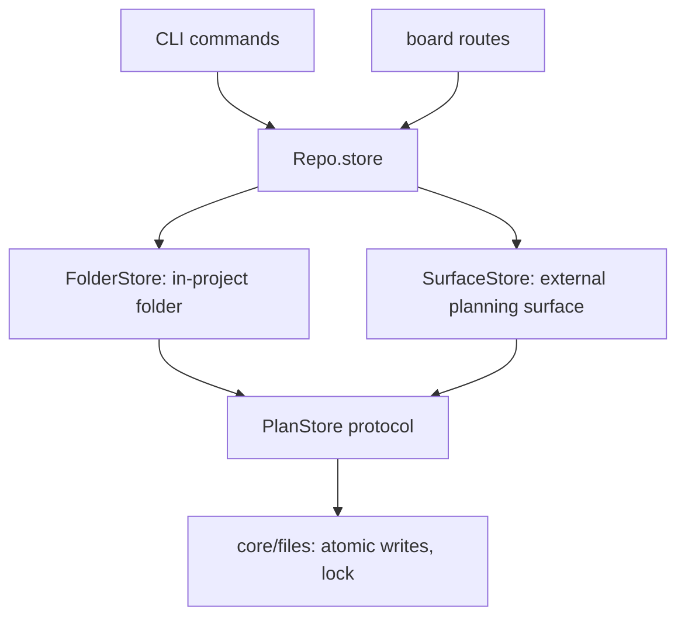

## Summary

The plan (the backlog and the batch records) is written as plain Markdown and JSON by the CLI and the board, each through its own file calls. This PR puts every published write behind one small storage interface, with one conformance test every backend must pass, and makes each command declare the published paths it will touch before it changes anything. Behaviour does not change: same files, same commands, same messages, no refusal. It is the base a later change needs to refuse a write while no writer runs.

## Deliverables

A new package `store/` in the `core/` layer, reached through `Repo.store`:



```python
class PlanStore(Protocol):
    root: Path
    features: frozenset[str]          # publishes, local-files, refuses-without-publisher
    def write_text(self, rel: str, text: str) -> None: ...
    def write_json(self, rel: str, data, **kw) -> None: ...
    def write_bytes(self, rel: str, data: bytes) -> None: ...
    def make_folder(self, rel: str, exist_ok: bool) -> None: ...
    def move(self, rel_src: str, rel_dst: str) -> None: ...
    def remove(self, rel: str) -> None: ...
    def lock(self): ...
    def published(self, rel: str) -> bool: ...
    def check_publish(self, rels, *, config=False, command=None) -> None: ...
```

Choices: both backends keep the plain files (no database, no hidden ref); `check_publish` is called with every published path before a command's first change and no backend refuses yet; local files (batch record, locks, journals) keep the direct file functions; the planning folder's `.gitignore` is written through the store and never checked.

## Blast radius

Grade: **2**. Every published write of the CLI and the board now passes through the store, so a slip would show as a changed file or message; the existing suite (unchanged expectations) and the new tests guard it. Roll back with a revert of the PR.

## Autonomous decisions

- `restored.json` is now written atomically with LF bytes (it was a plain `write_text`, CRLF on Windows), so the same bytes are written on every system.
- The `formerly <CR> of <batch>` line is appended in the file's own line endings, and a missing file is created with the line alone.
- Commands that move several CRs (`open`, `order add`) check all their paths once at entry; in these two commands the malformed `formerly.json` check now comes before the "unclaimed" check, which only changes which of two refusals comes first when both apply.
- At close, a missing own file now fails with `CR folder not found` (exit 2) instead of the `is in use` text, and a failed put-back raises the CLI's own error instead of a raw `OSError`; both only in already failing cases.
- The command name used in a future refusal is set once per CLI call (a module setting, like the project), and per board route.

## Known gaps

- The dedicated-branch backend and the `refuses-without-publisher` cases are declared and skipped in the conformance test; they belong to later changes.
- `release` and `board ungroup` have no row of their own in the command-table test; they reach the same code as the `handback` and `group` rows.
- `just test` adds about 15 s on a noisy machine (66.9 s without the two new test files, 81.3 s with); not measured against the 18.5 s baseline machine.

<details>
<summary>Details</summary>

## Changes

- `store/` (`base.py`, `folder.py`, `surface.py`): the protocol, the path guard (the existing "path must be inside the planning folder" text, now in one place), the two backends, the lifecycle lock (same file, same 30 s wait, same message), the configuration file names and the read-only refusal text.
- `Repo.store`; `changes_lock` delegates to the store's lock; `move_directory` now goes through `store.move`.
- Writes routed through the store: filing, triage, abandon and restore, init, open, take, round, handback, release, order, cancel, close and its undo, summaries, the board's backlog writes and its Configuration save.
- Tests: `test_store_conformance.py` (one body over the backends) and `test_store_command_table.py` (a spy store over the command table, checking `check_publish` precedes the first write and the folder is unchanged at that moment).
- `CONTRIBUTING.md`: the `core/` layer list names the plan's store.

## Human decisions

- The interface also carries `write_bytes` and `make_folder`; a copy and an append are a read then a write, so every published write can go through the store and none stays outside.
- The Configuration page's save goes through a named method, `write_config`, checked like any published write; no write can name a path outside the planning folder.
- The planning folder's `.gitignore` is written through the store and never refused; refusing every command after an upgrade would be a larger change.
- The append keeps the file's own bytes and line endings; `changes_lock` keeps its name and delegates to the store, so no call site moves.

## Impacts

No visible change for users; for developers, a single place to write the plan and to later refuse a write.

## Test plan

- [ ] New tests: conformance across backends; command-table spy test (the check-before-write mutation fails it)
- [ ] Local gates at `<sha7>`: `just check`, `just eval-dry-run`
- [ ] Evidence: no visual change; test output only
- [ ] Review: approved at `<sha7>`
- [ ] Verified at `<sha7>`
- [ ] CI green at `<sha7>`

## Internal references

CR-402 plan-store-interface (Part B of seven).

</details>
