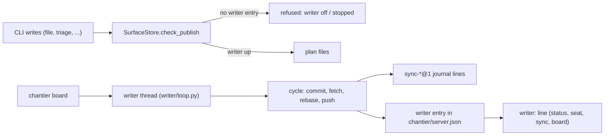

## Summary

With an external planning surface, nothing kept the plan in sync with the forge except a separate autosync tool the user had to install, run and keep alive. This PR makes the surface server (`chantier board`) the surface's one writer: a thread of the server commits, rebases and pushes the plan, so every change reaches the forge within 5 minutes. The separate autosync tool is no longer needed. With no surface server running, every write to the surface is refused (no fallback); a conflict between two clones is raised to the Chief of Staff (the user's steering agent), who resolves it or asks the user.

## Deliverables

- The new `chantier.writer` package (`loop`, `cycle`, `git_ops`, `blocking`, `lines`, `record`, `paths`) holds the cycle; `sync` / `sync now` ask for one at once; `status`, `seat` and the board show a `writer:` line; the board gets a writer pill, panel and one **Sync now** button (`POST /api/writer/sync`) in place of the autosync ones.
- Choices: one writer per surface and machine (an OS lock); the writer never stages an ignored file and blocks (never guesses) on a detached HEAD, a non-default branch, no upstream, a busy git, a nested repository, files staged by hand, or the old autosync tool still running; it never forces a push and never skips hooks.
- Removed: the autosync join, its API, its board panel, its picture and its scenario fake. Docs, SVG diagrams (with their texts) and screenshots are updated; two new pictures show the writer on the board.
- Screenshots: `docs/web-board/writer-pc.png`, `writer-phone.png` (taken by `scripts/docs_screenshots.py`).

## Blast radius

Grade: 3 - it changes who writes and pushes the planning surface, the board and the published journal's event types; a revert restores the autosync join but not the docs' or users' surface rules. Roll back by reverting the PR and restarting the autosync tool.

## Autonomous decisions

- An unset `origin/HEAD` keeps the strict reading: the writer blocks as `not-a-branch` and the message names `git remote set-head origin -a`; no default branch is guessed (settled by the Chief of Staff).
- If the writer's thread dies, the server keeps serving reads and refuses writes with a clear error; the `writer:` line says `stopped: <why>`, never `synced` (settled by the Chief of Staff).
- `AGENTS.md` says the CLI has two named git exceptions (the writer and the batch-end cleanup), since the autosync join goes, and "three named exceptions" in the scope bullet; the specification said the git count "becomes three".
- `autosync/view.py` and `reading.py` were deleted (no caller left); `autosync/records.py` is kept for the foreign-autosync check.
- `clock.real_now()` was added: the writer's `started` is real time so a fixed test clock cannot make a live writer look dead.
- The secret scan is left to the user's own pre-commit hook (the writer runs hooks).

## Known gaps

- No release-notes folder: this PR bumps no version; the release writes them (the surface's own AGENTS.md cleanup is part of that note).
- The full `just scenario` has not run locally yet; only the `surface-board` unit (251 of 251 checks) did.
- Linux and macOS runs of the second-loop lock tests are left to CI.

Details

## Changes

- `writer/`: cycle, git steps, blocking preconditions, episode lines; `hub/state.py`, `hub/lock.py`, `hub/schemas.py`, `hub/journal.py`: the `writer` entry, `writer.lock`, the `writer` source and four published event types.
- `store/surface.py`: the refusal of a published write with no writer.
- `commands/sync.py`, `writer_line.py`, `status`, `seat`, `preflight` (P13), `board/writer_api.py`, board web, cards, `AGENTS.md`, docs, scenario `surface-board`.

## Impacts

The board shows a writer pill and panel; `status` and `seat` print a `writer:` line; docs describe the writer instead of autosync.

## Test plan

- [ ] New or changed tests (they fail on the previous code)
- [ ] Local gates at `<sha7>`
- [ ] Evidence: before at `<sha7>`, after at `<sha7>`
- [ ] Review: approved at `<sha7>`
- [ ] Verified at `<sha7>`
- [ ] CI green at `<sha7>`

## Internal references

CR-404 "the surface's writer (Part C of seven)", batch-29.

