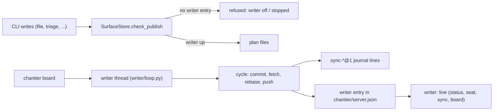

## Summary

With an external planning surface, nothing kept the plan in sync with the forge except a separate autosync tool the user had to install, run and keep alive. This PR makes the surface server (`chantier board`) the surface's one writer: a thread of the server commits, rebases and pushes the plan, so every change is meant to reach the forge within 5 minutes (**UNVERIFIED:** the bound is not measured on a real forge). The separate autosync tool is meant to be no longer needed. With no surface server running, every write to the surface is refused (no fallback); a conflict between two clones is raised to the Chief of Staff (the user's steering agent), who resolves it or asks the user.

## Deliverables

- The new `chantier.writer` package (`loop`, `cycle`, `git_ops`, `blocking`, `lines`, `record`, `paths`) holds the cycle; `sync` / `sync now` ask for one at once; `status`, `seat` and the board show a `writer:` line; the board gets a writer pill, panel and one **Sync now** button (`POST /api/writer/sync`) in place of the autosync ones.
- Choices: one writer per surface and machine (an OS lock); the writer never stages an ignored file and blocks (never guesses) on a detached HEAD, a non-default branch, no upstream, a busy git, a nested repository, files staged by hand, or the old autosync tool still running; it never forces a push and never skips hooks.
- Removed: the autosync join, its API, its board panel, its picture and its scenario fake. Docs, SVG diagrams (with their texts) and screenshots are updated; two new pictures show the writer on the board.
- Screenshots: `docs/web-board/writer-pc.png`, `writer-phone.png` (taken by `scripts/docs_screenshots.py`).

## Blast radius

Grade: 3 - it changes who writes and pushes the planning surface, the board and the published journal's event types; a revert restores the autosync join but not the docs' or users' surface rules. Roll back by reverting the PR and restarting the autosync tool.

## Autonomous decisions

- An unset `origin/HEAD` keeps the strict reading: the writer blocks as `not-a-branch` and the message names `git remote set-head origin -a`; no default branch is guessed (settled by the Chief of Staff).
- If the writer's thread dies, the server keeps serving reads and refuses writes with a clear error; the `writer:` line says `stopped: <why>`, never `synced` (settled by the Chief of Staff).
- `AGENTS.md` carries no count of the CLI's named exceptions (the Chief of Staff's rule): its git bullet names the writer and the batch-end cleanup, and the scope bullet names its exceptions without a number.
- `autosync/view.py` and `reading.py` were deleted (no caller left); `autosync/records.py` is kept for the foreign-autosync check.
- `clock.real_now()` was added: the writer's `started` is real time so a fixed test clock cannot make a live writer look dead.
- The secret scan is left to the user's own pre-commit hook (the writer runs hooks).

## Known gaps

- No release-notes folder: this PR bumps no version; the release writes them (the surface's own AGENTS.md cleanup is part of that note).
- The 5-minute bound and the removal of the autosync tool are **UNVERIFIED**: the scenario job passes at the pushed head, but no run measured the bound on a real forge.
- No before/after evidence was captured for this change beyond the two new board pictures in `docs/web-board/`.

Details

## Changes

- `writer/`: cycle, git steps, blocking preconditions, episode lines; `hub/state.py`, `hub/lock.py`, `hub/schemas.py`, `hub/journal.py`: the `writer` entry, `writer.lock`, the `writer` source and four published event types.
- `store/surface.py`: the refusal of a published write with no writer.
- `commands/sync.py`, `writer_line.py`, `status`, `seat`, `preflight` (P13), `board/writer_api.py`, board web, cards, `AGENTS.md`, docs, scenario `surface-board`.

## Human decisions

- The checkout paths of the project's code (`checkout.yml`, else `.repo` and `.worktrees`) are excluded from the plan; any other nested repository blocks the writer.
- Secrets: only git hooks; the writer runs the user's hooks and never skips them.
- A failed git step is retried each cycle and reported only when it fails twice in a row; a stash git cannot restore is reported at once.
- The writer pushes every local commit of the branch, hand commits included; nobody pulls or pushes the surface by hand while it runs.
- A board still serving from an older version (no writer) is named with its version, PID and stop command, and the user is asked to stop it.
- The surface's other files (`AGENTS.md`, scripts) stay committed by hand; the writer touches only the plan.

## Impacts

The board shows a writer pill and panel; `status` and `seat` print a `writer:` line; docs describe the writer instead of autosync.

## Test plan

- [x] New or changed tests (they fail on the previous code): `tests/` writer cases and the `surface-board` scenario unit
- [x] Local gates at `e855fe9`: `just check` pass, `just eval-dry-run` pass (18 of 18)
- [ ] Evidence: none captured (see Known gaps)
- [x] Review: approved at `e855fe9`
- [ ] Verified at `e855fe9`
- [x] CI green at `e855fe9`: `gh pr checks 379`: check (macos, ubuntu, windows), eval-dry-run and scenario pass

## Internal references

CR-404 "the surface's writer (Part C of seven)", batch-29.

