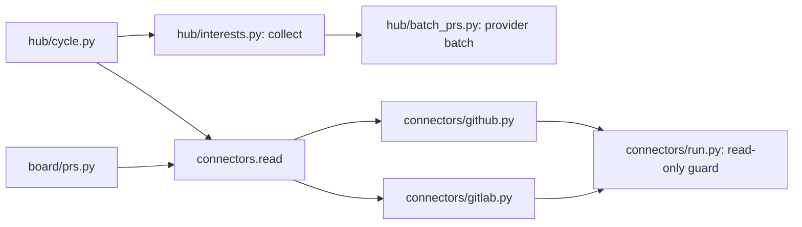

## Summary

chantier's forge hub polled the forge through GitHub- and GitLab-specific code in one module, and read every PR of a running batch whether or not anything was waiting on it. This PR moves forge reads behind one connector interface (GitHub and GitLab ship; adding a forge is one module and one line in a table) and makes the hub read only the PRs that someone waits for, through a small interest registry derived from the record each cycle. A PR link no connector claims is now named in the hub's error and on the PRs page, and the batch's other PRs are still read.

## Deliverables

The connector package replaces `board/forge_read.py`; the hub asks the registry what is awaited and reads it through the connectors:



```python
# connectors/__init__.py: the plugin table
CONNECTORS = (github.CONNECTOR, gitlab.CONNECTOR)
def read(links: list[str], facts: frozenset[str] = frozenset()) -> dict[int, Facts]: ...
# hub/interests.py: who waits
PROVIDERS = (batch_prs.PROVIDER,)
```

Choices: one query per project and cycle (unchanged budget); the registry is derived, never stored; every forge call passes a guard that accepts only `api [--hostname <host>] graphql` with a `query` (no mutation); GitLab answers `review: unproved` until its approval read is proved; `review` on GitHub is read only when an interest asks for it.

## Blast radius

Grade: 2. The hub and the board's PRs page change their read path (the query text is unchanged when no optional fact is asked); revert restores the previous module, no data format changes.

## Autonomous decisions

- `Interest` and `Provider` live in `hub/interest.py`, re-exported by `hub/interests.py`, to avoid an import cycle the project's code-target test refuses.
- The page's unclaimed-link case is in a new test file because `tests/test_board_prs.py` is at its size cap.

## Known gaps

- On a cycle where the hub both leaves out an unclaimed link and sets a journal event aside as invalid, the second error replaces the first in the project's hub entry; rare, left as is.

<details>
<summary>Details</summary>

## Changes

- New `connectors/` package (`base`, `run`, `github`, `gitlab`, `__init__`); `board/forge_read.py` removed, its code moved by forge.
- New `hub/interests.py`, `hub/interest.py`, `hub/batch_prs.py`; `hub/cycle.py` reads through them; `board/prs.py` through `connectors.read`.
- A link no connector claims: left out of the read, named as `no connector reads <link>: chantier reads GitHub and GitLab`.
- `AGENTS.md` (two budget sentences), new `docs/forge-connectors.md`, `README.md`, `docs/hosts.md`, `docs/web-board.md`, and two cards (`session-start.md`, `concepts.md`).

## Human decisions

- Connectors are modules in chantier's own package plus one table line; no install step, no plugin loading from outside.
- The forge is read with the user's own `gh` and `glab` logins: no token, no HTTP library.
- Polling stays (no webhook); GitLab approvals stay unproved until read on a real merge request.

## Impacts

No visual change. A foreign-forge PR link in a batch no longer blanks the whole read.

## Test plan

- [x] New or changed tests (they fail on the previous code): `tests/test_connectors.py`, `test_hub_connectors.py`, `test_forge_hub.py`, `test_board_prs_unclaimed.py`
- [x] Local gates at `40363bd`: `just check` pass (1096 passed), `just eval-dry-run` pass (18 of 18), `just scenario` pass
- [x] Evidence at `40363bd`: two real GitHub reads of `reviewDecision`: `REVIEW_REQUIRED` on a repository requiring one approval, `null` on one requiring none (mapped to `unknown`)
- [x] Review: approved at `40363bd`
- [x] Verified at `40363bd`
- [x] CI green at `40363bd`

## Internal references

- CR-405 forge-connectors, batch-29.

</details>
