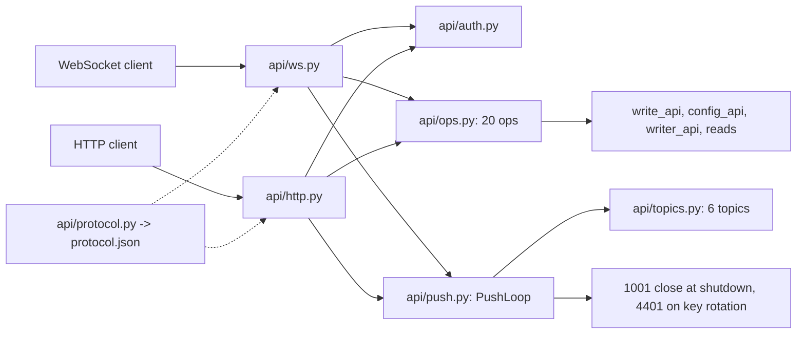

## Summary

The surface server's board speaks through ad-hoc HTTP routes that only its own web page knows, so no other program can read or drive a planning surface, and the page depends on a polling loop. This adds one published API, protocol 1, with one message shape on two transports: a WebSocket (`/api/v1/ws`, with server push) and, as the degraded case behind a proxy that cuts upgrades, plain HTTP (`POST /api/v1/call/<op>` and a long-poll `POST /api/v1/poll`). The existing routes stay for now, so the current page keeps working while the API lands.

## Deliverables

Where the API sits in the server (new package `board/api/`; the old routes stay beside it):



The wire shape, in one sketch (frames of `protocol.json`):

```text
client: {"t":"hello","protocol":1,"key":"..."}        server: {"t":"welcome", ...}
client: {"t":"call","id":7,"op":"backlog.move","args":{...}}   server: {"t":"result","id":7,"ok":true,"data":{...}}
client: {"t":"sub","id":8,"topic":"board","args":{...}}        server: {"t":"result",...} then {"t":"event","sub":8,"rev":"...","data":{...}}
close codes: 4401 key, 4408 no hello in time, 4426 protocol, 1001 server stopping; 429 over 32 subscriptions, 503 over 16 unwelcomed sockets
```

Choices made: one `call` shape for all 20 ops, with schemas published as `protocol.json` (generated from the models, checked by a test); six topics pushed by one loop that computes each (topic, args) once for all watchers; the `prs` topic reads the forge at most once per 10 s per project and not at all once every PR is done; the cookie is honoured only from the server's own origin, a header key from any origin, and CORS answers `*` without credentials; the key exchange redirects to a relative `Location`.

## Blast radius

Grade: 2. The server gains a package and a dependency (`websockets`) and the shared `Context`, `routes` and `app` change; the old routes and the page are untouched, so a `git revert` restores the previous behaviour.

## Autonomous decisions

- An extra `http.poll` schema in `protocol.json`, for the long-poll body.
- The seats check also runs on early 401 and 405 answers of `/api/v1/`, so a client that only gets refusals still counts as a seat.
- The two scenario `remote_board` checks on `Location` now expect the relative form the exchange now gives.
- A write with no live writer is refused by the existing 409 path, not a new check.

## Known gaps

- The web page still uses the old routes, which stay registered; the page's move to the API, the removal of those routes and the cut of `/api/board` to the identity probe are not in this PR yet.
- The scenario and `just eval-dry-run` have not run at this head.
- A long-poll holds one worker thread for up to 20 s.

<details>
<summary>Details</summary>

## Changes

- `board/api/`: `protocol.py` (frames, 20 op argument models, 6 topics) and generated `protocol.json`; `ops.py`; `topics.py`; `push.py` (loop, thread, subscriptions, key-rotation close); `auth.py`; `http.py`; `ws.py`; `times.py`.
- `app.py`: `/api/v1/ws` route, `make_server` with `ws="websockets-sansio"`, 1001 close of every socket at shutdown, a 413 cap on request bodies.
- `guard.py`, `address.py`, `routes.py`, `context.py`, `prs.py`: relative `Location`, seat registration on v1, the shared context's new fields.
- `websockets` added to `pyproject.toml` and `uv.lock`; `just protocol-schema` regenerates `protocol.json`.

## Impacts

No visual change.

## Test plan

- [ ] New or changed tests (they fail on the previous code): `test_server_api.py`, `test_server_api_calls.py` (a good call for each of the 20 ops), `test_server_api_ws.py` (real server, 11 cases), `test_server_protocol.py`
- [ ] Local gates at the uncommitted round-2 tree over 9841318: `just check` pass (1341 passed, 13 skipped)
- [ ] Evidence: none yet (server-side change, no picture)
- [ ] Review: not yet approved
- [ ] Verified: not yet
- [ ] CI green: not yet pushed

## Internal references

CR-406 server-api.

</details>
