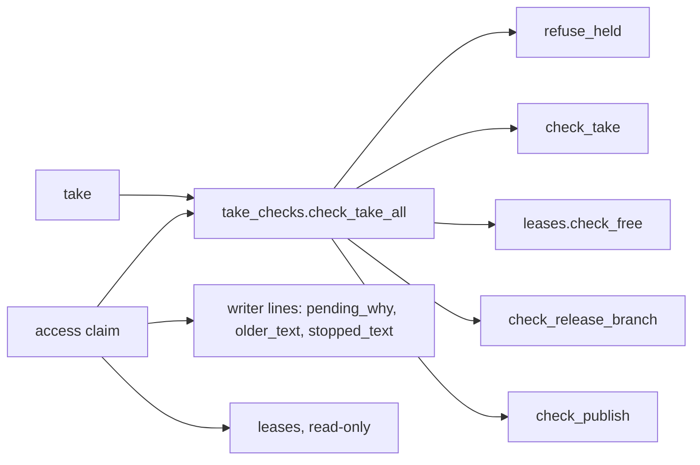

## Summary

When a write, a claim of a change request or a push is refused, the reason is spread over several rules (the surface's writer, a driver's lease, the slot, budget and dependency checks). A session had to ask someone, or guess. `chantier access [write|claim|push] [<cr>]` now answers, in at most six lines and read-only, what each rule says right now for this session. It changes nothing: no lease renewed, no journal line, no file written, no permission granted.

## Deliverables

The command and the lines it prints, for a session that holds the seat, in an external planning surface whose writer is not running:

```text
$ chantier access CR-12 --lease 3 --epoch 2
session abc-123: holds the seat of demo
write: refused: the surface's writer is not running; start the surface server ($CHANTIER board --seat <session id>)
claim: refused: <the text `take` would print>
push: allowed: lease 3 of CR-12 is live; push <branch> without force; a rewrite uses --force-with-lease
push surface: only the writer pushes the surface; never by hand
```

Where the checks live now:



Choices made:

- `take` and `access` call one function for the claim checks, so a check added to `take` later is explained by `access` with no second edit.
- `access` never removes a dead hold record and never renews a lease, even with a valid `--lease`.
- A lease that ran out reads "not confirmed", as the lease texts already say; a push on it is allowed with "renew it first".

## Blast radius

Grade: **1**. A new read-only command; `take` keeps its checks and texts, now in a shared function. A plain `git revert` restores the previous behaviour.

## Autonomous decisions

- The writer's `stopped` state prints as a `write: refused` line, as it refuses writes today (the specification listed no such state).
- The `write: refused` line prints `$CHANTIER` literally, as the writer's own lines do.
- A change request the named batch does not hold gives a `refused:` line with exit 0, not a usage error.
- In `take`, the CR driver check that the plugin files are in step now runs after the shared checks; it changes no state.
- The `--epoch` command list in the Chief of Staff's card now names `access`.

## Known gaps

- `test_access.py` takes about 10.6 s serial (3.8 s of it shared session fixtures), above the 1.5 s the specification estimated; the full `just test` run measured 72 s with `-n auto`. No "before" figure was taken.
- No output captured from a real batch (no `evidence/access-live.txt`); the answers are proven on prepared states.
- No test case for a release's branch check in `claim`.

<details>
<summary>Details</summary>

## Changes

- `declare/access.py`, `commands/access.py`: the command, registered in `cli.py`.
- `commands/take_checks.py`: the shared claim checks, used by `take` and `access`.
- `core/leases.py`: a `drop=False` mode that does not delete dead hold records.
- `writer/lines.py`: the "not pushed yet" reason and the older-board and stopped texts are public functions.
- `hub/autostart.py`, `commands/seat.py`: one `holds_seat` comparison for the seat line.
- Cards: `concepts.md` (the `access` word), `driver.md` (one line, off the common path), `foreman.md`, `griller.md`, `chief-of-staff.md`; `AGENTS.md` names `access` among the CLI's exceptions.

## Human decisions

- A push on a lease that ran out, with nobody having taken the change request again, is allowed, with "renew it first".
- A claim on a working, ready or blocked change request is not refused; the line says `take` needs `--note`.
- `claim` and `push` take a change request only, not a stack or a QA order.
- The Chief of Staff's card gets the "run `access` before asking" line.
- No scenario case: the prepared-state tests cover it.

## Impacts

No visual change. A session that meets a refusal it does not understand can run `access` before asking.

## Test plan

- [ ] New or changed tests: `tests/test_access.py` (37 cases: session, write, claim, push, usage, nothing written, `take` text parity for each claim refusal)
- [ ] Local gates at `cd99f0a`: `just check`, `just eval-dry-run`
- [ ] Evidence: none beyond the tests (see Known gaps)
- [ ] Review: approved at `cd99f0a`
- [ ] Verified at `<sha7>`
- [ ] CI green at `<sha7>`

## Internal references

- CR-408 explain-access (part F of the planning-server split); investigation and round notes under its `work/` folder.

</details>
