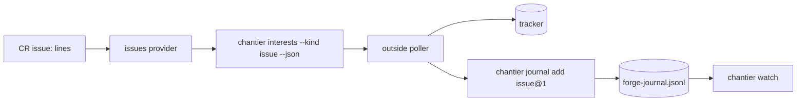

## Summary

chantier's forge hub reads pull requests, never tracker issues. This change lets an outside poller (the user's own script, cron job or service) tell chantier about issue events: it asks which issues are awaited, polls its tracker, and writes what it finds into the project's event journal through one command. The watcher then tells the Chief of Staff, as it does for a merge.

## Deliverables

Two new commands, and one new journal event type:

```text
chantier --project <p> interests [--kind pr|issue] [--json]     # read-only: what the CRs wait for
chantier --project <p> journal add issue@1 --json <payload | -> # append one issue event
```



- `journal add` accepts only `issue@1`, only for an issue a CR's `issue:` line names; anything else is refused and nothing is written.
- The hub never collects `issues`: its reads and budget do not change.
- A payload with `wakes: false` rides along with the next waking line instead of waking the watcher.

## Blast radius

Grade: 1. New commands and one new journal type, no change to existing texts or readers; a `git revert` restores the previous behaviour.

## Autonomous decisions

- The published model is named `Issue1`, not `IssueV1`, to match the other models of `hub/schemas.py`.
- The model's fields are strict, as the other published models', so a wrongly typed field is refused at the model as well as at `journal add`'s own input check.

## Known gaps

- Not yet gated or verified at this head (see Test plan).

<details>
<summary>Details</summary>

## Changes

- `hub/issue_refs.py`: the `issues` provider; `Interest` gains kind `issue` and a `tracker` field; `tracker_of` is public.
- `hub/interests.py`: `collect_each`, and the `interests` command.
- `hub/journal_add.py`, `declare/journal.py`: the `journal add` entry; `poller` joins the journal sources.
- `hub/schemas.py` and `schemas.json`: the `issue@1` type, its wake rule and text.
- Project rules, cards and docs updated; new tests and a scenario case `outside_poller`.

## Impacts

No visual change. Users who run an outside poller get a documented contract in `docs/forge-connectors.md`.

## Test plan

- [ ] New or changed tests (they fail on the previous code): `test_outside_poller.py`, additions to `test_watch_events.py` and `test_forge_hub.py`
- [ ] Local gates at `<sha7>`: `just check`, `just eval-dry-run`
- [ ] Evidence: none beyond the tests and the scenario case
- [ ] Review: approved at `<sha7>`
- [ ] Verified at `<sha7>`
- [ ] CI green at `<sha7>`

## Internal references

CR-410 an-outside-poller-writes-issue-events-into-the-journal.

</details>
