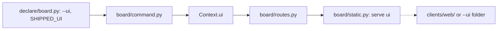

## Summary

The web board's files leave the server's package: they now live in `chantier/clients/web/`, still shipped in the one wheel. `chantier board` serves that folder by default, another UI's static files with `--ui <folder>`, or only the API with `--ui none`. A test keeps the server's code from naming the client's folder.

## Deliverables

- The web client moved with `git mv` (every file a 100 % rename except `DESIGN.md`, whose path sentence changed): `board/web/` -> `clients/web/`.
- `chantier board --ui <folder>|none`: a folder needs an `index.html`, refused at the start otherwise with nothing written; on a board already running, `--ui` is not applied and one line says so (exit 0).
- `--ui none`: outside `/api/`, every GET answers 404 with `this server serves no UI: see docs/server-api.md`.

## Blast radius

The board's static serving and the `chantier board` command line; paths in `.gitattributes`, `biome.json`, `justfile`, docs and tests. The API, protocol, key rules and the client's own files are unchanged. A board running from a checkout across the merge answers 404 on its page until restarted.

## Autonomous decisions

- The exit code of a refused `--ui` is `EXIT_USAGE` (1 in this code base).

## Known gaps

- Hand checks of the spec's 8.3 not yet run: wheel listing, eol listing, Biome file count, docs screenshots, browser check, `just test` timing.
- The symlink case of the new test skips on a Windows account that cannot make symlinks.
- No release-notes line: no file for the next release exists yet.

Details

## Changes

See the diff: static serving takes a folder; `Context.ui`; `--ui` parsing in `board/command.py`; `docs/server-api.md` "Serving another UI"; `docs/web-board.md`; `AGENTS.md` and `CONTRIBUTING.md` paths; tests incl. `test_board_ui.py`; scenario `remote_board` additions.

## Human decisions

`--ui` on a running board is not refused; no `board.ui` key; today's file types stay; a folder needs an `index.html`.

## Impacts

None on data, configuration or records.

## Test plan

- [ ] `just check` at the head
- [ ] `just eval-dry-run` at the head
- [ ] `just scenario` at the head

## Internal references

CR-411, batch-29; after CR-406.

