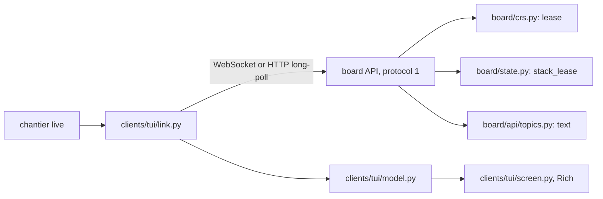

## Summary

The board's server publishes an API (protocol 1) that only the web board used. `chantier live` is a second client of it: a terminal screen, read-only, that follows a running board as things happen (live counts, projects and Drivers, a flow of events, the tasks with each Driver's lease time left). It proves the API serves a client other than the web page, and gives a terminal-only user the same view.

## Deliverables

The server's data gains three fields, protocol 1 unchanged (`protocol.json` is the same file), and a new client package reads only that API:

- `chantier live [--url <link>] [--only <project>] [--transport auto|ws|http] [--once]`: WebSocket first, HTTP when it does not open; a refused key or protocol ends the run and is never retried on the other transport; a lost link is retried every 5 s and the journal resumes with `after`.
- `--once` prints the screen once as plain text (the capture below, at the pushed head, comes with the final pass of this PR).
- Choices: Rich alone (no Textual), pinned in `pyproject.toml` and `uv.lock` (pure-Python wheel, so Linux, macOS and Windows alike); the client imports only `chantier.clients.tui`, `chantier.__version__` and `chantier.core.errors` (a test reads the shipped files to prove it); the lease time left is computed by the client from the server's facts and the server's clock, never the machine's.

## Blast radius

Grade: 2. A new command and a new dependency, plus additive fields in the board's state and `events` answers. Revert is possible; the one visible change to existing data is that an `events` line now carries `text` (the sentence of its type).

## Autonomous decisions

- The `text` field added on an `events` line replaces a payload's own `text` key for the types that have one (`board@1`, `issue@1`, `sync-*@1`), as the specification names the field `text`; each type's sentence quotes the payload's text, so the screen loses nothing.
- The Projects panel's ready count reads the project state's `3-ready` backlog count, since the board's project line carries none.
- A test that asserted `clients/` holds no Python file is narrowed to `clients/web/`.

## Known gaps

- Live screen not seen in a real terminal.
- No capture of `--once` from a board running this head yet (the one in `docs/boards.md` is to be replaced by it).

Details

## Changes

- `pyproject.toml`, `uv.lock`: `rich==15.0.0` (with markdown-it-py and mdurl, pure Python); `rich` is a banned module-level import (lazy, like `starlette`).
- `board/crs.py`, `board/state.py`, `board/fingerprint.py`, `board/api/topics.py`, `docs/server-api.md`: `lease` on a CR row, `stack_lease` on the batch, `.lease-hold.*.run` files counted in the fingerprint, `text` on `events` lines.
- `clients/tui/` (`link.py`, `model.py`, `screen.py`), `declare/live.py`, `commands/live.py`, `cli.py`: the command.
- `AGENTS.md`, `docs/boards.md`, `README.md`, `CONTRIBUTING.md`: the named exception, the user documentation, the tree.
- Tests: `test_live_model.py`, `test_live_link.py`, additions to the lease, board and API tests; scenario unit `surface-board` runs `live --once` on both transports.

## Impacts

A new command for users; nothing changes for existing commands. The suite gains about 16 s.

## Test plan

- [ ] New or changed tests (they fail on the previous code)
- [ ] Local gates at `<sha7>`: `just check`, `just eval-dry-run`
- [ ] Evidence: capture of `live --once` at `<sha7>`
- [ ] Review: approved at `<sha7>`
- [ ] Verified at `<sha7>`
- [ ] CI green at `<sha7>`

## Internal references

CR-418 live-activity-tui

