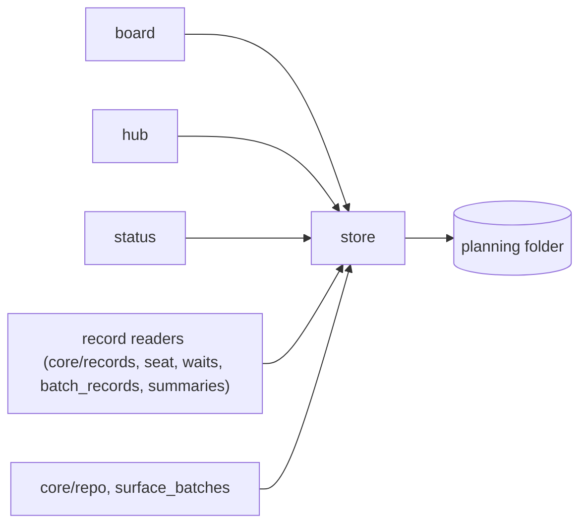

## Summary

The board, the forge hub and `chantier status` each read the planning folder (the Markdown and JSON files that hold the plan) directly with `pathlib` and `os`. That makes it hard to put an index (SQLite, Dolt) behind the plan later. This PR gives the plan's store (`PlanStore`) its read half and moves those readers onto it, so there is one way to read the plan. No index is built and no behaviour or output changes.

## Deliverables

The store gains nine reads, checked by the same guard as a write; the modules listed in a new structure test read the planning folder only through it.

```python
class PlanStore(Protocol):
    def read_text(self, rel: str, errors: str = "strict") -> str: ...
    def read_bytes(self, rel: str, limit: int | None = None) -> bytes: ...
    def exists(self, rel: str) -> bool: ...
    def is_file(self, rel: str) -> bool: ...
    def is_dir(self, rel: str) -> bool: ...
    def listdir(self, rel: str) -> list[str]: ...
    def glob(self, rel: str, pattern: str) -> list[str]: ...
    def stat(self, rel: str) -> tuple[int, int] | None: ...   # size, mtime_ns
    def walk(self, rel: str) -> Iterator[tuple[str, list[str], list[str]]]: ...
```



| | before (`a391c1eb`) | after (head) |
| --- | --- | --- |
| `chantier status`, median of 5 | 0.568 s | 0.563 s |
| one board state, median of 5 | 0.80 s | 0.90 s (+5 %) |
| `status` text and board state JSON | - | identical |

Measured on a prepared planning folder with 240 backlog items, same machine, back to back.

## Blast radius

Grade: **2**. Many modules of `board/`, `hub/`, `status/` and `core/` change how they read; the files on disk and every printed output stay the same. Revert restores the previous readers.

## Autonomous decisions

- The record readers take the store first and keep their path argument (`read_batch_json(store, path)`), computing the store-relative name with a new `rel_in` helper: callers and printed paths stay as they are.
- A read resolves the store's root once and checks each component below it with `lstat` (a symlink or junction goes to the full guard); a board state opens a scope (`PlanStore.reading()`) in which an already-checked component is not checked again, because resolving root and path on each of about 5,700 reads made a board state three times slower on Windows. The scope ends with the call; no file content or listing is kept, only the link check of a folder, for one pass. Writes keep the full guard.
- `tests/test_code_targets.py` ignores `if TYPE_CHECKING:` imports, as the type-only import of the store in `core/` would otherwise count as a cycle.

## Known gaps

- A link swapped into an already-checked folder during one board-state pass is not seen until the pass ends (writes are unaffected).
- `status`'s file count of a CR folder no longer enters a symlinked folder on Python before 3.13 (it did, through `rglob`).
- Work-note order in `status` is by name with a plain sort: notes that differ only by case may order differently on Windows.
- The modules outside the list (`lifecycle/`, `core/batch.py`, `gate_queue.py`, the rest of `summaries/`, `commands/`, configuration files) still read directly; the run-time proof that the board, `status` and the hub open nothing outside the store is left for a follow-up.
- **UNVERIFIED:** the full test and scenario gates at the pushed head.

<details>
<summary>Details</summary>

## Changes

- `store/base.py`, `store/folder.py`: the nine reads; `core/files.py`: `rel_in`.
- `board/`, `hub/`, `status/`, `core/repo.py`, `core/surface_batches.py`: reads go through the store; kept direct reads are marked `# direct:` with their reason.
- `core/records.py`, `core/seat.py`, `core/waits.py`, `core/batch_records.py`, `summaries/`: readers take the store; callers in `commands/`, `lifecycle/`, `core/` updated.
- `tests/test_store_reads.py` (new): static check, with a prepared source that must fail it; `tests/test_store_conformance.py` extended on both backends.
- `CONTRIBUTING.md`: one sentence for the rule.

## Impacts

No visual change; developers read the planning folder through `Repo.store`.

## Test plan

- [ ] New or changed tests (conformance and structure tests fail on the previous code)
- [ ] Local gates at `<sha7>`: `just check`, `just test`, `just eval-dry-run`
- [ ] Evidence: speed and golden-output comparison, before at `a391c1e`
- [ ] Review: approved at `<sha7>`
- [ ] Verified at `<sha7>`
- [ ] CI green at `<sha7>`

## Internal references

CR-419 the plan's store reads the planning folder (stacked on CR-418).

</details>
