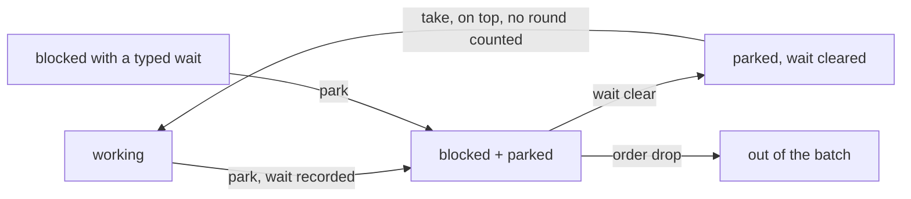

## Summary

A change request (CR) that waits on something outside the batch (the user's trial or answer, an approval, an outside pipeline or merge) used to keep a slot and its place in the stack for hours. This adds `chantier park`: the Foreman parks such a CR once the outside wait is recorded, with no question to the user. Its slot is free, it leaves the stack and the series order, the CRs that depend on it wait with it, and it stays red in the batch. Once its wait is cleared, the Foreman takes it back on top, before any queued CR. `close`, the batch's end and the release wait for it.

## Deliverables

The new lifecycle of a CR with an outside wait:

What a reader of the CLI gets:

- `park <cr> --epoch <n> [--wait <type>[=<ref>]]... [--note ...]`, with five ordered refusals (held, wrong status, release or fix CR, already parked, no outside wait).
- Shared predicates in `rails.py`: `is_held`, `is_parked`, `apart`, `out_of_order`, `apart_owner`; `series_predecessor` skips out-of-order CRs; `start_on` is now recorded at a series take too.
- `take` of a parked CR: refused while a wait is open (also by `access`), then places it on top with its dependents above it.
- `status`, the pane (`Parked` step, `parked: ...` phase, now/next) and the stack words name parked CRs and the CRs waiting with them.
- `close` and the batch's end refuse to finish over a parked, held or blocked CR and print each CR's way back (`way_back`, `left_open`).
- Cards for the Foreman, the Chief of Staff, the stack driver and the CR Driver (`rebase: <cr> dropped`), docs, and a `park_live` scenario case.

## Blast radius

Grade: 2. The shared predicates and the readers of `is_held` (stack, series, delivery, forge-stack, status, close, release) change; a plain revert restores the previous behaviour, but the CR that lands second with the hold change needs a mechanical rebase.

## Autonomous decisions

- `way_back` takes the batch too and lives in `commands/leftover.py` (an import cycle otherwise); `endpause` re-exports it.
- `close`'s refusal runs before `check_idle`, which would otherwise always raise first.
- `end_of_batch` is called whenever a CR ended in the command, and returns nothing unless the batch ended or only parked, held or blocked CRs remain.
- `open_counted` and `what` moved to `core/waits.py` to break an import cycle.
- The `close` and `left_open` lines print `<trash|P1..P4|3-ready>` as the destination.

## Known gaps

- No screenshot of the pane from a real session (the pane's step, phase, now and next words change).
- The new cases live in `test_park*.py` files, not in `test_stack_base.py` and `test_batch_end.py`; an accepted `close --yes` needs a priced Foreman transcript, so a unit test asserts the refusal is gone and the `park_live` scenario covers the acceptance.

Details

## Changes

- New `commands/park.py` and `declare/park.py`; `CrEntry.parked` in `core/records.py`.
- `rails.py`, `stacks.py`, new `stack_apart.py`: the shared predicates, base rule and start-on helpers; readers in `stack_words.py`, `commands/delivery.py`, `forge_stack*.py`, `facts.py`, `batch_status.py`.
- `commands/driver.py` (`take`, `handback`), `take_checks.py`, `orders_drop.py`, `orders_hold.py`, `orders_reorder.py`.
- `status/words.py`, `status/views.py`, new `status/now_next.py`.
- `commands/leftover.py`, `endpause.py`, `closing.py`, `orders.py`, `release.py`: way back, `close` and batch end.
- Cards `foreman.md`, `chief-of-staff.md`, `routing.md`, `driver.md`; `README.md`, use-case docs, batch lifecycle docs, `scenario/`.

## Human decisions

- The Foreman parks a CR that waits on something outside, without asking, and tells the user in one line.
- The rest of the stack goes on without the parked CR; it comes back on top, before queued CRs, once its wait is cleared, with no round counted.
- `close` is refused while a CR is blocked: the user resumes it or sends it out; the release waits too.
- A series successor already started on a parked CR waits with it as a dependent: its Driver goes on, it is not merged before the parked CR is back.
- Dropping an apart CR that has dependents: in a series or parallel batch their Drivers rebase to remove its commits; in a stack the stack driver removes it.
- A CR taken out never goes to the inbox (P1-P4, ready or trash).

## Impacts

The pane shows `Parked` for a parked CR; a CR waiting outside the batch no longer holds a slot. No other visual change.

## Test plan

- [x] New or changed tests (they fail on the previous code): `test_park*.py`, `test_came_back.py`
- [x] Local gates at `6fb2b35`: `just check`, `just eval-dry-run`, `just scenario` (all units, `park_live` included)
- [x] Evidence: none beyond the tests and the scenario
- [x] Review: approved at `18f2ac2` (round 2), then rebased onto `3b3eba0` as `6fb2b35`; the conflicts in routing.md and the svg were resolved after the review
- [x] Verified at `6fb2b35`
- [x] CI green at `6fb2b35`

## Internal references

CR-430 park-live-cr (batch-30). Shares a section with CR-431 hold-live-cr.

