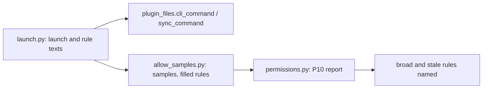

## Summary

The allow rules that preflight recommends for chantier's own command carried a `*` where a path belongs (`uvx --from * chantier *`), which lets `uvx` run any package from any source whose command line says `chantier`. Preflight now writes the real path of the plugin (or of the checkout, in chantier's own repository) into the rules, names every broad chantier rule it finds in the user's settings, and names the real-path rule that replaces each one. Nothing removes a rule for the user.

## Deliverables

Rules before and after (plugin mode; the dev mode gets the same treatment with its two rules):

| Rule | Before | After |
| --- | --- | --- |
| plugin | `uvx --from * chantier *` | `uvx --from "<plugin root>" chantier *` |
| dev | `uv run --no-sync --project * chantier *` | `uv run --no-sync --project "<checkout>" chantier *` |
| sync | `uv sync --locked --project *` | `uv sync --locked --project "<checkout>"` |

Proof that Claude Code matches the quoted real-path form and nothing else (Claude Code 2.1.326, Windows 11, `dontAsk`, Bash and PowerShell tools, user settings not loaded): the plugin, dev and sync rules let their own command through; `uvx --from "/elsewhere" chantier status` and `uv run ... python -c` are refused; an unquoted rule does not match the quoted command.

Choices: the rule text and the text the agents type come from one function, so they cannot drift; a broad rule is found by matching six probe commands, not by its text; a replacing rule is named beside each broad rule so it can be added before the broad one is removed.

## Blast radius

Grade: 1. A preflight report and cards change; no rule is written or removed. `git revert` restores the previous behaviour.

## Autonomous decisions

- The trial of rule matching ran before the code, with rule texts built by hand from the same `.as_posix()` form the code now uses; the trial's stand-in "checkout" is a scratch uv project, so the trial did not sync the live checkout.
- The launch and rule functions live in a new `launch.py` and the samples in `commands/allow_samples.py`, because the repository's file-size gate (400 lines) refused them in `plugin_files.py` and `permissions.py`.

## Known gaps

- Claude Code's matching is proved for the main session in `dontAsk` only; auto mode and subagents stay unproved, as the host card says.
- The trial ran the dev and sync rules against a scratch project standing in for the checkout, not the real checkout; the rule text and matching are the same, the folder differs.
- The tests exercise the Bash rule forms; the PowerShell forms are covered by the code on Windows and by the trial, not by a dedicated test case.
- `gate` and `lease hold` still run any command they are given, until a follow-up change.

Details

## Changes

- `launch.py`: plugin-form and dev-form launch text, the sync text, and the filled rule texts; `plugin_files.cli_command` and `sync_command` compose them with unchanged output.
- `commands/allow_samples.py` and `commands/permissions.py`: samples with placeholders filled at run time, broad rules found by probe, replacing rules named (marked `present`), stale rules named per mode, the preflight line kept within its limit.
- `skills/chantier/references/hosts/claude-code.md`: rows, block, notes on broad rules and on a moved plugin path, and the trial's mark.
- `skills/chantier/references/chief-of-staff.md`: the question lists the real-path rules; Broad rules and Stale rules bullets.
- The four skill files and `concepts.md` that define `$CHANTIER`: the path is absolute, forward-slashed, quoted, and carried verbatim.
- Tests (`test_allow_rules.py`, the host card test) and the scenario's new check.

## Human decisions

- The rules carry the plugin's real path in place of the `*`; the two development-mode rules carry the checkout's real path.
- Each broad chantier rule found in the user's settings is named as letting any command through, with the real-path rule that replaces it; the user removes it by hand and nothing removes it for them.
- The Chief of Staff offers to add the replacing rules at once, on the user's yes, so a night batch meets no prompt in between.
- When the plugin's path moves on an update, one question per update is accepted, and the stale rule is named for removal.
- A development-mode rule is stale only when its folder is gone; in plugin mode any other plugin path is stale, and in development mode plugin-form rules are left alone.
- Rule matching is tried in a real Claude Code session before the rules ship.

## Impacts

No visual change. Users see real-path rules in preflight's question and a warning naming their broad rules.

## Test plan

- [ ] New or changed tests (they fail on the previous code)
- [ ] Local gates at `<sha7>`: `just check`, `just eval-dry-run`
- [ ] Evidence: the trial of rule matching, results in Deliverables
- [ ] Review: approved at `<sha7>`
- [ ] Verified at `<sha7>`
- [ ] CI green at `<sha7>`

## Internal references

CR-432 chantier's allow rules name real paths, not a wildcard (batch-30). Trial: `evidence/trial.md`.

