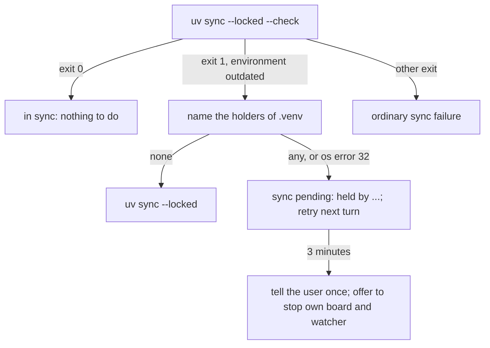

## Summary

In chantier's own checkout, the session's `uv sync` of the shared `.venv` could stop a running gate or watcher of another project, because it only looked at its own `status`. This change makes the sync check first, writing nothing, name the processes that hold the environment, wait for them, and never stop or kill one; the session's own board and watcher are stopped only on the user's yes.

## Deliverables

The sync flow in the dev mode (the four skills hold a short rule; the detail is a deferred section of `session-start.md`, "6. Sync the checkout"):

Choices made:

- Never stop or kill a process for a sync, whoever holds the environment (gate, watcher, board or hub, any project or surface). One exception, on the user's yes: the session's own board and watcher, with the cost stated (board and surface writer off for all projects, hub too unless another session's watcher takes it).
- The check is a new permission rule in the dev mode only (`uv sync --locked --check --project "<plugin root>"`), byte-identical in the four skills and in the rule the preflight prints.
- Startup size: the rule in the skill files stays short, so the startup budget (12544 bytes) is unchanged (worst startup 11748, worst reload 12543).

## Blast radius

Grade: 2. Wording of the shared skill and cards, one permission rule, and the preflight's rule list change; no data format. A `git revert` restores the previous behaviour.

## Autonomous decisions

- The detail of the wait (steps 4 to 6, "own", the yes/no handling) lives in `session-start.md` section 6 rather than in the four skill files, because each skill file is counted in the startup budget.

## Known gaps

- Every release bump of the version in `uv.lock` meets this path, so the first release after the merge is its first live proof.
- The session's behaviour (checking, naming, waiting, the 3-minute message, the later offer) and the stop, sync and restart of its own board and watcher are card behaviour with no automated proof; only the shipped text and the permission rule are tested.
- The holder listing has no allow rule and may prompt outside auto or bypass mode, rarely (after a `uv.lock` change).
- On macOS and Linux a gate started between the listing and the sync is not caught (no os error 32 there).
- The macOS, Linux and Copilot listings are untested; the Windows listing was exercised once by hand.
- Whether the host's stop of a background shell ends its whole process tree is unproved; a holder may stay listed after the stop and is then waited on, never killed.
- The startup-core.md exception sentence reads as Windows-only (the os error 32 case); the POSIX case is the gap above.
- On Windows, `test_triage_moves.py::test_w2_a_shell_inside_the_folder_refuses_then_lets_go` is a known flake; a rerun of the Windows check clears it.

Details

## Changes

- The four skill files: the `$CHANTIER` paragraph checks first and points to `session-start.md`, "6. Sync the checkout", for the steps.
- `session-start.md`: new section 6 with the six steps (check, name holders, sync, wait, 3 minutes, own board and watcher on the yes).
- `startup-core.md`: a named exception to "report the exact error and stop" for a sync held by chantier's own processes.
- Host references: the listing row "Name the holders of the checkout's environment" (Windows `Get-CimInstance`, POSIX `ps`/`grep -F`), the check rule row.
- `chief-of-staff.md`, `status-layout.md`, `concepts.md`, `AGENTS.md`, `CONTRIBUTING.md`: the sync is no longer "once"; the "stop the board, sync, start it again" with no question is gone; a pending sync is a **For you** item after 3 minutes.
- CLI: `launch.sync_check_line`, `plugin_files.sync_check_command`, the dev-mode permission sample and the preflight probe name the check rule.
- Tests: shipped-text checks for the paragraph, section 6, the exception, host rows and status layout; byte identity of the check line across skills, command and rule; preflight cases.

## Human decisions

- A sync blocked by chantier's own processes (gate, watcher, board or hub, any project or surface) kills nothing: the session names the holders, goes on unsynced, and tries again at its next turn.
- After 3 minutes the user is told, naming the holders.
- Only the session's own board and watcher may be stopped to sync, once, on the user's yes, with the cost stated.
- The session checks first, with its own permission rule named by the preflight, before it lists holders or syncs.
- In a batch the wait is one item of the report that needs the user, until the user answers.

## Impacts

No visual change. Developers of chantier see a `sync pending` line instead of a killed process, and one more permission rule in the dev mode.

## Test plan

- [x] New or changed tests (they fail on the previous code)
- [x] Local gates at 20b7e69: `just check` pass (1650 passed), `just eval-dry-run` pass (19 of 19)
- [x] Evidence at e21be68, carried to 20b7e69: the check's trial by hand on a throwaway project (uv 0.13.6, Windows): in sync exit 0; version bump exit 1 "The environment is outdated"; stale `uv.lock` exit 1, and the real `uv sync --locked` fails with its lock error
- [x] Review: approved at e21be68; the rebase onto 0e36d1f8 (one resolved conflict) re-inspected and approved at 20b7e69
- [x] Verified at 20b7e69 (the rebase move re-judged, the rest carried from e21be68)
- [x] CI green at 20b7e69 (macOS, Linux, Windows checks, eval dry run, scenario)

## Internal references

CR-437 sync-wait (split from CR-436 sync-blocked-by-others), batch-30.

