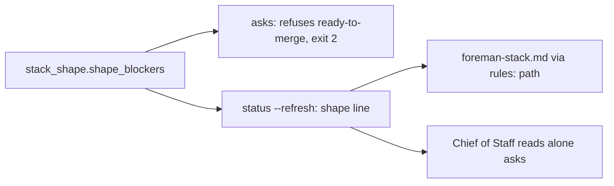

## Summary

In a stack batch (one native stack of PRs merged in one go), the Foreman's context is compacted from time to time and the stack procedure, buried deep in `foreman.md`, was forgotten: a later wave of CRs shipped as separate PRs on main, each with its own `ready-to-merge` ask, and every merge left the other open PRs behind main. This change makes a stack batch keep its shape through a light mechanism the CLI enforces: a shape line at each heartbeat, and a refusal of a per-CR `ready-to-merge` ask that would leave another PR of the stack behind main.

## Deliverables

The CLI's one criterion, read by three readers:



The heartbeat line, printed right after the batch line of `status --refresh` in a stack batch, with nothing recorded:

```text
shape stack: next parallel until 2 ready with a PR; stack driver: none; native stack: absent; alone asks: allowed; rules: <skill>/references/foreman-stack.md (reread after a compaction)
```

Choices: a CR outside the stack's chain (a fix or held CR) still asks alone; a CR truly alone still asks alone; `--outside-stack "O-<k>: <why>"` lets one ask through only on an open order of the Chief of Staff on that CR that carries the user's word; the stack rules now live in one card, `foreman-stack.md`, that the shape line points to.

## Blast radius

Grade: **2**. The guard changes `asks` for stack batches and cards move text between files; a revert restores the previous behaviour, with a check that the cards still link each other.

## Autonomous decisions

- The criterion and the shape line live in a new module `stack_shape.py` (not in `stacks.py`) to keep files within the line limit; `stack_due` keeps its behaviour through a shared `forming` helper.
- The `--outside-stack` happy path is covered by the unit tests only, not by the scenario, so that a pending order does not shift later scenario checks.

## Known gaps

- The scenario does not exercise the `--outside-stack` happy path (recorded text, then `order done`); the unit tests do.
- The scenario's `early_conflict` stack check does not assert that the stack is due; the unit tests cover the criterion.
- The shape line makes the card reachable after a compaction but cannot force the Foreman to read it; the CLI guard is the hard stop.

<details>
<summary>Details</summary>

## Changes

- `stack_shape.py` (new): `shape_blockers`, `next_step`, `shape_line`; `stacks.py`: `forming`.
- `rails_release.py` and `commands/batch_status.py`: the refusal and the `--outside-stack` flag of `asks`; the shape line in `status --refresh`; `declare/batch_status.py`: flag and help.
- Cards: new `foreman-stack.md` (the stack rules moved out of `foreman.md`, which keeps pointers), manifest action `batch:stack`, a reload sentence in `session-start.md`, and the Chief of Staff's check of each ask against the shape in `chief-of-staff.md`.
- Scenario: the scripted Foreman follows the guard; new checks in the stack step; README coverage bullet.
- Tests: `test_stack_shape.py`; card-list and joined-card reads in existing tests.

## Human decisions

- The guard refuses unless forced, with an explicit flag, rather than only warning.
- The stack rules go in a separate card rather than staying in `foreman.md`.
- A stack ask is checked by the Chief of Staff and sent back to the Foreman with a one-line note to the user.
- The change lands in the current batch, on top of the CRs that edit the same cards.

## Impacts

No visual change. Foremen of stack batches see one new heartbeat line; a refused ask names the next step.

## Test plan

- [x] New or changed tests (they fail on the previous code)
- [x] Local gates at `62e119c`: `just check`, `just eval-dry-run`, `just scenario` pass (stack unit alone 501.5 s of its 750 s budget)
- [x] Evidence: none planned beyond the tests and the scenario
- [x] Review: approved at `c5af034`, carried over the rebase onto `62e119c` (patch unchanged)
- [x] Verified at `62e119c`
- [x] CI green at `62e119c`: `gh pr checks 412` all 5 pass

## Internal references

CR-438 stack-shape-guard.

</details>
