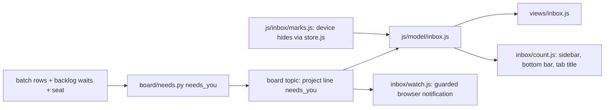

## Summary

The web board has no single place that says what is waiting for the user: a question from an agent, an approval asked on a pull request, a PR ready to merge, a blocked CR. This adds an **Inbox** page, second in the navigation right after Home, that lists them as one card each with Open, Snooze (1 hour), Later (next 08:00) and Discard. It is not the planning inbox (`1-inbox`). The page notifies by a count beside its navigation entry, the count in the browser tab's title, a "new" mark and, on the user's yes, a browser notification while a board page is open. It works on a project and on "All projects".

## Deliverables

- The server builds the entries once: a pure `needs_you(state)` in `board/needs.py`, read-only, published as one new key on each project line of the `board` topic (no new op, topic or protocol number).

- Four kinds: question, approval asked, ready to merge, blocked. An entry exists only while its fact lasts; a new occurrence is a new entry.
- Hides (snooze, later, discard) live in the browser only, through the store; the board edits no batch and messages no agent.
- Screenshots: **UNVERIFIED:** not attached yet (see Known gaps).

## Blast radius

Grade: 1. One added read-only key on the `board` topic and a new page; the other pages are unchanged. A `git revert` restores the previous board.

## Autonomous decisions

- The retaken documentation pictures of the other pages are committed: the navigation now shows the Inbox entry, so they changed.

## Known gaps

- **UNVERIFIED:** the written check of the hides, the notification and the screenshots are not yet captured.
- The guarded notification call is not exercised on Android Chrome.
- `just docs-screenshots` fails at its `panel` step on a selector that predates this change; the panel, editor, new, writer, picker and selection pictures are not retaken.

Details

## Changes

- `board/needs.py` (new), `board/state.py` (`needs_you` on each project line), `docs/server-api.md`.
- Web client: `views/inbox.js`, `inbox/{marks,count,watch,entry}.js`, `model/inbox.js`, `css/views/inbox.css`, `.tag.st.off` in `chip.css`, registry, bottom bar badge, header title, tab title, icon, words in English and French, `DESIGN.md` section.
- Tests: `tests/test_board_needs.py`, `test_the_inbox_is_the_second_view_and_reads_only`.
- Docs: `docs/web-board.md`, demo waits, `scripts/docs_screenshots.py`.

## Impacts

A new Inbox page and a count in the navigation and the tab title; no change elsewhere.

## Test plan

- [ ] New or changed tests (they fail on the previous code)
- [ ] Local gates at `<sha7>`: `just lint`, `just test` pass; `just check`, `just eval-dry-run` pending
- [ ] Evidence: after at `<sha7>`
- [ ] Review: approved at `<sha7>`
- [ ] Verified at `<sha7>`
- [ ] CI green at `<sha7>`

## Internal references

CR-444 board-user-inbox.

