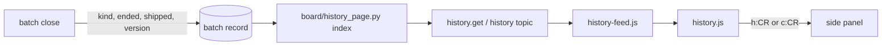

## Summary

The web board has no place to see what was done over time: a reader had to open each batch and each archived change request (CR) to learn what shipped last week. This adds a read-only History page: pick a day, a week or a month, move with previous, next and Today, and read, grouped by local day, every CR merged or dropped, every PR opened and every release of that period, under five plain totals. It reads the records and the archived CRs' steps only (never the forge or git) and writes nothing. From now on a batch's close adds to its record the times and the release mark the page needs.

## Deliverables

The page is fed by one new server topic and draws nothing the board did not already have (existing chips, one-line titles, tokens only, no chart).

| Choice | Result |
|---|---|
| Periods | day, week, month; `hp` and `hd` in the address, so Back walks them |
| Local day | computed on the server with `zoneinfo` and `tzdata`, from the browser's time zone |
| Rows | time, kind chip (merged, dropped, PR opened, release), number, one-line title, batch, rounds and cost |
| Older records | CRs with no recorded end are counted in a foot line, never guessed |

**UNVERIFIED:** the look of the page in a real browser (no screenshot yet).

## Blast radius

Grade: 2. The batch close now writes four more keys into each CR of the record, and the dependency set gains `tzdata`. Both are additive; a `git revert` restores the previous behaviour, and old records stay readable.

## Autonomous decisions

- The page's index is rebuilt when a record, an archive folder or `4-batch` changes, not when an archived `STATUS.json` is edited in place (archives do not change).
- A CR that ended with no recorded time counts in the foot line's "no recorded end"; an unreadable archived file counts there too.

## Known gaps

- A PR made ready (out of draft) is not shown: no record keeps that time once its batch is closed.
- Older CRs with no recorded end are in no period; the foot line counts them.
- A CR dropped back to the inbox or the backlog has no folder: its row opens nothing.
- No screenshot of the page from a real browser yet; the view has no Node-run test.

Details

## Changes

- Close: `commands/close_archive.py`, `history.py` and the shared `core/cr_times.py` write `kind`, `ended`, `shipped` and `version` for each CR of the record.
- Server: `board/history_page.py` (index and answer), `history.get` op and `history` topic, `HistoryArgs`, `protocol.json`, `docs/server-api.md`, `tzdata` in `pyproject.toml` and `uv.lock`.
- Client: `views/history.js`, `views/history-feed.js`, router keys `hp`/`hd`, registry entry after PRs, `history` icon, `en-history.js` and `fr-history.js`, `css/views/history.css`, the `h:<CR>` opener target, `DESIGN.md` and `docs/web-board.md`.

## Impacts

A new "History" entry in the sidebar and the phone's bottom bar; Home, Costs and the Batch navigator are unchanged.

## Test plan

- [ ] New or changed tests (`test_board_history.py`, `test_board_history_client.py`, one call added in `test_server_api_calls.py`)
- [ ] Local gates at `<sha7>`: `just check`, `just eval-dry-run`, `just scenario`
- [ ] Evidence: after at `<sha7>`
- [ ] Review: approved at `<sha7>`
- [ ] Verified at `<sha7>`
- [ ] CI green at `<sha7>`

## Internal references

CR-445 board-history.

