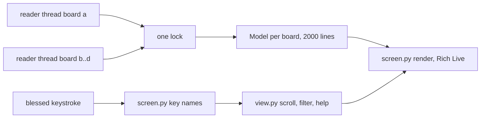

## Summary

`chantier live` showed one board per run and read no key. It now scrolls back over the Flow, filters the Flow and the Tasks by a text, shows a help of its keys and quits on `q` or Ctrl-C, always giving the terminal back. `--url` is repeatable: up to four boards in one screen, one key and one connection each. No server or protocol change; `live` stays read-only.

## Deliverables

- Keys: Up/Down, PgUp/PgDn, Home, End scroll the Flow (last 2000 lines per board; it pauses and counts new lines, title `Flow  paused, <n> new`); `/` filters (case-free, Flow and Tasks, counts unchanged, local); `?` shows the keys; Esc clears; `q`/Ctrl-C quit with exit 0. Keys are read through the pinned `blessed==1.53.0` (lazy import). With no keyboard the screen runs as before with `Ctrl-C to quit`.
- Several boards: labels `a`..`d`, one header line per board, `<label>/<project>` names, a task's CR cell `<label> <CR>`, the Flow merged by time. A fifth `--url` or the same board twice is refused; a refused key on any board exits 4 with the server's sentence and `(board <base>)`, never the key.
- New `clients/tui/view.py` (keys and state, no terminal), tests with no terminal, docs in `docs/boards.md` and `docs/server-api.md`.



```text
before: chantier live --url <link>            one board, no key
after:  chantier live --url <a> --url <b> ... up to 4 boards, q / Ctrl-C, / filter, ? keys
```

- `just test` at this head, on a Windows machine: 85 s for the whole suite (the live tests alone about 7 s), beside the AGENTS.md budget of 18.5 s plus at most 30 s (measured on the user's Windows machine). The suite as a whole is above that budget on this machine; this change adds about 7 s of it.
- Systems tried in a real terminal: none yet.

## Blast radius

Grade: 1. A terminal client, no server, protocol or record change; one new dependency. A plain revert restores the previous behaviour.

## Autonomous decisions

- The usage refusals exit with the project's `EXIT_USAGE` constant (1 in `core/errors.py`), where the specification wrote "exit 2".
- `screen.run` carries one targeted `noqa` for its parameter count, as the specification gives it that many parameters.

## Known gaps

- Keys not tried in a real terminal on Linux, macOS and Windows; Windows key decoding (`blessed`) is unproved until then.
- **UNVERIFIED:** a real SIGTERM on POSIX is not delivered in any test (only the handler's restore is); the several-board `--once` timeout sentence has no test.
- The usage refusals exit 1, not the 2 the specification wrote (see Autonomous decisions).

<details>
<summary>Details</summary>

## Changes

- `declare/live.py`, `commands/live.py`: repeatable `--url`, boards, `--only` across boards, `once`/`watch`, SIGTERM, suffix on refusals.
- `clients/tui/view.py` (new), `screen.py`, `model.py`: view under keys, merged Flow, filter, `FLOW = 2000`.
- `pyproject.toml`, `uv.lock`: `blessed==1.53.0`.

## Human decisions

- Keys are read through one pinned dependency, `blessed`; the Rich screen stays (no application framework).
- Only the Flow scrolls, over the last 2000 lines of each board, nothing fetched; it pauses while scrolled back.
- One case-free text filters the Flow and the Tasks, locally; the counts and `--only` are unchanged.
- At most four boards, labelled `a`..`d` in `--url` order; the same board twice is refused.
- A refused key on any board ends the run; a lost board is retried.
- SIGTERM on POSIX leaves like Ctrl-C; nothing added on Windows.

## Impacts

`chantier live` gains keys and several boards; one-board output is as before plus the keys footer.

## Test plan

- [x] New or changed tests (they fail on the previous code)
- [x] Local gates at `acb1cd3`: `just check` pass (1693 passed), `just eval-dry-run` pass (18 of 18), `just scenario` pass
- [x] Evidence: after at `acb1cd3` (tests over two real servers; no real-terminal capture, see Known gaps)
- [x] Review: approved at `acb1cd3`
- [x] Verified at `acb1cd3`
- [x] CI green at `acb1cd3`

## Internal references

CR-446 live-several-boards-and-keys.

</details>
