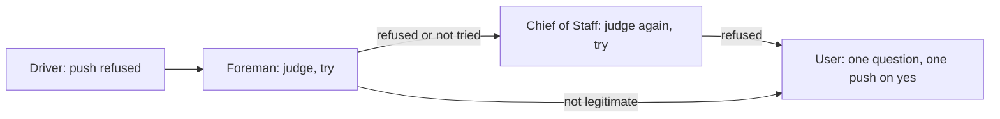

## Summary

When the host refuses a Driver's legitimate force push of its own `chantier/` branch (on Claude Code, the auto-mode classifier), the user used to be asked at once. The push now climbs a ladder and reaches the user last: the Foreman (the session that steers a batch's Drivers) judges and tries it, then the Chief of Staff (the session that talks to the user) judges it again and tries it, and only if the host refuses both is the user asked one question and the push made once on their yes.

## Deliverables

- One place holds the check and the judgement: `foreman.md`, section "A Driver's refused force push"; `chief-of-staff.md`, `driver.md` and `routing.md` link to it.
- A new allow rule for the steering session's `git -C <checkout> push --force-with-lease=chantier/* origin *chantier/*` route (sample, P10 count, test).
- The eval audit's J22 exemption now covers the route form in both modes, only after a `push judged legitimate` or `push on the user's go` note naming the branch; new dry-run case `foreman-route-push`.

## Blast radius

Grade: **1**. Cards, one allow-rule sample, the eval kit and docs; a plain `git revert` restores the previous behaviour.

## Autonomous decisions

- No investigator: the specification names every file and edit.

## Known gaps

- Whether the Foreman's push resolves through the allow rule before the classifier is documented, not yet seen; the first Foreman batch that meets a refusal records it in `hosts/claude-code.md`.
- Whether the user's yes lets the classifier pass the Chief of Staff's push, and Copilot's behaviour on a Foreman push, are unproved.

Details

## Changes

- `foreman.md`: new section holding the check, the judgement, the route-rule read, the `push` line to the Chief of Staff and the answer's way back.
- `chief-of-staff.md`, `driver.md`, `routing.md`, `status-layout.md`, `concepts.md`, `startup-manifest.json`: ladder wording and links.
- `hosts/claude-code.md`, `hosts/copilot.md`: the route rule rows, the ladder in Auto mode, the Copilot sentence.
- `commands/allow_samples.py` and tests; `evals/kit/audit.py`, `dry_run.py`, `evals/SCORECARD.md`.
- Docs: `docs/tutorial-claude-code.md` and `docs/hosts.md` (one clause each).

## Human decisions

- The ladder order is the Foreman, then the Chief of Staff without asking, then the user's yes and one push.
- Whoever pushes judges first; the Chief of Staff judges again on the Foreman's line. A push judged not legitimate is never pushed and goes to the user, naming both judgements; a failed hard check (not this batch's branch, no long gate) is refused with no user question.
- One new allow rule covers the `git -C` route form, since with a planning surface the steering push is always `git -C <clone>`.
- The Foreman tries only when the route rule is present, and records `push not tried: route rule missing` otherwise; on Copilot it skips that read and tries.

## Impacts

No visual change. A user sees fewer questions about refused force pushes.

## Test plan

- [x] New or changed tests: `test_the_cards_name_the_push_ladder`, the allow-rule tests
- [x] Local gates at `6ac8498`: `just check` (1630 passed), `just eval-dry-run` (19 of 19 cases), `just scenario` (pass)
- [x] Evidence: none beyond the gates (no visual change)
- [x] Review: approved at `6ac8498`
- [x] Verified at `6ac8498`
- [x] CI green at `6ac8498`

## Internal references

CR-450 push-refusal-ladder (batch-30).

