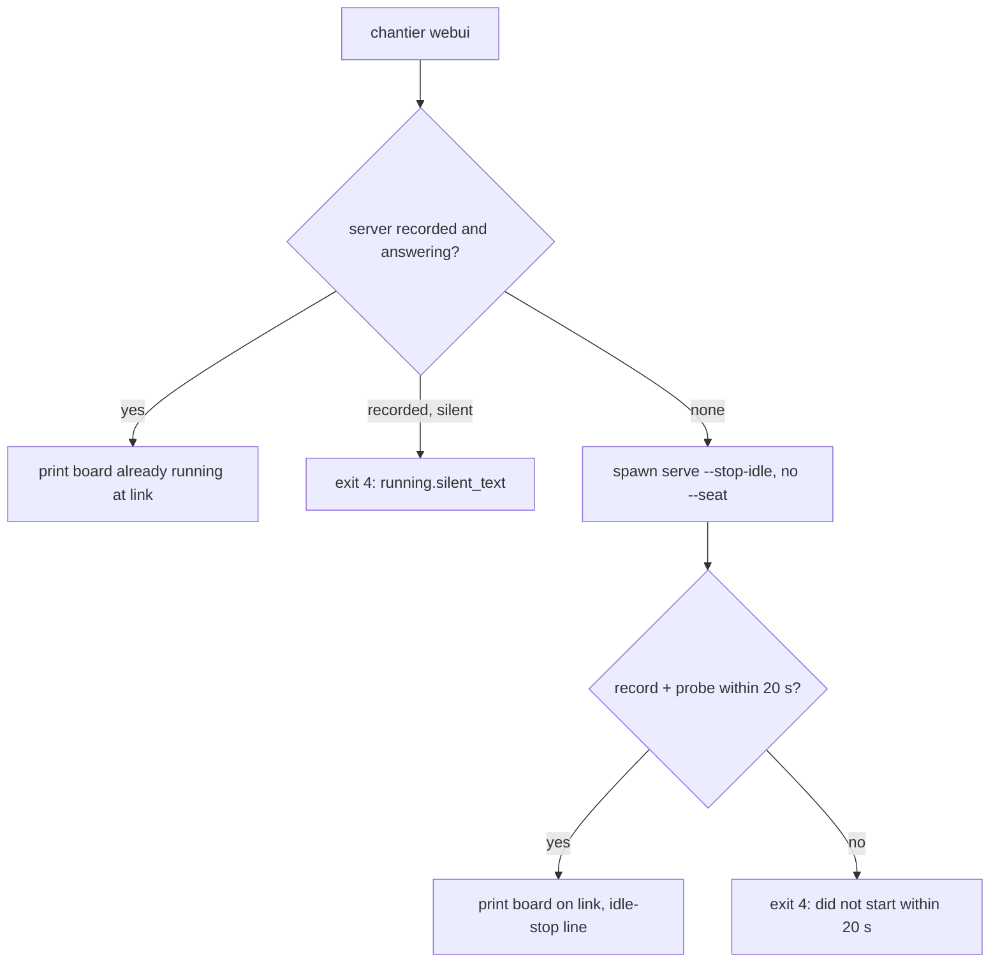

## Summary

The command that starts chantier's surface server was called `chantier board`, which hid what it does (it serves the planning folder to every client, the web board among them) and left no command to simply get the web board's link. This PR renames it `chantier serve`, adds `chantier webui` (prints the web board's link with its key, and starts the server when none runs), lets two surfaces' servers share one machine without clashing, and gives each server its own browser cookie.

## Deliverables

- `chantier serve` replaces `chantier board`, with the same options. `chantier board` is now argparse's "invalid choice" (no alias). The watcher's autostart runs `serve --seat <session> --stop-idle`. The printed prefixes that name the web board (`board on <link> over <folder>`, `board already running at <link>`, `board not started: ...`) stay, as do the `board:` key of `chantier.yaml` and the page title.
- `chantier webui` prints the link of a running server, or starts `serve --stop-idle` (detached, no seat) and prints the link once it answers (waits up to 20 s, else exits 4). Typing it is the yes; the server it starts stops by itself 30 minutes after its last client.

- Two surfaces on one machine: a server that finds the default port held by another chantier board (another key or another folder) takes a free port and prints `board: port 8765 is held by another chantier board (...): this one takes port <n>`. A port named by `--port` or `board.port`, or held by a program that is not a chantier board, still refuses as before.
- Cookies: the browser cookie is now `chantier_board_<12 hex of the SHA-256 of the served folder's POSIX path>` (`key.cookie_name(served)`), so several boards work side by side in one browser. The old `chantier_board` cookie is ignored (open the printed link once more).

| Before | After |
| --- | --- |
| `chantier board` | `chantier serve` |
| no command for the link | `chantier webui` |
| default port held by another board: refused | takes a free port, prints it |
| one cookie `chantier_board` | `chantier_board_<id>` per served folder |

## Blast radius

Grade: 2. The command's name changes everywhere it is written (CLI, cards, docs, scenario, tests) and the cookie name changes, so an already open browser session needs the link opened once more. Roll back with a revert; no data or format is touched.

## Autonomous decisions

- The socket-binding code moved into a new module `board/binding.py` because `board/command.py` passed 400 lines.
- `find_pid` still matches an older build's `board` command line besides `serve`, so a server of an earlier version is still found.
- The scenario's second-surface step skips with a note when another program holds the default port 8765.

## Known gaps

- The scenario's new `serve_and_webui` step has been compiled but not run locally; its first real run is the pipeline's `surface-board` unit.

Details

## Changes

- `declare/board.py` becomes `declare/serve.py`; new `declare/webui.py` and `commands/webui.py` (spawn through the watcher's `hub/feed` means); `hub/feed.py` `serve_argv`; `board/binding.py`; `board/key.py` `cookie_name`, threaded through `board/guard.py`, `board/api/{auth,http,ws}.py`, `board/routes.py`, `board/context.py`.
- Command text that names what to run: `board/command.py`, `board/running.py`, `writer/lines.py`, `hub/watch_lines.py`, `commands/live.py`, `declare/watch.py`; docstrings elsewhere.
- `AGENTS.md`: `chantier serve`, `webui` as a third starter of the server and the forge hub, the two-surfaces rule, `webui` among the named tools.
- Cards and host references, docs, `scripts/docs_screenshots.py`, `scenario/` and `evals/README.md`: the command's name; the dev-mode sync step names a `webui`-started server as not the session's own and gives its stop command.
- Tests: every CLI call of `board` becomes `serve`; new `tests/test_serve_webui.py` (renamed lines, `serve_argv`, `find_pid`, ports, cookies, `webui`) and `tests/test_command_names.py` (no stale command name left in the cards, docs and web strings).

## Human decisions

- The names: `serve` starts the server, `live` stays the terminal client, `webui` prints the web board's link.
- `webui` starts the server when none runs, with no further question; typing it is the yes.
- A server `webui` starts has no seat and stops 30 minutes after its last client.
- Two surfaces' servers on one machine never clash: a held default port gives a free port.
- Each server's cookie is its own, so several boards work side by side in one browser.

## Impacts

A user types `chantier serve` where they typed `chantier board`, and `chantier webui` for the link. No visual change in the web board.

## Test plan

- [x] New or changed tests (they fail on the previous code)
- [x] Local gates at `cf29f3c`: `just check`, `just eval-dry-run`
- [ ] Evidence: none (CLI rename); see Verified
- [x] Review: approved at `cf29f3c`
- [ ] Verified at `<sha7>`
- [ ] CI green at `<sha7>`

## Internal references

- CR-456 rename-the-surface-server-command-to-ser (part A of the remote CLI stack, batch-30)

