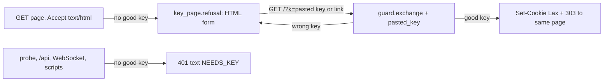

## Summary

A browser that holds no cookie for a board (an iPhone home-screen web app, a private tab, an in-app browser, a cleared jar) used to meet a dead end: a one-line "ask the Chief of Staff" text. The board now shows a page with a field where the user pastes the key or the whole link, and goes on. The cookie moves to `SameSite=Lax` so a link opened from another site or app, followed by the board's key exchange redirect, keeps its cookie. Several boards, of one surface or of several, work side by side in one browser, each with its own cookie.

## Deliverables

The server's refusal page (`board/key_page.py`), served for a page load with no good key; every other request keeps the `401` text:

- The page has no script (CSP `script-src 'none'`, `style-src` by hash, `form-action 'self'`); its form action is relative, so a proxy's path prefix is kept; English or French from `Accept-Language`; every repeated value is escaped.
- When the page is already open and the server refuses its key, the header notice holds a field and an "Open" button; the text is never stored (no store field, no web storage, no script cookie).
- Choice: `SameSite=Lax` for both cookies. Writes stay refused cross-site by `POST`-only writes, `guard.refusal` and `auth.own_origin`.

## Blast radius

Grade: 2. The cookie attribute and the refusal path of the board server change; revert restores the previous behaviour, and no stored data is involved.

## Autonomous decisions

- The new scenario step is named `16d1b` (`16d2` already names another step).
- The two new notice words live in `i18n/en-board.js` and `fr-board.js` (merged into `en` and `fr`), because `en.js` and `fr.js` are at the 300-line limit.

## Known gaps

- Not checked on iOS Safari (a link opened from another app, a home-screen launch with the paste field): browsers' `SameSite` handling is documented, not tested.
- No screenshot of the page from a real browser.

Details

## Changes

- `board/key_page.py` (new): the refusal page; `board/routes.py`, `board/guard.py`: page loads get it, `guard.pasted_key` reads a key, a link or a query; `board/key.py`: `SameSite=Lax`.
- Web client: `js/ui/key-notice.js` (new), `ui/header.js`, `main.js`, `css/shell.css`, i18n words, `DESIGN.md` section "The key notice".
- Docs: `docs/server-api.md`, `docs/web-board.md`, `chief-of-staff.md`.
- Tests: `tests/test_board_key_page.py` (new), `tests/test_board_exposure.py`; scenario step `16d1b` and the flipped check at 16d.

## Impacts

A board with no cookie shows a paste field instead of a dead end; no other visible change.

## Test plan

- [ ] New or changed tests (they fail on the previous code)
- [ ] Local gates at `<sha7>`: `just check`, `just eval-dry-run`
- [ ] Evidence: none (no visual capture)
- [ ] Review: approved at `<sha7>`
- [ ] Verified at `<sha7>`
- [ ] CI green at `<sha7>`

## Internal references

CR-460 board-key-survives-several-boards-and-a, batch-30, built on CR-456 and CR-457.

