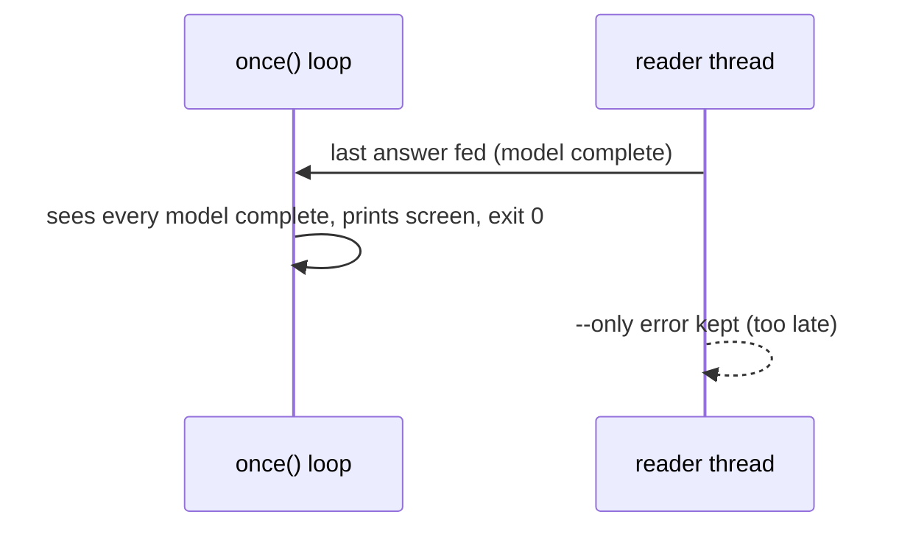

## Summary

Two tests failed at random in `just check`. `chantier live --once --only <id>` could print a screen and exit 0 instead of refusing an `--only` that no board serves, and a test of the folder lock could pass its move when it should be refused. Both are made deterministic.

## Deliverables

Sequence of the `live --once` race, before the fix:



After the fix `once()` judges `--only` itself on the finished models before it prints, so the order of the threads no longer matters:

```python
with lock:
    _check_only(models)   # raises the --only usage error (exit 2)
    screen.plain(models, ...)
```

The folder-lock test now waits for its child process to report `up` before it tries the move.

Evidence (command and output):

```text
uv run --locked --group dev pytest -q -p no:xdist test_live_link.py test_triage_moves.py -k "(test_the_refusals_of_several_boards and only) or w2"   (50 serial runs)
50 x "3 passed, 23 deselected"

folder-lock test, 8 parallel loops, before the fix: 1 failed (assert (0 == 4)); after the fix, 8 loops x 7: 56 passed
```

The new live test forces the interleaving (every model complete before any reader error is kept) and fails on the previous code.

## Blast radius

Grade: **1**. One check added in `once()` and a test change; a plain `git revert` restores the previous behaviour.

## Autonomous decisions

- The folder-lock test's flakiness was a test race (the child takes its working directory after `Popen` returns), so the fix is in the test, with no change to the lock code.

## Known gaps

- Linux and macOS were not run locally; CI covers them.
- `just eval-dry-run`, owed for a change under the CLI's `src/`, is run before the first push.

<details>
<summary>Details</summary>

## Changes

- `commands/live.py`: `once()` calls `_check_only(models)` under the lock before printing.
- `tests/test_live_model.py`: a forced interleaving (every model complete before any reader error is kept) that fails on the previous code.
- `tests/test_triage_moves.py`: the child prints `up` and the test reads it before moving the folder.

## Impacts

No visual change. `live --once --only <unserved id>` always exits 2 with the `--only` sentence.

## Test plan

- [ ] New or changed tests (they fail on the previous code)
- [ ] Local gates at `<sha7>`: `just check`
- [ ] Evidence: 50 runs of both tests, no failure
- [ ] Review: approved at `<sha7>`
- [ ] Verified at `<sha7>`
- [ ] CI green at `<sha7>`

## Internal references

CR-461 two-flaky-tests-of-batch-30

</details>
