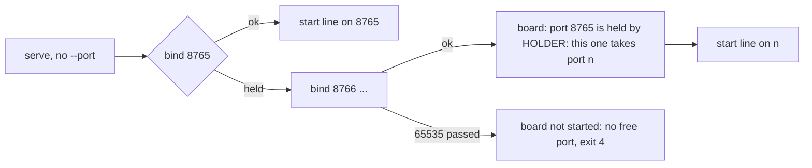

## Summary

The web board used to depend on port 8765 being free: when another program (or another chantier board) held it, the start took an operating-system-picked port only for another chantier board, and refused for any other holder. The scenario's `serve`/`webui` step bound 8765 explicitly, so the local long gate failed on a machine where a real board was already running. With no `--port` and no `board.port`, the board now tries 8765, then 8766, 8767, and so on, and keeps the first port it binds.

## Deliverables

The default start walks the ports one bind at a time:

- A port counts as held on "address in use" and, on Windows, on "access denied" (reserved or exclusively held ports). Any other bind error refuses as before.
- One line names the default port's holder (`another chantier board (<folder>)`, `another chantier board (another project's key)`, or `another program`) before the start line.
- An explicit `--port` or a configured `board.port` is used as is, and a held one still refuses; `--port 0` is still the system's pick.
- The scenario's `serve`/`webui` step starts its first server with no `--port`, checks that its start line comes (stderr into the transcript when it does not), and no longer skips the second-surface check.

## Blast radius

Grade: 1. It touches the board's start and its tests and texts; `git revert` restores the previous behaviour. A board of one surface started on a walked port whose record was lost is not found by a second start (accepted).

## Autonomous decisions

- The walk's holder probe asks only about the default port, as the previous takeover did; the ports skipped after it are not probed.

## Known gaps

- **UNVERIFIED:** the cause of the earlier long-gate run (the `webui` check) did not reproduce on an idle Windows machine with a real board on 8765: the step passed at the base. The most likely cause is a slow start of the restarted server on a loaded machine; this is unproven. The step now fails on its own label with the server's stderr when a start line does not come.
- The Windows "access denied" case is covered only by a prepared bind in the tests, not on a real reserved port. macOS is covered by `just check` only.

Details

## Changes

- `board/binding.py`: the walk, the held-port rules, the end of the walk and the holder naming; `board/command.py` passes the default case and the probe.
- `scenario/run_scenario.py`: the `serve`/`webui` step as above.
- `declare/serve.py`, `docs/web-board.md`, `evals/README.md`, `scenario/README.md`, `AGENTS.md`: the text that names the behaviour.
- `tests/test_serve_webui.py`: a walk test (another surface's board, another key, a plain program, two ports held in a row, a named port refused), and a parametrized test of the held errors and the end of the walk.

## Human decisions

- The default port is tried first, then each next port up, until one is free; the board, `webui` and the scenario never depend on 8765 being free.
- Windows' exclusive bind (`SO_EXCLUSIVEADDRUSE`) is left out of this change.
- A board of the same surface on a walked port whose record was lost is not found, and a second one may start: accepted.

## Impacts

The board's link is no longer always on 8765; the start line prints the port. No visual change.

## Test plan

- [ ] New or changed tests (they fail on the previous code)
- [x] Local gates at `b9ec1d6`: `just check` pass, `just eval-dry-run` pass, `just scenario` pass (long gate, with a board on 8765)
- [ ] Evidence: see Known gaps for the reproduction
- [ ] Review: approved at `<sha7>`
- [ ] Verified at `<sha7>`
- [ ] CI green at `<sha7>`

## Internal references

CR-472 dynamic-port, batch-31. Reproduction log: work/repro-surface-board.log.

