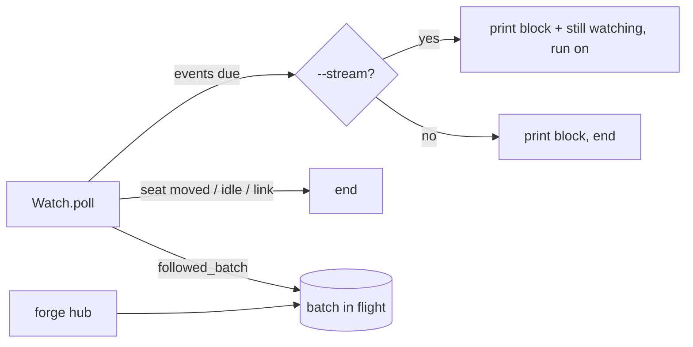

## Summary

While a batch runs, the Chief of Staff started the watcher again after every merge (about twenty times in one batch), and a watcher that ended after 2 h with no event took the board down during a long CI wait or the owner's merge pause. This makes one watcher stay up and tell each block of events, and removes the 2 h end while a batch is in flight.

## Deliverables

- `chantier watch --stream`: at the point where the watcher would end with its events, it prints the block, a closing line `watch: <name> told up to cursor <n>; still watching (...)`, and runs on. The next block comes no sooner than `events.wake_every` after the previous one. It ends only when the project's seat is another session's, after the idle limit, or on a link failure. Refused with `--once`.
- The printed watcher command ends with `--stream` on Claude Code, not on Copilot nor with no host known; every line that names the command carries the host's form.
- The 2 h idle end applies only while no batch runs and none is paused with a PR held neither merged nor cancelled; the 2 h are counted from the latest of the start, the last waking event and the last moment such a batch was in flight.
- The forge hub reads the PRs and waits of a batch that is paused with open PRs, in the same one query per project and cycle as for a running batch; none once every PR is merged or cancelled. A hub test asserts the one call.

Cost baseline: about twenty watcher restarts in one batch (batch-30), four board restarts by hand (Studio batch-09). The first batch after the merge records the watcher starts next to its merges.

## Blast radius

Grade: 2. The watcher, the hub's batch rule and the cards that name the watcher's command change; a revert restores the previous end rules.

## Autonomous decisions

- `hub/watch_reads.py` (new) takes the watcher's read helpers out of `hub/watch.py`, which the code-size test caps at 400 lines.
- The new stream tests sit in `tests/test_watch_stream.py` rather than `test_watch_events.py`, for the same cap.
- The `events.wake_every` comment in the default configuration follows the new wording.

## Known gaps

- The Claude Code `Monitor` start is unproved on a real session (status "unproved" in the host reference; the trial is a batch with two merges and one watcher).
- No streaming form on Copilot.

Details

## Changes

- CLI: `hub/watch.py`, `hub/watch_reads.py`, `hub/watch_lines.py`, `hub/times.py`, `hub/autostart.py`, `hub/batch_prs.py` (`followed_batch`), `hub/waits.py`, `hub/lines.py`, `declare/watch.py`, `declare/interests.py`.
- Tests, scenario step 16d, cards, `docs/web-board.md`, `AGENTS.md`.

## Impacts

The Chief of Staff on Claude Code gets one notification per block and no restart between merges; the board's `status` line shows the hub for a paused batch with open PRs.

## Test plan

- [ ] New or changed tests (they fail on the previous code)
- [ ] Local gates at `<sha7>`: `just check`, `just eval-dry-run`
- [ ] Evidence: before at `<sha7>`, after at `<sha7>`
- [ ] Review: approved at `<sha7>`
- [ ] Verified at `<sha7>`
- [ ] CI green at `<sha7>`

## Internal references

CR-476 watcher-limit

