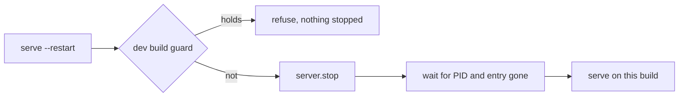

## Summary

After a merge that touches the board, the user had to hunt the running process to make the surface server run the new code, and on a surface shared by several projects another project's cached build came back every time the board was stopped. This adds a clean stop, one restart action, and a rule that a chantier dev session's own build serves the surface.

## Deliverables

- New private-key op `server.stop` (28th op): refused while a client's command runs, otherwise answers `{"stopping": true, "pid": <pid>}` and stops the board through its usual shutdown (writer's last cycle included).
- New `chantier serve --restart`: stops the running board cleanly, waits for it to end (at most 120 s), prints `board stopped: ...`, then serves on this build. Usage error with `--stop-idle`; refuses under the dev-build guard.
- `seat take` records the build (`build` in `seat.json`) in the dev mode. While a chantier dev session holds its seat (its watcher's lock is held), other projects' watchers start no board and wait to link; the start line says so.
- Cards (session start, steering, hosts) offer the restart on the user's yes; AGENTS.md states the stop and build rules.

## Blast radius

Grade: 2. Touches the board's API, `serve`, the watcher's start and the cards; revert is a plain `git revert`, the new op and flag are additive.

## Autonomous decisions

- Open questions of the specification: plain `serve`, `webui` and the dev session's own watcher stay unchanged; the inbox item on two surface servers is not folded in; "holds its seat" is read as written.
- The Chief of Staff start-reading size caps in `tests/test_start_reading.py` were raised by the cards' measured growth.

## Known gaps

- The whole surface-board scenario unit was not run in one go by the coder (its budget exceeds a foreground run); the long gate covers it.

Details

## Changes

- `board/api/ops.py`, `protocol.json`, `idle.py`: `server.stop`.
- `board/restart.py`, `board/command.py`, `board/options.py`, `declare/serve.py`: `--restart`.
- `core/records.py`, `commands/seat.py`, `hub/autostart.py`, `hub/watch.py`, `hub/watch_lines.py`: seat build and the guard.
- `board/address.py` (`call_op`), `hub/watch_reads.py` (`checked`, moved out of `watch.py`), `commands/orders_apply.py` (an unused import removed).
- Cards, `AGENTS.md`, `CONTRIBUTING.md`, `docs/server-api.md`, `scenario/README.md`, the scenario unit and tests.

## Impacts

No visual change.

## Test plan

- [x] New or changed tests (they fail on the previous code)
- [x] Local gates at `34a3034`: `just check`, `just eval-dry-run`; long gate `just scenario` at `29162b7`
- [x] Evidence: after at `29162b7` (long gate unit surface-board, restart case); no before: new feature
- [x] Review: approved at `29162b7`
- [x] Verified at `29162b7`
- [x] CI green at `29162b7`

## Internal references

CR-478 board-restart

