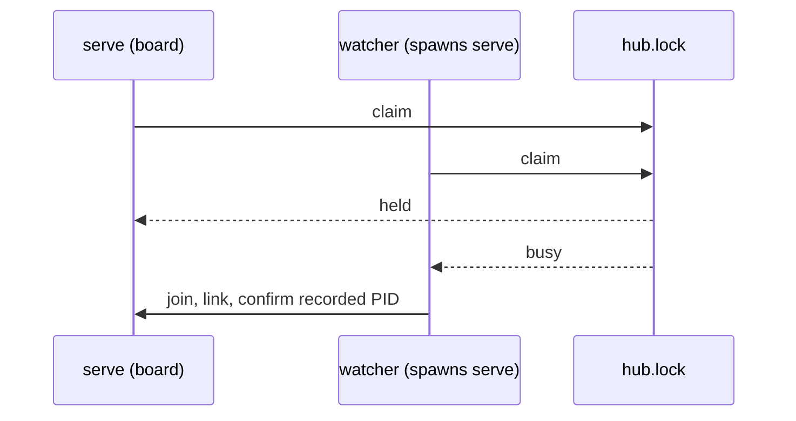

## Summary

The forge hub stayed idle for hours while a session's watcher and a board page were "subscribed": two `chantier serve` processes served one planning surface, and every loopback client reached the one that held no hub. This change makes one process serve a surface, makes the watcher check that it is linked to the process that holds the hub, and makes `status` tell these cases apart.

## Deliverables

- One serving process per surface and machine: the check for a running board and the claim of the surface are one step, under the OS lock the hub already holds (`hub.lock`, no new file). A second start joins the running board ("board already running", seat registered) or refuses with the silent-board text.
- "Port held" means held on any address, on every system (a connect check before the bind, and an exclusive socket on Windows). The default port still walks to the next free one; a configured port refuses.
- A server that finds `server.json` naming another live server stops by itself; it never touches that entry.
- The watcher counts a link only when the answering process is the recorded server, links again after a restart from its cursor, and otherwise ends with a line naming both PIDs and the remedy.
- `status` prints one line when the watcher runs but is not subscribed to the hub, instead of "watch runs" beside "forge hub: idle".

Live evidence of the fault, read on 2026-11-24 before the fix (the stray was stopped by hand afterwards, so the live state no longer shows it; the new tests are the proof at this head):

```text
TCP 0.0.0.0:8765    LISTENING    29916  serve --host 0.0.0.0 --seat local_ce68... (started 14:25:02 UTC)
TCP 127.0.0.1:8765  LISTENING    37316  serve --seat local_ce68... --stop-idle     (started 14:25:02 UTC)
TCP 127.0.0.1:8765  ESTABLISHED  37316  <- the watcher (PID 22552), a browser, the desktop app
server.json: server, hub and writer entries name PID 29916 (no keys quoted); 37316 holds neither lock.
```



## Blast radius

Grade: 2. Board start, port binding and the watcher's link change; revert restores the old behaviour, including its double-server fault.

## Autonomous decisions

- The surface claim reuses `hub.lock` rather than a new lock file, so no new file in the git folder.
- Only a server of this build stops itself when it is a stray; a stray of an older build does not know the check, and the watcher's end line names it.
- The scenario's unit budget went from 735 to 780 s for the new step.
- The Chief of Staff's start card gets no new sentence (its startup reading is at its byte ceiling); the sentence is in the longer card.

## Known gaps

- **UNVERIFIED:** the macOS behaviour of the bind test (proved only by the pipeline's macOS run of `just check`).
- `status` does not itself detect two live servers (it makes no probe); the watcher's end line and the stray's own stop line cover that.
- No screenshot: nothing visible changes.

<details>
<summary>Details</summary>

## Changes

- `board/binding.py`, `board/claim.py`, `board/command.py`, `board/start_lines.py`, `board/context.py`: held-anywhere check, atomic claim, stray stop.
- `clients/tui/link.py`, `hub/feed.py`, `hub/watch.py`, `hub/watch_confirm.py`, `hub/watch_seat.py`, `hub/watch_lines.py`: the watcher's confirmation, relink and end line.
- `hub/lines.py`, `hub/state.py`, `hub/loop.py`: the `status` line.
- `AGENTS.md`, `skills/chantier/references/chief-of-staff.md`: the sentences that say what is now true.
- `scenario/run_scenario.py`, `scenario/README.md`: step `one_board`.

## Impacts

No visual change. A second `serve` start on a surface now joins instead of serving twice.

## Test plan

- [ ] New or changed tests (`test_board_claim.py`, `test_watch_confirm.py`, a real-socket bind test in `test_serve_webui.py`)
- [ ] Local gates: <to fill>
- [ ] Review: <to fill>
- [ ] Verified: <to fill>
- [ ] CI green: <to fill>

## Internal references

CR-484 one-board-per-surface (folder 484-pr-conflict-rebase-order). Evidence from the specification, 2026-11-24: two serve processes (PID 29916 on 0.0.0.0:8765 recorded in server.json, holding both locks; PID 37316 on 127.0.0.1:8765, not recorded, holding neither, receiving the watcher, a browser and the desktop app); both started in the same second from the same seat; PID 37316 stopped by hand around 20:45 UTC.

</details>
