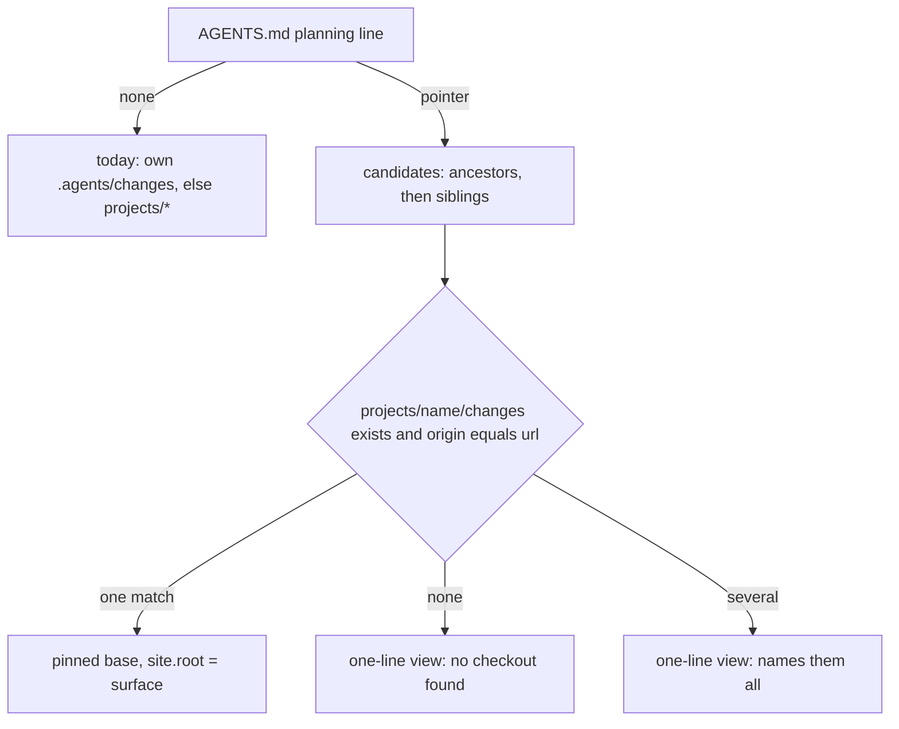

## Summary

In a Claude Code session whose folder is a project's checkout and whose planning surface is only added to the session, `/chantier-board` showed an empty pane: the board mod looked in the project's own `.agents/changes/` and never found the surface. The mod now reads the project's `AGENTS.md` `planning:` pointer and finds the surface's checkout above or beside the project's checkout, by matching its `origin` to the pointer's url. A leftover `.agents/changes/` in the project no longer hides the surface.

## Deliverables

The pane's search for a project that has a `planning:` pointer:

- With a pointer, the project's own `.agents/changes/` is never read, with or without a `STATUS.json`.
- No match and several matches draw one line with the Refresh button; the mod never picks one. A Refresh after the surface is cloned finds it.
- A pinned base names its project exactly, so the seat and batch records are not read and no "No seat names this session" line is drawn. The Services section reads the surface's own `chantier/server.json`.

## Blast radius

Grade: 1. One file of the board mod, its tests and one doc sentence; a plain `git revert` restores the previous pane.

## Autonomous decisions

- None.

## Known gaps

- **UNVERIFIED:** no screenshot of the pane from a real session (Playwright is not available here); owed from a real Claude Code session in the Studio layout, captioned with the head's SHA.
- A surface checkout placed neither above nor beside the project's checkout is not found (the engine lists no added working directories); the pane says so in one line.

Details

## Changes

- `hooks/register.tsx`: `findBases` reads `AGENTS.md` for the `planning:` line, searches the ancestors then the siblings of the project's checkout, matches `git remote get-url origin` after url normalisation; `choose` keeps a `pinned` base with no seat lookup; `Base` gains `pinned`, the `site` atom tag goes to `site-6`; header comment updated.
- `hooks/register.test.tsx`: the `world` fake answers `process.run` by argv and cwd; eight new tests (beside, own folder with a status, nested, no match then Refresh, several matches, no pointer, the surface's keys, a Windows drive path with CRLF).
- `docs/boards.md`: one sentence on the pointer.

## Human decisions

- Go ahead on the same night; the surface is found from the project's `planning:` pointer matched by `origin`, since the engine lists no added working directories.
- With a pointer, the project's own folder is never read; no match or several matches is said in one line, with no look-alike fallback.
- Proof: one screenshot from a real session in the Studio layout, until then a Known gap.

## Impacts

The pane shows the project's board in the Studio layout; no change when the session's folder is the surface.

## Test plan

- [x] New or changed tests (they fail on the previous code)
- [x] Local gates at `f7e9910`: `just mod` 106 pass; `just check` 2631 passed; long gate `just scenario` pass
- [ ] Evidence: none; no real-session screenshot could be captured (see Known gaps)
- [x] Review: approved at `f7e9910` (carried from `2dbfcc7`)
- [x] Verified at `f7e9910`
- [x] CI green at `f7e9910`: all five checks pass

## Internal references

- CR-486 board-mod-surface

