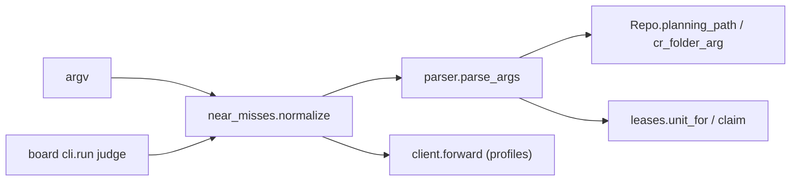

## Summary

Agents keep typing a few argument forms that the CLI rejects although each can mean only one thing: `--lease N` on read-style commands, a quoted `phase "gate preflight"`, a CR folder given with a repeated planning prefix or from a shell inside it, `--epoch N` before the command name. Each stumble costs a failed call, a `--help` and a retry. The CLI now accepts these forms with the canonical effect and lists them in each command's `--help`.

## Deliverables

One argv step runs before the parser, and a few commands gain options:

| Form typed | Now means |
| --- | --- |
| `phase CR-7 "gate preflight"` | `phase CR-7 gate preflight` |
| `--epoch 3 take CR-7` | `take CR-7 --epoch 3` (only for commands that declare `--epoch`) |
| `handoff`, `log`, `verdict`, `wait`, `rules`, `lease` with `--lease N` | valid renews, stale exits 3 `claim lost`, none changes nothing (`rules` ignores it) |
| `lease --lease N CR-7 renew`, `lease CR-7 --lease N` | `lease CR-7 renew --lease N` |
| a CR folder with the planning prefix repeated, `.` from inside it, or its short name | the CR folder (ambiguity exits 1 naming both) |
| `take CR-7` without `--epoch` | refusal now names `handoff CR-7` |
| `summary lint` gaps | print both limits (72, 300) and the whole `summary set` form |

`just test` time: the new tests (two files, in-process) take about 9 s alone; whole-suite runs on the same machine were 163 s before and 130 s after under varying load, so the added time is within noise and not measurable more finely than those 9 s.

## Blast radius

Grade: 2. `normalize` and `planning_path` sit in front of every command; a value that resolves today keeps its reading and any other argv is returned unchanged. Rollback is a revert.

## Autonomous decisions

- `take` accepts no `--lease`, and no command gains `--epoch` it did not declare (the specification's open questions, left as written; the owner has not confirmed these defaults).
- The gap placeholders read `<at most N characters>` so existing matches on the gap lines keep passing.
- The path readings live in a new `core/planning_readings.py` to keep `repo.py` under the file-size limit; `leases.unit_for` and `renew_read` were added in `core/leases.py`.

## Known gaps

- `file` is not covered by the path forms: its argument is a request text or `@path`, not a CR folder.
- `take --lease N` is still rejected by the parser.

Details

## Changes

- New `near_misses.py` (`normalize`, `EPOCH_COMMANDS`), called by `cli.main` and `board/cli_run.judge`.
- `--lease` on `handoff`, `log`, `verdict`, `wait`, `rules`, `lease`; unit choice stack, then QA order, then the CR's own.
- `Repo.planning_path` readings and `stages.cr_folder_arg`, wired in `summary`, `triage`, `abandon`, `open`, `wait`, backlog moves.
- `summaries/gaps.py` and `title.py`: complete `summary set` forms with limits.
- `--help` epilogs headed `also accepted:`.
- New `tests/test_near_misses.py` and `tests/test_near_misses_help.py`; `tests/test_validate.py` updated for the unreadable gap line.

## Impacts

No visual change. Agents' existing near-miss calls now work; canonical forms are unchanged.

## Test plan

- [x] New or changed tests (they fail on the previous code): `tests/test_near_misses.py`, `tests/test_near_misses_help.py`
- [x] Local gates at `b64d3c1`: `just check` pass, `just eval-dry-run` pass (19/19), long gate `scenario` pass
- [x] Evidence: before at `096f073`, after at `b64d3c1` (command outputs, no screenshots: nothing visual changes)
- [x] Review: approved at `b64d3c1` (carried from `b9e02b6`; the rebase left the patch unchanged)
- [x] Verified at `b64d3c1`
- [x] CI green at `b64d3c1` (5 of 5 checks)

## Internal references

CR-488 sc02-cli-near-misses.

