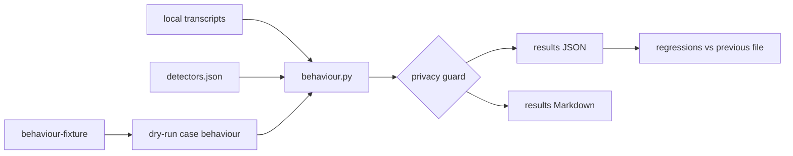

## Summary

The cards are about to shrink, and "no behaviour lost" has to be judged on what the roles really read and do, not on what the cards declare. Until now that was measured once, with throwaway scripts. This PR makes the measure a permanent tool of the eval kit: `just behaviour` reads the user's local Claude Code transcripts and writes, per role, what each role read (card bytes above all), how it stumbled (usage errors, refusals, denials, waits) and how often each checkable rule was broken (the detectors). Its first results, on the 0.15.1 cards, are committed as the baseline that later card changes are compared with.

## Deliverables

`just behaviour [--since <date>] [--prune]` runs `evals/kit/behaviour.py` (standard library only, `python -I`) and writes a JSON and a Markdown file in `evals/results/`, counts and message templates only:

- Per role: runs, tool calls, card bytes by card, CLI usage errors and refusals, `--help` and `help <topic>` reads, host denials, write-guard refusals, waits, tools not in the role's list, push refusals.
- Nine detectors (`merge-by-agent`, `merge-not-ff`, `plain-force-push`, `discard-work`, `git-stash`, `stop-by-name`, `add-all`, `cd-into-changes`, `no-verify`), each with a positive and a negative example; a detector more than 5 points worse than in the previous file, or a new S-list line, is listed as a regression.
- `--prune` prints deletion candidates and writes nothing.
- Baseline: `just behaviour --since 2026-11-17` at version 0.15.1, run on 2026-11-25 in 27.5 s over 4136 transcript files (2368 skipped), found 3652 runs of 14 roles and 484 runs of no chantier role; files `evals/results/behaviour-2026-11-25-v0.15.1.json` and `.md`. Runs / card bytes read / S-list lines per role: cr-driver 603 / 39,093,659 / 4; verifier 720 / 13,627,776 / 1; spec-writer 515 / 11,772,577 / 4; inspector 680 / 8,567,216 / 0; coder 536 / 6,538,593 / 0; stack-driver 81 / 5,260,573 / 6; spec-critic 241 / 4,979,791 / 0; chief-of-staff 6 / 3,017,281 / 45; release-driver 31 / 1,194,523 / 7; conflict-resolver 109 / 620,471 / 0; griller 10 / 630,708 / 6; investigator 45 / 337,750 / 1; retro-critic 25 / 314,984 / 0; debugger 50 / 187,012 / 0. Regressions: none (no earlier measure).

## Blast radius

Grade: **1**. A new tool, a new `just` recipe and a dry-run case; no CLI, hook, card or CI change. A plain `git revert` removes it.

## Autonomous decisions

- The fixture lives in `evals/kit/behaviour-fixture/`, not `evals/kit/fixture/`: the latter is the planted campaign's project, copied whole into each workspace.
- `detectors.json` carries an extra `except` key on `merge-by-agent` (roles the rule does not bind).

## Known gaps

- **UNVERIFIED:** the host's texts (denials, wakes, "No such tool available") are not a published format; the fixture pins them as read in 0.15.1-era transcripts.
- **UNVERIFIED:** reading `$CLAUDE_CONFIG_DIR/projects` (no run with that variable); `--projects` is proved by the dry run.
- Copilot transcripts are not measured.
- Detectors are regexes on commands: built from variables or here-documents they miss or over-match; rates are indicators.

Details

## Changes

- `evals/kit/behaviour.py`: the reader, the role rules, the figures, the privacy guard, the results writer, `--prune`.
- `evals/kit/detectors.json`: the nine detectors.
- `evals/kit/behaviour-fixture/`: hand-written transcript lines, `expected.json`, `previous.json`, a `leak/` folder.
- `evals/kit/dry_run.py`: the `behaviour` case.
- `justfile`: the `behaviour` recipe. `evals/README.md`: kit table and results naming.
- `evals/results/`: the baseline files.

## Impacts

No visual change. A developer can run `just behaviour` on their own machine; never in CI.

## Test plan

- [ ] New or changed tests: the `behaviour` dry-run case (fixture figures, regressions, `--since`, detectors, privacy guard, `--prune`)
- [ ] Local gates at `<sha7>`: `just check`, `just eval-dry-run`
- [ ] Evidence: baseline run at `<sha7>`
- [ ] Review: approved at `<sha7>`
- [ ] Verified at `<sha7>`
- [ ] CI green at `<sha7>`

## Internal references

CR-491 sc05-behaviour-measure, child 5 of the simplify-cards program.

