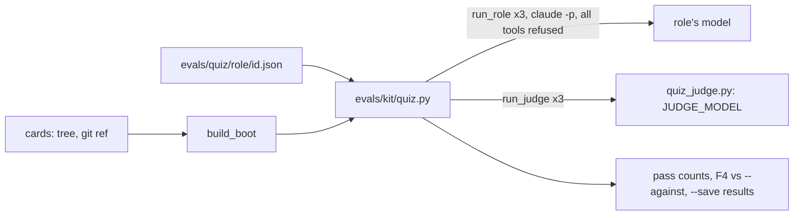

## Summary

Checking that rewritten cards lose nothing important needs a run of every role, which is slow and costly. This adds a quick, cheap check: give a role the text it boots on, add one situation, ask "what do you do next", run that three times on the role's own model, and have a separate judge model read each reply against the behaviour expected. A new card set passes when no case it scores 0 of 3 was passed by the old cards. It ships the tool, 50 seed cases and the docs; the baseline on today's cards is not run (see Known gaps).

## Deliverables

```
just quiz <role>... [--cards <git ref or folder>] [--case <id>] [--model <id>]
                    [--max-usd <dollars>] [--plan] [--against <results.json>] [--save <label>]
```



- Seed cases: 50 in `evals/quiz/<role>/` (29 floor-rule cases, 21 judgement-rail cases, over 11 roles); the rails that one reply cannot test are listed with their reason in `evals/README.md`.
- Choices: the role's model is the shipped default, never a project override; the three session roles need `--model`; the judge never uses the role's model; every call is capped (`--max-usd`, default 10) and the plan is printed first; no reply text, prompt, username or home path is saved; never run in CI or `just check`.

## Blast radius

Grade: 1. New eval-kit files, a `justfile` recipe and five dry-run cases; no `src/`, card or test change. Revert restores the previous state.

## Autonomous decisions

- The strict 29-floor-case check in the dry run is kept, so it fails until the cases exist; both land in this PR.
- Rails J19, J20 and J21 name no role in their `from` column; they were given to the foreman, chief-of-staff and chief-of-staff.
- J4 and J15 are folded into the `rules` of an existing floor case for the same role rather than given their own case.

## Known gaps

- **Baseline not run:** `claude` is not on the PATH of the machine the Driver ran on (`quiz.py: claude: not found on this machine`, exit 4), so no baseline results files are committed and no model was called. Estimated plan for three roles alone: cr-driver about $20.25 (18 cases), coder $3.27, verifier $2.23, above the default $10 cap for cr-driver. The Chief of Staff runs it.
- **UNVERIFIED:** the host flags (`--setting-sources ""` keeping the user's `CLAUDE.md` out, the plugin hook harmless in a headless run, `total_cost_usd` and `num_turns` present in the JSON, a text `result` when every tool is refused, `--model claude-fable-5-2` accepted under `-p`) and `HOST_PROMPT_TOKENS` (25,000, a starting value): only the baseline run shows them.
- **UNVERIFIED:** no screenshot is involved; command spellings inside case situations may need a wording fix after the first real run.
- Seconds added to `just test`: 0 (no pytest file touched). `just eval-dry-run` gains about 3 s (`quiz-ref` 2 s, `quiz-staged` 1 s).

<details>
<summary>Details</summary>

## Changes

- `evals/kit/quiz.py`: boot text by stage (old-card walk, git ref via `git archive`, folder via `chantier brief`, refused while the CLI has none), case loading and validation, spend estimate and cap, three runs per case, judge, pass counts, F4 against earlier results, results files.
- `evals/kit/quiz_judge.py`: the judge model constant, its one-line verdict prompt, a standalone mode.
- `evals/kit/dry_run.py`: five no-model cases `quiz-cases`, `quiz-staged`, `quiz-cap`, `quiz-ref`, `quiz-folder`.
- `justfile`: the `quiz` recipe (not in `check`).
- `evals/quiz/**`: the 50 seed cases. `evals/README.md`: tool rows and "The situation quiz".

## Human decisions

- One card set only, with proof that nothing important is lost before the swap; the quiz is a cheap part of that proof.
- A new card set fails only if it scores 0 of 3 on a case the old cards passed at least once.
- The judge is a separate named model, never the role's own.

## Impacts

No visual change. Contributors get `just quiz`; it spends model money only when run by hand.

## Test plan

- [ ] No behaviour change in shipped code; the quiz plumbing is checked by the five dry-run cases
- [ ] Local gates at `<sha7>`: `just check` and `just eval-dry-run`
- [ ] Evidence: none: the baseline run is not done (Known gaps)
- [ ] Review: approved at `<sha7>`
- [ ] Verified at `<sha7>`
- [ ] CI green at `<sha7>`

## Internal references

CR-492 sc06-situation-quiz, child 6 of the `simplify-cards-and-prompts` program; base: CR-491's branch.

</details>
