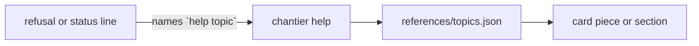

## Summary

A model that hits a rare case today has to remember which card section to open: the 33 pieces of `references/` are reached only through manifest actions. This adds `chantier help [<topic>] [--for <role>]`, which prints a rare-case topic whole from the plugin's own cards, and makes the refusals and status lines where a rare case starts name the topic to read (for example `(`help lease`)`). It only adds: no card text, manifest or piece changes.

## Deliverables

A new topic index, `references/topics.json` (38 topics: readings, roles served, the line that sends a role there), read by the new command:

```text
$ chantier help
topics: 38; help <topic> prints one, help --for <role> lists a role's
lease: a `--lease` refusal, `claim lost`, a lease `not confirmed`, a wait over 3 minutes (cr-driver, stack-driver, qa-driver, release-driver, foreman, chief-of-staff)
checkpoints: a checkpoint commit (cr-driver, stack-driver, qa-driver, release-driver)
steering-messages: a message from or to the steering session (cr-driver, stack-driver, qa-driver, release-driver)
$ chantier help --for cr-driver
lease: a `--lease` refusal, `claim lost`, a lease `not confirmed`, a wait over 3 minutes
checkpoints: a checkpoint commit
steering-messages: a message from or to the steering session
$ chantier help lease
topic lease: a `--lease` refusal, `claim lost`, a lease `not confirmed`, a wait over 3 minutes (cr-driver, stack-driver, qa-driver, release-driver, foreman, chief-of-staff)
--- references/driver-session.md#Means: the lease ---
## Means: the lease
```

The new test file adds about 0.3 s to `just test` (17 tests, measured on its own on this machine, before the rest of the suite).

Lines that now end with a topic name: the lease refusals (`help lease`), the push refusals (`help lease`, `help refused-push`), `restack owed:` (`help stack-merge`), the `handed back:` line (`help merge`) and nine watcher end lines (`help watcher`, `help board`).



Choices: `help` runs where it is typed and never through a profile (`NEVER_REMOTE`), so a role reads the cards of the plugin it loaded; it needs no batch and no project; the common watcher restart line is unchanged, since its text is quoted by the cards.

## Blast radius

Grade: **1**. Additive: one new command, one data file and appended text on existing lines; a plain `git revert` restores the previous behaviour.

## Autonomous decisions

- The index holds 38 topics, the rows of the table the change was specified from.
- `load_topics` also checks that each reading's file and heading exist on both hosts, so a renamed heading fails at once.
- The lease refusal named in the `lost` allow-list of the refusal gate now carries a topic, so its allow-list entry was removed and the allowed count lowered from 7 to 6.

## Known gaps

- Whether a role reads a topic when a line names it is unproved: it is measured later from transcripts.
- The whole-suite seconds of `just test` before and after were not measured: only the new test file was timed, on its own.
<details>
<summary>Details</summary>

## Changes

- `references/topics.json`: the topic index.
- `commands/help.py`, `declare/help.py`, `cli.py`, `core/remote_wire.py`: the command and its wiring; never through a profile.
- `core/leases.py`, `commands/push.py`, `commands/orders_merged.py`, `status/ready_line.py`, `hub/watch_lines.py`: topic names appended to the lines above.
- `tests/test_help_topics.py` and extended tests; a scenario step and coverage bullet; `AGENTS.md` names `help` among the commands.

## Impacts

No visual change; a role that stumbles can read the rare case from one command.

## Test plan

- [ ] New or changed tests (they fail on the previous code)
- [ ] Local gates at `<sha7>`: `just check`, `just eval-dry-run`
- [ ] Evidence: before at `<sha7>`, after at `<sha7>`
- [ ] Review: approved at `<sha7>`
- [ ] Verified at `<sha7>`
- [ ] CI green at `<sha7>`

## Internal references

CR-493 sc07-help-topics, child 7 of the simplify-cards program.

</details>
