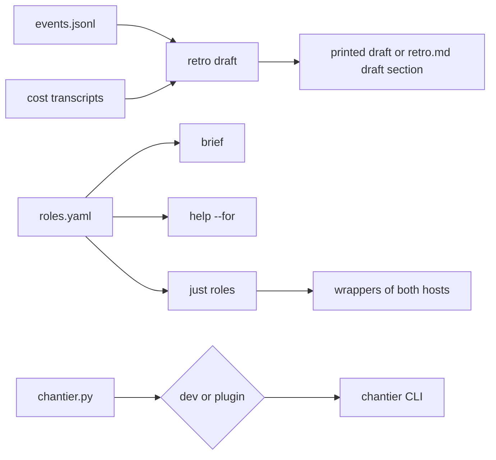

## Summary

Three additions to the plugin, each a tool built before any card uses it, so every intermediate `main` keeps working with today's cards:

- `chantier retro draft` reads the batch's events and drafts the retro's points (asks, refusals, blocks, Driver restarts, red long gates, cost outliers). The author still judges each point. Until now the steering session read the notes, events and costs by hand to find them.
- A launcher, `skills/chantier/scripts/chantier.py`, picks the dev or plugin mode and runs the CLI by the one method AGENTS.md describes, and runs the dev mode's checked sync (`--sync`) itself. The four `SKILL.md` files keep their long `$CHANTIER` paragraph for now.
- The 18 roles become one data file, `skills/chantier/roles.yaml`, read by `brief` and `help --for` (their output is unchanged), and `just roles` checks that the hand-written wrappers of both hosts agree with it and that their bodies are identical.

## Deliverables

| New file | What it gives |
| --- | --- |
| `src/commands/retro.py`, `retro_draft.py`, `declare/retro.py` | `retro draft --epoch N [--since SEQ] [--write]`: prints the draft; `--write` appends it to `4-batch/retro.md` only when it has no draft section |
| `skills/chantier/scripts/chantier.py`, `src/launcher.py` | `uv run --script "<plugin root>/skills/chantier/scripts/chantier.py" [--project <folder>] <command>`; `--print`, `--sync` |
| `skills/chantier/roles.yaml`, `src/roles_data.py`, `scripts/roles_check.py` | role data, its one reader, and `just roles` |

Choices made: the draft prints by default and writes nothing; `--write` only appends when no draft section exists. The launcher runs from uv's own script environment, never the checkout's `.venv`, runs no `uv sync` but under `--sync`, and stops no process. The wrappers stay hand-written.

Launcher trial in a real session (Claude Code 2.1.326, Windows 11, `claude -p --permission-mode dontAsk`): the launcher ran under its allow rule with Bash and PowerShell, exactly as today's dev form does, and was refused with the rule removed. Median of 5 `--version` calls: dev 370 ms against 242 ms for today's form (+128 ms), plugin 439 ms against 294 ms (+145 ms).

## Blast radius

Grade: 1. New commands and files only; `cost`'s output is unchanged (its top moved into a function), `brief` and `help --for` produce the same bytes. A `git revert` restores the previous state.

## Autonomous decisions

- `retro` was added to the epoch-command list that a test requires.
- `explicit_package_bases` and `mypy_path` were added to the mypy settings so the launcher script type-checks beside the package.
- `roles.yaml` follows the order of the existing role table, not the order of the specification's table.
- A text cut "at 160 characters" in the draft keeps 160 characters and adds `…`.

## Known gaps

- **The launcher leaves the CLI running after its stop on Windows**: stopping only its top `uv` process left the CLI chain serving (found by the stop check, then ended by hand). Nothing uses the launcher yet; the cards must not switch to it until this is fixed.
- The launcher trial proves Claude Code's main session in `dontAsk` only. **UNVERIFIED:** auto mode without rules, a Driver (subagent) session, Copilot, macOS and Linux, a cold uv cache with `UV_OFFLINE=1`.
- The launcher adds about 130 to 145 ms per call on the trial machine.
- An unfilled draft section left in `retro.md` would be archived as is at the batch's close; nothing writes one until the cards say to.
- The draft reads only the batch's events and the spend: red CI, refused host commands and rounds past the first are left to the author.
- The local long gate is not run here: this PR is not the top of its chain of pull requests, and the scenario job on ubuntu is green at `f7b74e6`.
- `help --for router`, `--for status` and an unknown name now refuse with the list of the 18 roles, as the specification asks.
- The AGENTS.md launcher sentence reads awkwardly ("which picks the mode" can read as referring to `.venv`); left as a cosmetic defect.

Details

## Changes

- `retro draft`: window by pause events or `--since`; six kinds of points; `batch_rows` extracted from `cost`; `--write` under the batch lock; scenario step and coverage bullet; AGENTS.md exception.
- Launcher: mode rule written once in `launch.py` (`project_is_chantier`, parity-tested against `Repo.find`), `launcher.py` (stdlib only), `--print`, `--sync`; scenario section `launcher_modes`.
- Roles: `roles.yaml`, `roles_data.py`, `brief` and `help --for` read it, `scripts/roles_check.py` and `just roles`, the wrapper-identity half of `test_plugin_files.py` moved into the check.

## Impacts

No visual change. Developers get `just roles`, the launcher and `retro draft`; users see no change in any existing command.

## Test plan

- [ ] New tests: `test_retro_draft.py`, `test_launcher.py`, `test_roles_data.py`
- [x] Local gates at `f7b74e6`: `just check` pass (2932 passed, 20 skipped); `just eval-dry-run` pass (25 of 25)
- [x] Evidence: launcher trial recorded above, run at `d7db74a`
- [x] Review: approved per part at `2ced739` (retro draft, after its body items were fixed), `d7db74a` (launcher) and `d7db74a` for roles, committed as `f7b74e6`
- [x] Verified at `f7b74e6`
- [x] CI green at `f7b74e6`: `gh pr checks 484`: check on three systems, eval-dry-run and scenario (ubuntu) pass

Seconds of `just test` on the same machine: 117.1 s at the base (`eb1f4d0`, 2745 tests) and 130.6 s at `f7b74e6` (2932 tests). The 187 added tests add about 13 s; the machine was noisy, and part of the figure is the chain's earlier PRs, which are in this branch's base. Alone, the new files take about 1.7 s (retro draft), 3.4 s (launcher) and 2 s (roles), measured by their authors.

## Internal references

CR-502, three parts of the `simplify-cards-and-prompts` program (children 16, 17, 18).

