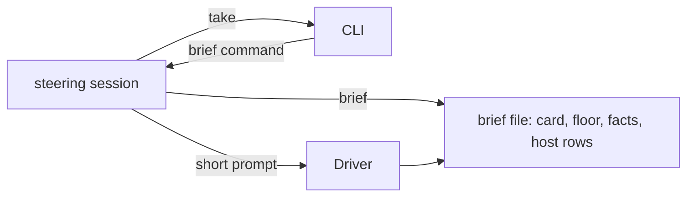

## Summary

The plugin held two sets of role cards: the old one that every session loaded, and a new, smaller one staged beside it. This change makes the new set the only one: roles get their card, the shared floor rules and their facts from `chantier brief`, and the old cards, their startup core and their startup manifest are removed. The CLI, the agent files, the skills, the hook, the tests, the eval kit, the scenario and the docs move to the new set.

## Deliverables

One card set, and one way to start an agent.

| | Before | After |
| --- | --- | --- |
| Card sets | `references/` (loaded) and `cards-next/` (staged) | `references/` only |
| A role's start | startup core, manifest, role card sections | `brief <role> <unit>`: card, floor, facts, host rows |
| `take`, `take stack`, `order qa` | print a Driver prompt skeleton | print the lease and the `brief` command |
| `round`, `handoff` | print each worker's opening lines | print one `workers:` line naming `brief` |
| A Driver's `Team:` and review steps | filled by hand by the session that starts it | filled by `brief` from the configuration and the project's instructions |

Brief sizes in bytes (old start reading to new brief, test fixture): Foreman 91,612 to 22,125; Chief of Staff 202,936 to 24,351; CR Driver 27,834 to 9,773; Coder 14,226 to 3,939.

## Blast radius

Grade: 3. Every role's contract and the way every agent is started change at once. It merges in order with the changes stacked with it, in one sitting. A rollback is a revert of this change together with those.

## Autonomous decisions

- The launcher is not switched in the cards: they keep today's `$CHANTIER` paragraph and sync commands, because the launcher leaves the CLI running after its stop on Windows.
- `take` prints the `brief` command and only `brief` writes brief files (default taken without the owner, to be confirmed).
- The board Griller's fixed brief does not name the floor (default taken without the owner, to be confirmed).
- `brief` fills a Driver's `Team:` line from the configuration and the extra review steps from the `## chantier` section of the project's instructions, so that no placeholder is left for the starting session.
- `brief` prints a `Note:` line, read from the `take` event or the QA order's note, so that a note given at `take` is not lost.
- `take` prints two lines that start with `brief:`: the command, and the fact about `brief`.
- `roles.yaml` `reply:` names a level-1 heading where a card holds its reply block under its title.
- The CLI's facts builder is split in two (a CR's facts, with the `workers:` line, and a worker's facts) instead of taking a flag.
- The board Griller's brief ends its card line once the host clause is gone; the unused host file lookup is removed.
- A configuration refusal names the host's row file; the access refusal cites the floor rule instead of a removed card.
- The hook's reload message says "through your skill's `$CHANTIER` command".
- The quiz builds a new-card boot with the batch variable removed and the host fixed to Claude Code, because an inherited batch variable made the boot fail.
- The runbooks of the Copilot and direct-mode evaluations, which the specification did not list, had links to fix too.
- `docs/incidents.md` holds the stories that only one of the card inventories marked for it.
- The tests' file-and-heading pins are gathered in one test; the board read-key test now scans the topics too.
- The generic-agent case of the host matrix is left as a known gap, with no further work: it expects contract lines that no Claude Code configuration produces, before or after this change, and the brief already holds the card and the floor.

## Known gaps

- Do not merge alone: it merges in order with the changes stacked with it, in one sitting, by the owner.
- Quiz of the roles on the new cards, not run: skipped on the owner's word, 2026-11-26: `just quiz coder conflict-resolver cr-driver debugger demo-explorer release-driver stack-driver verifier --max-usd 40` and `just quiz chief-of-staff foreman griller --model claude-sonnet-5-5 --max-usd 45` (only the free `--plan` form was run).
- Old-card quiz baseline to compare against, not run: skipped on the owner's word, 2026-11-26: the same two commands with `--cards ea11a9e0` (the last head with the old set), then each new run with `--against <that results file>`.
- No transcript of a real Claude Code session showing the reload message after `/compact`: only the hook's own tests ran.
- Unproved in a real Copilot session: briefs build for every role on that host, its host rows stay untested, and it has no hook, so the reload message and the write guard are inert there.
- On Claude Code, a worker configured with a generic agent gets a brief with its card and the floor but without the extra generic-agent contract lines, which are printed only where chantier itself starts a role generic; this change does not alter that, and no test covers that Claude Code case.
- Real run not done: no real batch has run on these cards.
- Launcher not switched: it leaves the CLI running after its stop on Windows.
- The board Griller does not read the floor.
- Some new cards still describe output the CLI no longer prints (a worker's opening lines, the worker `writes:` line, the prompt skeleton of `take` and `order qa`): `topics/cr-workers.md`, `concepts.md` ("The prompt" and its template), `topics/trouble-worker.md`, `foreman.md`, `topics/direct-mode-p2.md`, `topics/direct-mode-switch-p4.md`, `topics/qa-order.md`, `topics/order-verbs-p1.md`, `topics/stack-run.md`. Card content was not rewritten here; these sentences should be fixed before a real batch runs on these cards.
- A worker's agent file refuses a prompt that names no path to its card (`coder.md`), while the short prompt of `brief` names `.../<unit>-coder.md`. Not tried with a real agent.
- `AGENTS.md` says `brief` reads the record and the planning folder only; it now also reads the project's instructions for the review steps. `AGENTS.md` is unchanged here.
- Review steps are read when `brief` runs, while two docs pages say a running batch keeps the team it started with.
- The generic agent's contract heading still says "after the opening lines", though it is now in the worker's brief.
- Cards over their size target, in bytes (target): `release-driver.md` 3,809 (3,072), `spec-writer.md` 1,667 (1,500), `coder.md` 1,603 (1,500), `verifier.md` 3,112 (3,000), `demo-explorer.md` 1,612 (1,500), `spec-critic.md` 1,572 (1,500), `retro-critic.md` 1,565 (1,500).
- The Drivers' briefs are over their start targets: CR 9,773 (6 KB), stack 9,179 (6 KB), release 9,531 (5 KB), QA 6,032 (4 KB).
- Two data files kept byte-identical still hold removed file names: `hosts/claude-code.json` (`driver.md`, `session-start.md`) and `hosts/copilot.json` (`session-start.md`, `foreman-lost-driver.md`).
- Wording of the old set not found in the new one: some sentences of the sync offer, "A release with no PR yet is no anomaly", the Foreman's pointer to `help session-shell`; "say it once to the user as printed" became "offer the restart once".
- Stale text left as found: some evaluation scorecard rows cite the host card for rules that now live in rows or topics, one sentence of the Claude Code tutorial, `AGENTS.md`'s mention of a removed card, the direct-mode runbook's "unproved" list; some evaluation links now go to topics that do not keep the old section titles.
- A `foreman:`, `chief-of-staff:` or `griller:` entry in the project's `## chantier` section would print as a review step, though only a name that is no built-in role should.
- The CR Driver's brief size budget in its test is 9,900 bytes, where rounding the measured 9,773 up gives 9,800.
- One sentence of `evals/README.md` still names a removed test.
- The new hook test case reads only the test's own constants; the cases next to it tie them to what the hook sends.
- The type checker's warnings on `hooks/register.tsx` were there before.
- **UNVERIFIED:** the test suite's added time stays within the expected 3 seconds: one pair of runs on the same machine gives 165.0 to 167.2 seconds of wall time (157.8 to 162.5 as the test runner counts), while runs of the new head span 139 to 265 seconds.

Details

## Changes

- `skills/chantier/references/` now holds the new cards; the old files and the staging folder are removed. The floor, the two host row files and the review step's reply block are unchanged.
- The four skills' `SKILL.md` carry the new texts.
- `skills/chantier/roles.yaml` and the agent files of both hosts point at the new cards and replies.
- The CLI's own lines (`take`, `take stack`, `order qa`, `round`, `handoff`, `brief`, `open`, `foreman set`, `status`, `preflight`, the board Griller and refusal texts) name only files that exist; the host rows that `brief` and `host` print from the data files still hold some removed names (see Known gaps).
- Comments that named a removed host-card section now name a row or topic: `board/griller_host.py`, `playbook/models.py`, `playbook/timing_check.py`, `commands/allow_samples.py`, `commands/permissions.py`.
- `hooks/register.tsx`: the reload message after a compaction names the floor.
- Eval kit: the audit expects a brief for a role started that way; the dry run checks `brief`'s boot; the quiz boots from `brief`, and `--cards <ref>` of a head before the swap still walks that head's manifest.
- Scenario: every Driver is started from the printed `brief` command; the new fact lines and the stack line are checked.
- Docs: links and sentences that named removed files are fixed; `docs/incidents.md` is new.
- New tests: `test_card_names.py` (names the CLI prints), `test_card_homes.py` (where each rule lives) and `test_brief_bytes.py` (each brief's size); a Driver brief's `Team:` line is checked. Other tests that pinned removed files are converted.
- Deleted tests, each with what replaces its rules (`test_card_homes.py` holds one home per old phrase; the phrase-by-phrase list is in a comment on this pull request):

| Deleted | Replaced by |
| --- | --- |
| `test_role_cards_split.py`, `moved_rules.tsv`, `test_stack_chain_cards.py`, `test_watcher_step.py` | `test_card_homes.py` |
| `test_start_reading.py` | `test_brief_bytes.py`; "rules come first" is now a floor rule |
| `test_startup_manifest.py` | byte budgets in `test_brief_bytes.py`, homes in `test_card_homes.py`; the manifest is gone |
| `test_session_start_split.py` | its connector test moved to `test_plugin_files.py`; the no-forge-tool test kept; the manifest readings are gone |
| card tests in `test_came_back.py`, `test_release_tag.py`, `test_stack_shape.py`, `test_reload_rules.py`; heading checks in `test_rebase_rules.py` | `test_card_homes.py` |
| the move clause of `test_triage_moves.py` | the topic's roles |
| the long sentences of `test_cli_stop.py` | floor rule 4 |
| the split pieces of `test_help_topics.py` | the topic files |
| the proof-file date test of `test_host_rows.py` | its capability-heading test and history check |
| the manifest test and "Visible evidence" check of `test_release_template_card.py` | the `release-evidence` topic |

- Card text edited beyond the move (link fixes, and sentences that named a removed file):
  - `references/topics.json` (the `paths` note), `references/topics/foreman-start-p2.md` (step 4 names `brief foreman`), `references/concepts.md` (host reference and Driver card names, the four Driver `Card` cells).
  - The four `SKILL.md`: the new texts, with today's `$CHANTIER` paragraph kept ("is a stop: report its exact error (floor 4)") and the reload sentences of the router, Chief of Staff and Griller adjusted to it.
  - `references/sync-checkout.md`: today's title, intro and four steps kept; step 2, step 4 and the closing sentence now name `help` and `host` lines and the floor.
  - `references/topics/host-allow-rules.md` and `host-allow-rules-copilot.md`: the launcher sentences say unproved or no longer name it.

## Human decisions

- No evaluation run is made for this change (no quiz, no campaign); the owner runs them later, and they block nothing.
- The merge waits for no evaluation: the stacked changes merge in order, in one sitting, by the owner (a reading of the owner's words, to be confirmed).

## Impacts

Sessions load the new cards, and a Driver is started from the output of the `brief` command that `take` prints. No visual change.

## Test plan

- [ ] New or changed tests (they fail on the previous code)
- [x] Local gates at `b85be4c`: `just check` (2748 passed, 19 skipped), `just eval-dry-run` (25 of 25 cases), `just mod` (119 pass)
- [ ] Evidence: before at `ea11a9e`, after at `b85be4c`
- [x] Review: approved at `b85be4c` (carried from `7d2c4dc`)
- [ ] Verified
- [x] CI green at `b85be4c`: `just check` on Linux, macOS and Windows, `just eval-dry-run`, `just scenario`

## Internal references

- CR-510 sc24-cards-swap, batch-31; its branch started on CR-507's (PR 487, merged).
- Hand-over checklist of the specification (rows 11 to 14: not done, the launcher is not switched, decision D9 under order O-159):

| # | What | State |
| --- | --- | --- |
| 1 | The quiz boots from `brief`; the dry run checks that boot; `--cards` of a pre-swap head works | done |
| 2 | Quiz on every role against the baseline | not done: skipped on the owner's word, 2026-11-26 |
| 3 | `topics.json` swapped; every `help <name>` resolves; docs links fixed | done |
| 4 | Host cards' history in `docs/proofs/` or `docs/incidents.md` | done |
| 5 | `AGENTS.md`'s role sentences true; `CONTRIBUTING.md` aligned | done |
| 6 | `take` prints the `brief` command; no worker opening lines; the Foreman runs `brief foreman` | done |
| 7 | `test_brief_bytes.py` replaces `test_start_reading.py`; the manifest check goes | done |
| 8 | One facts builder, no strip list | done |
| 9 | `foreman-conflict.md` removed | done |
| 10 | The hook's reload message | done |
| 11 | Launcher allow sample | not done: D9 |
| 12 | Launcher line in the allow table | not done: D9 |
| 13 | Launcher form in `permissions.py` | not done: D9 |
| 14 | Old forms' rules and the command form | not done: D9 |
| 15 | `roles.yaml` and the wrappers together; `just roles` | done |
| 16 | `griller.md` holds the board section; command-name test scans the folder | done |
| 17 | Board Griller's brief bytes reported | done |
| 18 | Each Driver role points at its own card | done |
| 19 | The stack line | done |
| 20 | Old phrase pins converted | done |
| 21 | Griller and Chief of Staff cards in `roles.yaml` and the board brief; old files gone | done |
| 22 | No CLI change | done |
| 23 | The four `SKILL.md`, version lines | done (launcher form: D9) |
| 24 | Incident stories in `docs/incidents.md` | done |
| 25 | Driver table, "Change Request", host rows, topics and allow block read after the swap | done |

🤖 Generated with [Claude Code](https://claude.com/claude-code)
