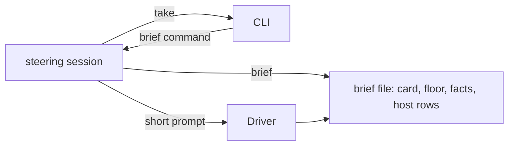

<!-- title: feat(cards)!: swap in the new role cards and remove the old set -->

## Summary

The plugin held two sets of role cards: the old one that every session loaded, and a new, smaller one staged beside it. This change makes the new set the only one: roles get their card, the shared floor rules and their facts from `chantier brief`, and the old cards, their startup core and their startup manifest are removed.

## Deliverables

One card set, and one way to start an agent.

| | Before (`88d9ab4`) | After |
| --- | --- | --- |
| Card sets | `references/` (loaded) and `cards-next/` (staged) | `references/` only |
| A role's start | startup core, manifest, role card sections | `brief <role> <unit>`: card, floor, facts, host rows |
| `take`, `take stack`, `order qa` | print a Driver prompt skeleton | print the lease and the `brief` command |
| `round`, `handoff` | print each worker's opening lines | print one `workers:` line naming `brief` |

## Blast radius

Grade: 3. Every role's contract and the way every agent is started change at once. A rollback is a revert of this change together with the changes stacked with it.

## Autonomous decisions

- The launcher is not switched in the cards: they keep today's `$CHANTIER` paragraph and sync commands, because the launcher leaves the CLI running after its stop on Windows.
- `take` prints the `brief` command and only `brief` writes brief files (default taken without the owner, to be confirmed).
- The board Griller's fixed brief does not name the floor (default taken without the owner, to be confirmed).
- `brief` prints a `Note:` line, read from the `take` event or the QA order's note, so that a note given at `take` is not lost.
- `take` prints two lines that start with `brief:`: the command, and the fact about `brief`.
- `roles.yaml` `reply:` names a level-1 heading where a card holds its reply block under its title.
- The CLI's facts builder is split in two (a CR's facts, with the `workers:` line, and a worker's facts) instead of taking a flag.
- The board Griller's brief ends its card line once the host clause is gone; the unused host file lookup is removed.
- A configuration refusal names the host's row file; the access refusal cites the floor rule instead of a removed card.
- The hook's reload message says "through your skill's `$CHANTIER` command".
- The tests' file-and-heading pins are gathered in one test; the board read-key test now scans the topics too.

## Known gaps

- Do not merge alone: merges with the changes stacked below and above it as one unit, after the real-run campaign.
- Real run not done: it is the last change of the stack.
- Launcher not switched: it leaves the CLI running after its stop on Windows.
- The board Griller does not read the floor.
- Some new cards still describe output the CLI no longer prints (a worker's opening lines, the worker `writes:` line, the prompt skeleton of `take` and `order qa`): `topics/cr-workers.md`, `concepts.md` ("The prompt" and its template), `topics/trouble-worker.md`, `foreman.md`, `topics/direct-mode-p2.md`, `topics/direct-mode-switch-p4.md`, `topics/qa-order.md`, `topics/order-verbs-p1.md`, `topics/stack-run.md`. Card content was not rewritten here; these sentences must be fixed before a real batch runs on these cards.
- A worker's agent file refuses a prompt that names no path to its card (`coder.md`), while the short prompt of `brief` names `.../<unit>-coder.md`. Not tried with a real agent.
- The generic agent's contract heading still says "after the opening lines", though it is now in the worker's brief.
- Two data files kept byte-identical still hold removed file names: `hosts/claude-code.json` (`driver.md`, `session-start.md`) and `hosts/copilot.json` (`session-start.md`, `foreman-lost-driver.md`).
- Wording of the old set not found in the new one: some sentences of the sync offer, "A release with no PR yet is no anomaly", the Foreman's pointer to `help session-shell`; "say it once to the user as printed" became "offer the restart once".
- The eval kit, the scenario and the docs are not yet moved to the new set.
- The type checker's warnings on `hooks/register.tsx` were there before.

Details

## Changes

- `skills/chantier/references/` now holds the new cards; the old files and the staging folder are removed. The floor, the two host row files and the review step's reply block are unchanged.
- The four skills' `SKILL.md` carry the new texts.
- `skills/chantier/roles.yaml` and the agent files of both hosts point at the new cards and replies.
- The CLI's own lines (`take`, `take stack`, `order qa`, `round`, `handoff`, `brief`, `open`, `foreman set`, `status`, `preflight`, the board Griller and refusal texts) name only files that exist; the host rows that `brief` and `host` print from the data files still hold some removed names (see Known gaps).
- Comments that named a removed host-card section now name a row or topic: `board/griller_host.py`, `playbook/models.py`, `playbook/timing_check.py`, `commands/allow_samples.py`, `commands/permissions.py`.
- `hooks/register.tsx`: the reload message after a compaction names the floor.
- New tests: `test_card_names.py` (names the CLI prints), `test_card_homes.py` (where each rule lives) and `test_brief_bytes.py` (each brief's size). Other tests that pinned removed files are converted.
- Deleted tests, each with what replaces its rules (`test_card_homes.py` holds one home per old phrase):

| Deleted | Replaced by |
| --- | --- |
| `test_role_cards_split.py`, `moved_rules.tsv`, `test_stack_chain_cards.py`, `test_watcher_step.py` | `test_card_homes.py` |
| `test_start_reading.py` | `test_brief_bytes.py`; "rules come first" is now a floor rule |
| `test_startup_manifest.py` | byte budgets in `test_brief_bytes.py`, homes in `test_card_homes.py`; the manifest is gone |
| `test_session_start_split.py` | its connector test moved to `test_plugin_files.py`; the no-forge-tool test kept; the manifest readings are gone |
| card tests in `test_came_back.py`, `test_release_tag.py`, `test_stack_shape.py`, `test_reload_rules.py`; heading checks in `test_rebase_rules.py` | `test_card_homes.py` |
| the move clause of `test_triage_moves.py` | the topic's roles |
| the long sentences of `test_cli_stop.py` | floor rule 4 |
| the split pieces of `test_help_topics.py` | the topic files |
| the proof-file date test of `test_host_rows.py` | its capability-heading test and history check |
| the manifest test and "Visible evidence" check of `test_release_template.py` | the `release-evidence` topic |

- Card text edited beyond the move (link fixes, and sentences that named a removed file):
  - `references/topics.json` (the `paths` note), `references/topics/foreman-start-p2.md` (step 4 names `brief foreman`), `references/concepts.md` (host reference and Driver card names, the four Driver `Card` cells).
  - The four `SKILL.md`: the new texts, with today's `$CHANTIER` paragraph kept ("is a stop: report its exact error (floor 4)") and the reload sentences of the router, Chief of Staff and Griller adjusted to it.
  - `references/sync-checkout.md`: today's title, intro and four steps kept, step 2 and step 4 and the closing sentence now name `help` and `host` lines and the floor.
  - `references/topics/host-allow-rules.md` and `host-allow-rules-copilot.md`: the launcher sentences say unproved or no longer name it.

## Impacts

Sessions load the new cards. No visual change.

## Test plan

- [ ] New or changed tests (they fail on the previous code)
- [ ] Local gates
- [ ] Evidence
- [ ] Review: approved
- [ ] Verified
- [ ] CI green

## Internal references

- CR-510 sc24-cards-swap, batch-31; stacked on CR-507 (PR 487).

