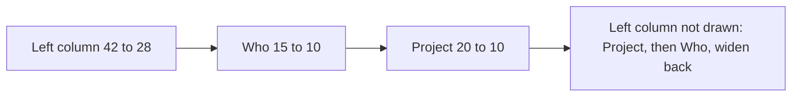

## Summary

In `chantier live`, three columns cut their text: the left column (the Projects and Agents boxes), and the Flow's `Project` and `Who` columns. They are now wider by default, and on a terminal too narrow for these widths they close up again, in a fixed order, before anything disappears.

## Deliverables

Wider default columns:

| Column | Before | After | Narrowest |
|---|---|---|---|
| Left column (Projects, Agents) | 28 | 42 | 28 |
| Flow `Project` | 10 (12 with several boards) | 20 (22 with several boards) | 10 (12 with several boards) |
| Flow `Who` | 10 | 15 | 10 |

What gives way on a narrowing terminal, so that the `Event` column keeps 20 columns:



One function computes the drawn widths for both the panel list (and so Tab's order) and the drawing:

```python
class Widths(NamedTuple):
    left: int      # 0: the left column is not drawn
    project: int   # the board's label included
    who: int

def column_widths(models: list[Model], width: int, maximized: bool = False) -> Widths
```

The left column is now drawn from this terminal width (before: 100 in every case):

| Watched | Left column drawn from | All default widths from |
|---|---|---|
| One project | 122 | 141 |
| Several projects | 133 | 162 |
| Several boards | 135 | 164 |

## Blast radius

Grade: 1. Only the layout of the terminal live view changes; it writes nothing and adds no dependency. A plain `git revert` restores the previous layout.

## Autonomous decisions

- `Who` closes up before `Project`: the order between the two was left to the implementation side.
- The left column's threshold counts the `Time` column's width also when the narrower `Ago` column is shown, so switching with `t`, or a line ageing, never shows or hides the left column.
- The width computation lives in a new module, `clients/tui/widths.py`: with it, `screen.py` would pass the project's 400-line limit.
- The capture in `docs/boards.md` is printed by the code of this change from prepared events of a made-up batch, at 140 columns, with no board.
- `chantier live --once` with no terminal size still prints 120 columns: changing that width was not asked.

## Known gaps

- With one project watched, `chantier live --once` with no terminal size (120 columns, for instance piped) no longer draws the Projects and Agents boxes, since the left column now needs 122 columns. Raising the default print width would close it.
- No screenshot of `chantier live` in a real terminal on a running board yet.
- The end-to-end scenario was not run locally on Windows for this change; CI runs it on Linux, and the Windows run is left to the pull request stacked on this one.
- In `--once` output a blocked item's reason can be cut: the Tasks box counts one line for an item drawn on two. This predates the change and is visible in the docs capture.

<details>
<summary>Details</summary>

## Changes

- `clients/tui/parts.py`: the left column's default width, 28 to 42.
- `clients/tui/widths.py` (new): the default and minimum widths, and `column_widths`.
- `clients/tui/screen.py`: the fixed 100-column threshold is gone; the panel list, the drawing, the maximized Flow and `flow()` use the computed widths.
- Tests: parametrized cases reading the widths from the drawn text; the two `live --once` cases print at 140 columns.
- `docs/boards.md`: the live view's text, the keys table and the capture. `scenario/README.md`: the live view bullet no longer promises the Agents box at every width.

## Human decisions

- Wider defaults: the left column 50 % wider, `Project` twice as wide, `Who` 1.5 times as wide, `Project` and `Who` inside the central column.
- On a narrow terminal the columns close up first, with `Event` keeping at least 20 columns: the left column down to 28, then `Who` and `Project` down to 10; the left column is dropped only when even that does not fit.
- `Event`'s 20 columns come first: with one project the left column is drawn only from 122 columns.
- Resizing columns with the mouse and keeping the widths are a separate, later change.

## Impacts

Wider left, `Project` and `Who` columns on large terminals; on terminals between 100 and 121 columns (more with several projects) the left column is no longer drawn. Where the left column still shows, `Event` can be narrower than before: with one project at 141 columns it goes from 39 to 20.

## Test plan

- [ ] New or changed tests (they fail on the previous code)
- [ ] Local gates: `just check`, `just eval-dry-run`
- [ ] Evidence: the live view at this head
- [ ] Review: approved
- [ ] Verified
- [ ] CI green

## Internal references

CR-522 tui-resize-columns

</details>
