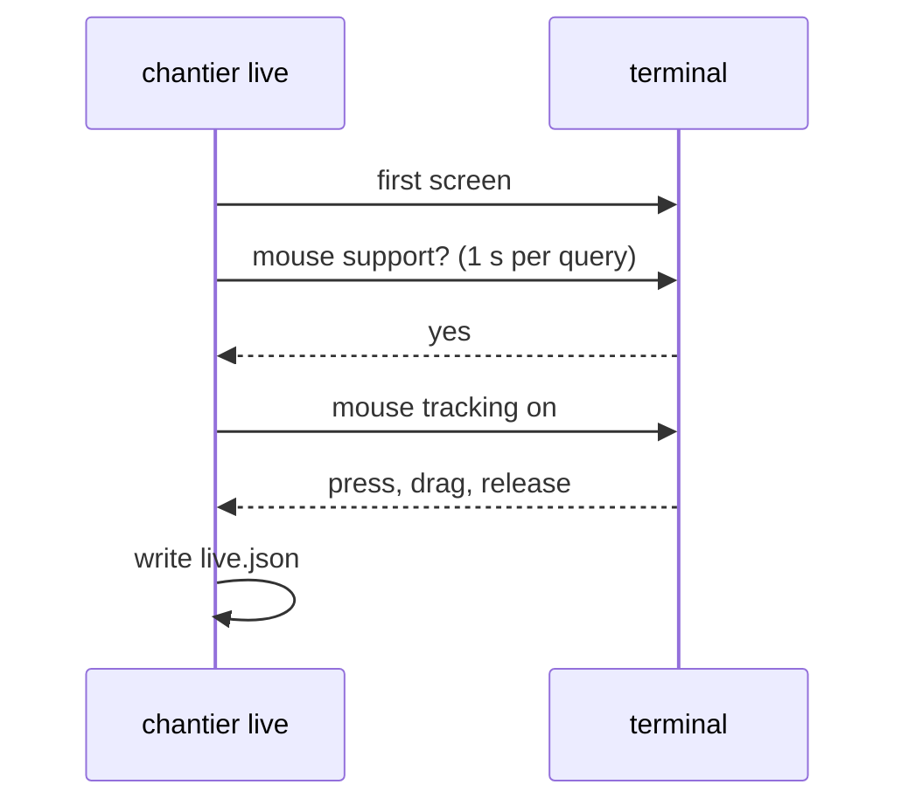

## Summary

In `chantier live`, the widths of the three main columns (left, central Flow, right) were fixed. They can now be resized by dragging the borders with the mouse, and the widths are kept for the next start.

## Deliverables

Two borders already on screen become draggable, from either side; nothing new is drawn:

| Border | Sets | Smallest width | Default |
|---|---|---|---|
| Left column / Flow | left column | 20 | 42 |
| Flow / Ready and Tasks | right column | 30 | 44 |

The order at start: content first, then the mouse.

- A drag stops at the smallest width, or where the Flow reaches its own minimum.
- On release, the widths are written to `live.json` in the user's chantier configuration folder: `{"left": 50, "right": 44}`. Deleting the file resets them; a bad file refuses the start with one line naming it.
- The wheel scrolls the active panel, one line per event. The footer and the help say how to resize, select text and open a link.
- `--once` reads no `live.json`, writes nothing and draws the defaults.
- On a terminal too narrow for the kept widths, the file is left as it is and the drawing gives way: right column down to 44, left column down to 28, then Who and Project down to 10, then no left column.

## Blast radius

Grade: 2. The configuration folder, used by most commands to find `profiles.json`, is now computed by a new dependency (`platformdirs`), and on macOS it moves. A revert is possible; the locked environment must be synced again either way.

## Autonomous decisions

- Each mouse query waits at most 1 second, passed as a parameter, so a silent terminal does not hold the keys for longer; the `BLESSED_QUERY_TIMEOUT_SECONDS` variable is neither read nor set for these queries.
- During a drag the other side column keeps the width it had; the release saves the dragged column as drawn and leaves the other saved value unchanged.
- A width is changed and written only when the dragged column's drawn width differs from the one at the start of the drag, so a plain click on a border never overwrites a kept width.
- Where the Flow is already under its minimum, a drag can narrow a side column but not widen it. `?` or `m` during a drag drops it.
- On a narrow terminal a right column kept wider than 44 gives way first; without the left column it takes spare columns back toward its kept width.
- The wheel does nothing while the help is open or a filter is typed; the mouse words are the first part of the footer to be cut.
- A `live.json` with an unknown key is refused like any wrong value. It is written atomically with the user's default file mode.
- The check that the terminal client imports nothing else of chantier is unchanged: the file's path is passed in from the command.
- The "terminal, reads only" line of the surface server diagram becomes "terminal, reads the server only".
- The mouse code is a new module, and the Agents box drawing moved to `boxes.py`, to keep files within the project's 400-line limit.
- On macOS an absolute `XDG_CONFIG_HOME` still wins over `~/Library/Application Support`, as the dependency resolves it.

## Known gaps

- **UNVERIFIED:** mouse support on a real terminal. The hand run in Windows Terminal is not done: first screen with no felt wait, keys typed at start handled in order, both drags, the wheel, widths kept at a second start, the terminal given back after `q`, and which of the library's two Windows paths runs (terminal escape modes or the console's own mouse input). Tests use a stand-in terminal only. No screenshot of the real terminal.
- **UNVERIFIED:** the footer's words `Shift-drag: select` and `Ctrl-click: open a PR` were not tried; on other terminals the link modifier may differ.
- The same hand run on Linux or macOS is not done.
- A widened column can snap back at release on a terminal that is not wide enough: the narrow-terminal order then gives that width back to the Flow, while `live.json` keeps the dragged value. At 140 columns with one project and the defaults, a right column widened from 44 to 49 is drawn at 44 again.
- A terminal that answers the mouse question later than 1 second has its late answer read as keys.

Details

## Changes

- `clients/tui/mouse.py` (new): asks the terminal for mouse support after the first draw, holds tracking until every way out, handles press, drag, release and wheel.
- `clients/tui/widths.py`: kept widths, the narrow-terminal rule for them, drag bounds, reading and writing `live.json`.
- `clients/tui/view.py`, `screen.py`: the view holds the widths; footer and help words.
- `commands/live.py`: reads `live.json` before connecting, except with `--once`.
- `clients/profiles.py`: the configuration folder comes from `platformdirs` (`CHANTIER_CONFIG_HOME` still first).
- `pyproject.toml`, `uv.lock`: `platformdirs==4.14.8`, one pure-Python wheel (`py3-none-any`) for Linux, macOS and Windows. On Windows it asks the system's known-folder API (or `WIN_PD_OVERRIDE_APPDATA`), not `APPDATA`; on the machine checked, the folder equals `%APPDATA%\chantier`.
- Docs: `AGENTS.md`, `docs/boards.md`, `docs/server-api.md`, the surface server diagram and its text file.

## Human decisions

- The mouse resizes the main columns only, grabbed by either existing border; nothing new is drawn, and the columns inside the Flow are not resized.
- Mouse tracking is accepted (a plain drag no longer selects text) if the status bar says what to do and the wheel keeps scrolling the main part.
- One configuration folder, computed by `platformdirs`; on macOS only, `profiles.json` moves and `chantier login` is run again; nothing changes on Windows.
- Smallest widths: 20 for the left column, 30 for the right one.
- The first screen is drawn before the terminal is asked about the mouse.

## Impacts

- With tracking on, selecting text and opening links need a modifier.
- macOS users run `chantier login` again. On Linux a relative `XDG_CONFIG_HOME` is now ignored.
- A terminal without mouse reporting works as before. On Linux and macOS a terminal that does not answer within 1 second gets no mouse; on Windows the library then uses the console's own mouse input. Apple Terminal gets no mouse.
- No screenshot: see Known gaps.

## Test plan

- [ ] New or changed tests (they fail on the previous code)
- [ ] Local gates: `just check`, `just eval-dry-run`, the end-to-end scenario on Windows
- [ ] Evidence: before and after
- [ ] Review
- [ ] Verified
- [ ] CI green

## Internal references

CR-523 tui-mouse-resize

