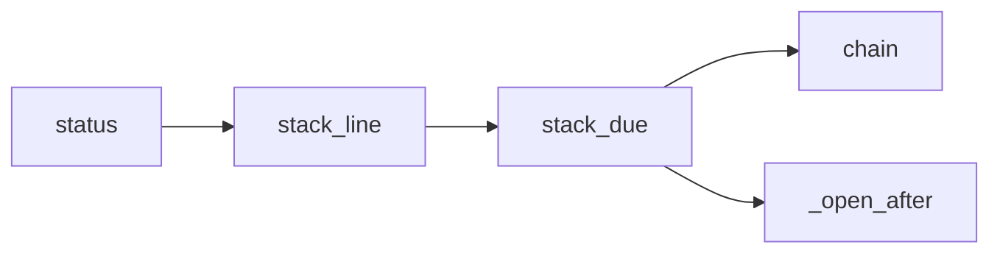

## Summary

In a stack batch, the first `take stack` rested on the Foreman remembering a rule of its card, and in a recent batch it was missed: two CRs were ready with a PR long before the first stack driver started. `chantier status` now prints one line that says the first stack is due, so the steering session sees it on its next wake.

## Deliverables

While a running stack batch has two or more CRs ready with a PR (release and fix CRs aside, each with its open dependencies ready too), no stack driver recorded, and no CR of the batch ever placed by `stack`, `status` prints, after the CR rows:

```text
stack: take stack now: CR-1, CR-2 ready with a PR, no stack made yet (`take stack --epoch <n>`)
```



- The line is a reminder only: it refuses nothing, starts nothing, records nothing, and is not in `STATUS.md`, `STATUS.json`, the pane or the web board.
- It never returns once a stack was made, merged CRs included; a batch that leaves a stack and comes back to one gets it again.

## Blast radius

Grade: 1. One extra output line of `status`, a function that replaces an unused one; a plain `git revert` restores the previous behaviour.

## Autonomous decisions

- The scenario's "absent after a merge" check sits right after the first merge is recorded rather than at the last merges, because the batch is paused by then.

## Known gaps

None.

<details>
<summary>Details</summary>

## Changes

- `stacks.py`: `stack_due` (replaces the unused `stack_forms`) and `stack_line`.
- `commands/batch_status.py`: appends `stack_line` after the CR rows.
- `skills/chantier/references/foreman.md`: the first take's bullet names the line as its trigger.
- `scenario/run_scenario.py`, `scenario/README.md`: checks that the line shows, hides with a stack driver recorded, and stays hidden once stacked and merged.
- `tests/test_stack_due.py`: parametrized unit test of both functions.

## Impacts

Foremen and the Chief of Staff in direct mode see the trigger in `status`. No visual change elsewhere.

## Test plan

- [x] New or changed tests (`test_stack_due.py`, they fail on the previous code)
- [x] Local gates at `5f5bb5a`: carried from 99ed572 over a clean restack onto CR-336 (`just check` pass; `just eval-dry-run` pass (17 of 17))
- [x] Evidence: no screenshot, a text line only (verified by running `status` on a scratch batch; carried from 99ed572 to `5f5bb5a`)
- [x] Review: approved at 99ed572, carried to `5f5bb5a` (clean restack)
- [x] Verified: carried from 99ed572 to `5f5bb5a` (clean restack)
- [x] CI green at `5f5bb5a`: all five jobs pass, `just scenario (ubuntu-latest)` included

## Internal references

- CR-337 status-take-stack-trigger

</details>
