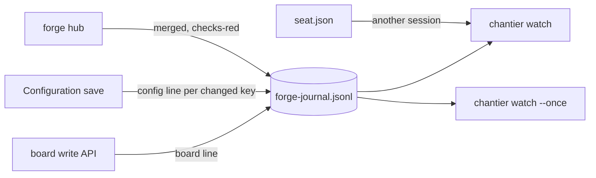

## Summary

A running Chief of Staff session heard nothing of what the user does in the web board until told "rescan": an idea added to the inbox, a priority or stage changed, a note saved from the board's editor, an agent, model or escalation changed on the Configuration page. The board now writes each such action to the project's `forge-journal.jsonl`, and the session's watcher (which now runs with or without a batch) wakes the Chief of Staff on it within about 20 s, on the same wake as forge merges. Where nothing can wake the session, the same events wait in the journal and a pull command (`watch --once`) reads them at the user's next message.

## Deliverables

One journal, two writers, one reader; each project's board writes land in its own journal only:



| Line | Written for | Wakes |
|---|---|---|
| `board`, action `new`, `move`, `edit` | an idea added, a priority or stage changed, a file saved from the editor | yes |
| `board`, action `label`, `group`, `ungroup`, `next-batch` | other backlog writes | no (carried to the next wake) |
| `config`, key `batch.slots`, `specifying.parallel`, `hosts.<host>.roles.<role>.<agent\|model\|escalation>` | a Configuration save, one line per changed key | yes |

- The watcher needs no batch and no `--seat` flag; it ends 20 s after the last waking line, or when the project's seat belongs to another session (it then prints a seat line and no restart line).
- `watch --once --after <n>` prints the lines above `n` and a cursor line with the next command; it takes no lock, reads no forge and starts no process.
- `status` and `seat` print the watcher lines for a paused batch or no batch; `status` names a live board of another version.
- Choice: a role's model is written in the `config` line as its id (`inherited` when none applies).

Before and after, a project with no batch (base `9c3fb6d`, head `4ca2f82`, carried from `7a87cfc`; the project is a scratch one):

```
before: chantier watch --after 0
error: watch: no running batch in p: nothing to watch

after:  chantier watch --after 0
watch: p from cursor 1, the hub
board wrote (move): board-idea -> P2; for the Chief of Staff: tell the user, act on nothing
board wrote (label): label 'x' on board-idea; for the Chief of Staff: tell the user, act on nothing
watch: p (no batch) still running: for the Chief of Staff, start again in the background now: chantier watch --after 3
```

And the pull path at `4ca2f82` (carried from `7a87cfc`): `chantier watch --once --after 0` prints the three `board wrote (...)` lines, then `watch: cursor 3; next, at the user's next message: chantier watch --once --after 3`.

## Blast radius

Grade: **2**. The journal's key rule, the watcher's end rules and the printed `watch: not running` line change for every session; a `git revert` restores the previous behaviour and the journal stays valid (readers ignore unknown kinds).

## Autonomous decisions

- A save that leaves a key at its effective value writes no `config` line, so a second identical save writes none (the specification also says an identical save appends a line; the first rule was kept).
- A role's model in a `config` line is its id, as its effective value is an id and name pair.

## Known gaps

- The main session's wake by a background watcher's end is unproved on Claude Code and Copilot (host trials after the merge).
- An ended session's watcher may run until another session takes the seat (the Claude Code trial says whether the host ends it).
- **UNVERIFIED:** a live Configuration save from the board (needs a planning surface) and a seat taken by another session ending a running watcher (needs two processes) were not run by hand; the unit tests cover both.
- The Copilot wake is unproved, like the main-session wake above.
- The long gate is the pipeline's `just scenario (ubuntu-latest)` job, green at the PR's head; Windows and macOS are covered by `just check` in CI only.

<details>
<summary>Details</summary>

## Changes

- `hub/journal.py`: key dispatch on `kind`, `board_event`, texts for `board` and role `config` lines; `lines()` keeps `merged` and the slots line only.
- `board/write_api.py` appends a `board` line beside the board journal's line; `board/config_api.py` appends one `config` line per changed key, role keys included.
- `hub/watch.py`, `declare/watch.py`: no batch needed, wake filter, seat end, board version note, `--once`.
- `not_running_line` takes no status and gains the pull-path clause; `status` and `seat take`/`seat` print it; `status` prints a `pull path` line and a `board:` version line.
- Cards (session start, Chief of Staff, Foreman, concepts, Claude Code and Copilot host references), `AGENTS.md`, `CONTRIBUTING.md`, `docs/web-board.md`, `docs/planning-folder.md`.
- Tests (new `test_watch_events.py`, `test_board_journal.py`; updated others) and the scenario's `board_writes`, `surface_config_page`, `forge_hub` legs.

## Human decisions

- Only an idea added, a priority or stage changed, a note saved from the editor and a Configuration change wake the session; opening a page, typing, labels, groups, ungroup and next batch do not (they ride along with the next wake).
- The watcher runs for the whole session, with or without a batch, running or paused; the forge is still read only while a PR of a running batch is open.
- After the user's no to the watcher, or on a host that may not wake the session, the events wait in the journal and a pull command reads them at each user message; the host is told once.
- Woken, the Chief of Staff acts alone only on merges and on the two limit keys; any other board or Configuration line is one line to the user, no action.
- A board of another version than the CLI is named once, with "restart it"; the forge is still read.
- Each project hears only its own board writes.

## Impacts

No visual change (nothing under the board's web files). Chief of Staff sessions hear the board's writes without "rescan".

## Test plan

- [x] New or changed tests (they fail on the previous code): 109 passed at `4ca2f82` (carried from `7a87cfc`) (`test_watch_events.py`, `test_board_journal.py`, `test_board_config.py`, `test_watcher_autostart.py`, `test_forge_hub.py`, `test_limits.py`)
- [x] Local gates at `4ca2f82` (carried from `7a87cfc`): `just check` pass (also with the ambient session id unset); `just eval-dry-run` pass (17 of 17), run before the last test-only commit, at the rebased head with the same patch
- [x] Evidence: before at `9c3fb6d`, after at `4ca2f82` (carried from `7a87cfc`) (Deliverables); scenario `board_writes`, `forge_hub`, `surface_config_page` in the pipeline's scenario job at `4ca2f82`
- [x] Review: approved at `4ca2f82` (carried from `7a87cfc`)
- [x] Verified at `4ca2f82` (carried from `7a87cfc`)
- [x] CI green at `4ca2f82` (`gh pr checks 351`: 3 check jobs, eval-dry-run, scenario ubuntu)

## Internal references

- CR-384 session-events-board-griller; stacks on CR-375 (watcher autostart) and CR-383 (config CR).

</details>
