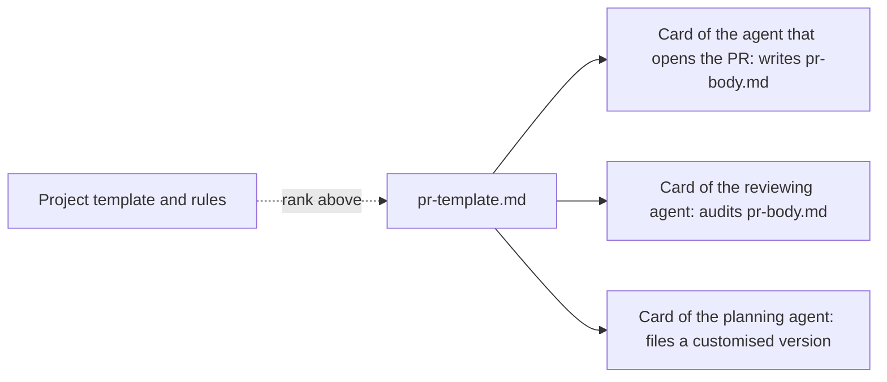

## Summary

Pull request descriptions written by chantier's agents are two or three sentences today, which leaves reviewers outside the team without context and gives them nothing to audit. chantier now ships one default description template, taken over from a project whose template worked well, and the agent that opens a change's pull request fills it in. The reviewing agent checks the description against it.

## Deliverables

The new reference `skills/chantier/references/pr-template.md`, and who reads it:

The template has eight sections, in this order: Summary, Deliverables, Changes, Impacts, Blast radius (graded 1 to 3), Test plan, Autonomous decisions, Internal references.

## Changes

- New `skills/chantier/references/pr-template.md`: scope and precedence, the writing rules, the template, the audit list, and how a customised version is delivered.
- The card of the agent that opens the PR has it write `pr-body.md` before each review and keep it current; a review that blocks only on the description is fixed in the same round, without a new round.
- The reviewing agent's card has it audit `pr-body.md` with the diff.
- The planning agent's card and the skill's entry table say how to request a project's own template.
- A change's name now goes only in the "Internal references" section, never in the title or the text.
- The scenario's scripted description follows the template; README and CONTRIBUTING list the new reference.

## Impacts

No visual change. Pull request descriptions of future changes will be longer and structured; open pull requests are not rewritten. A project's own template still ranks above the default.

## Blast radius

Grade: 1

Documentation of the agents' behaviour plus one scenario constant; no CLI code changes. A plain `git revert` restores the previous behaviour.

## Test plan

- [x] New or changed tests: No behaviour change
- [x] Local gates: `just check` passes (32 tests); `just scenario` passes on GitHub and GitLab (339/339 checks each)
- [x] Evidence: no visual change; the checks above were re-run independently at the pushed head
- [ ] Review
- [x] CI green

## Autonomous decisions

None.

## Internal references

CR-148 pr-template

